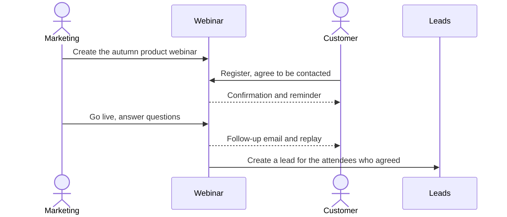

🏠 [Specs](../../../../README.md) › 🧩 [Functional capabilities](../../../README.md) › 🎙️ [F4 Meetings](../../README.md) ›
📝 [Use cases](../README.md) › 📝 [Use cases: FL-F4-14 Video messages, webinars and templates](README.md) ›
📝 UC-F4-29 Host a webinar

# 📝 UC-F4-29 Host a webinar

**Status:** ✅ specified

## Summary

Marketing hosts a live online talk for many people: a registration page, reminders, a live session with questions and a
chat, a recording with a transcript for replay, and a follow-up email. Attendees become leads only if they agreed to it
at registration.

## Personas

- [U12 Marketing and communication](../../../../01-users/personas/u12-marketing.md)
- [U09 Customer](../../../../01-users/personas/u09-customer.md), who registers and attends from a phone

## Goal

A product talk or a training reaches a hundred people, with their questions, without a manual registration list.

## Trigger

A product launch, a training for customers, a yearly customer event.

## Frequency

A few webinars a quarter.

## Preconditions

- The video meeting capability is on ([UC-F4-25](../12-rooms-and-client-video/uc-f04-25-hold-a-client-video-meeting.md),
  [E-F4-16 Client video meeting](../../data/e-f04-16-client-video-meeting.md)).
- The company's website can host the registration page and
  [UC-F18-04](../../../f18-hosted-websites-and-domains/use-cases/01-build-the-site/uc-f18-04-add-a-contact-page-that-feeds-leads.md)
  shows how a page feeds leads.
- The marketing consent wording is approved
  ([CR-FR-063](../../../../10-country-packs/france/consumer/cr-fr-063-electronic-marketing-consent.md)).

## Postconditions

- **Succeeded:** the webinar took place ([E-F4-28 Webinar](../../data/e-f04-28-webinar.md)), the registrations,
  attendance and questions are kept, the replay is available, and the attendees who consented are leads.
- **Failed:** the webinar is cancelled or stays a draft and the registered people are told.

## Main flow

1. Marketing opens Webinars ([S-F4-26](../../screens/14-video-messages-and-webinars/s-f04-26-webinar.md)) and creates
   one: title, date and time, speakers, description, maximum attendees and whether a replay is offered.
2. Marketing publishes the registration page; the registration form asks name and email and, as separate unticked boxes,
   agreement to be contacted about the company's offers and to receive the replay
   ([BR-F4-34](../../business-rules/br-f04-34-webinar-attendees-become-leads-only-with-consent.md)).
3. A customer registers from a phone and receives a confirmation with a calendar entry and a reminder the day before and
   the hour before.
4. At the start, the host opens the live session; speakers present, attendees ask questions that the host answers live
   or by text and vote on others' questions.
5. The session is recorded with the announcement shown to all
   ([BR-F4-01](../../business-rules/br-f04-01-every-recording-is-announced.md)); the transcript and a summary are
   written.
6. After the webinar, attendees and no-shows each receive the follow-up email, with the replay link when the host
   offered it.
7. Attendees who agreed to be contacted are created as leads with their attendance and questions; the others are not
   ([BR-F4-34](../../business-rules/br-f04-34-webinar-attendees-become-leads-only-with-consent.md)).

## Alternative flows

- 2a. Registrations are limited: the form closes at the maximum and offers a waiting list.
- 4a. A question is private: the host answers by message only to that attendee.
- 6a. The host decides not to offer the replay: attendees get the summary only.

## Error flows

- 3e. The email is already registered: the person is told and receives the confirmation again.
- 4e. The speaker's connection drops: the session pauses and resumes, or a message tells the attendees when it restarts.
- 7e. An attendee did not agree to be contacted: no lead is created, only the aggregate count
  ([BR-F4-34](../../business-rules/br-f04-34-webinar-attendees-become-leads-only-with-consent.md)).
- Any step: a service does not answer; the call is retried first
  ([BR-F3-32](../../../f03-assistant/business-rules/br-f03-32-retry-before-an-error.md)), then the message follows the
  error pattern ([D122](../../../../06-decisions/ux/d122-error-message-standard.md)) and the registrations stay as they
  were.

## Business rules

- [BR-F4-34 Webinar attendees become leads only with consent](../../business-rules/br-f04-34-webinar-attendees-become-leads-only-with-consent.md)
- [BR-F4-01 Every recording is announced](../../business-rules/br-f04-01-every-recording-is-announced.md)
- [BR-F4-28 A client video link works for one meeting](../../business-rules/br-f04-28-a-client-video-link-works-for-one-meeting.md)
- [BR-F4-33 Video messages follow meeting retention](../../business-rules/br-f04-33-video-messages-follow-meeting-retention.md)

## Entities

- [E-F4-28 Webinar](../../data/e-f04-28-webinar.md): created, changed
- [E-F4-16 Client video meeting](../../data/e-f04-16-client-video-meeting.md): read
- [E-F6-20 Lead](../../../f06-customers-and-sales/data/e-f06-20-lead.md): created, with consent

## Permissions

Marketing creates and hosts webinars; sales sees the leads that were created; attendees see only their own registration
and the replay if offered.

## Notifications

- The registrant: confirmation and reminders.
- Sales: the leads created after the webinar.
- The host: a webinar starting in an hour with the registration count.

## Audit events

Each webinar created, published, held and cancelled; each registration with its consent choices; each lead created and
why; each replay view.

## AI involvement

The AI assistant may draft the description and the follow-up email, and summarise the questions; the host sends nothing
without reading it ([BR-F3-12](../../../f03-assistant/business-rules/br-f03-12-drafts-go-to-their-editor.md)).

## API, MCP and A2A exposure

T5 operations of F4 for webinars; the registration page is public. No MCP tool hosts and there is no A2A skill.

## Screens

- [S-F4-26 Webinar](../../screens/14-video-messages-and-webinars/s-f04-26-webinar.md)

## Flowchart

See [FL-F4-14 Video messages, webinars and templates](../../flows/fl-f04-14-video-messages-and-webinars.md#flowchart).

## Sequence diagram

## Acceptance criteria

1. **Given** a registration form **when** a visitor registers **then** contact and replay agreements are separate
   unticked boxes.
2. **Given** an attendee who did not agree to be contacted **when** the webinar ends **then** no lead is created for
   them.
3. **Given** an attendee who agreed **when** the webinar ends **then** a lead exists with their attendance and
   questions.
4. **Given** a webinar with a maximum of 100 **when** the 101st person registers **then** they join the waiting list.
5. **Given** a recorded webinar **when** it starts **then** all attendees see that recording is on.

## Non-functional notes

A webinar holds 500 attendees at a time; the replay is ready within 1 hour of the end.

## Regulatory references

Consent for marketing email:
[CR-FR-063](../../../../10-country-packs/france/consumer/cr-fr-063-electronic-marketing-consent.md); recordings
announced: [CR-FR-059](../../../../10-country-packs/france/ai-and-recording/cr-fr-059-recordings-are-announced.md);
cookies on the registration page:
[CR-FR-070](../../../../10-country-packs/france/data-protection/cr-fr-070-cookie-consent.md).

## Related use cases

- [UC-F4-25 Hold a client video meeting](../12-rooms-and-client-video/uc-f04-25-hold-a-client-video-meeting.md)
- [UC-F4-11 Share, export and clip a meeting](../08-share-and-reuse-outside/uc-f04-11-share-export-and-clip-a-meeting.md)
- [UC-F6-01 Capture and qualify a lead](../../../f06-customers-and-sales/use-cases/01-lead-to-quote/uc-f06-01-capture-and-qualify-a-lead.md)
- [UC-F18-04 Add a contact page that feeds leads](../../../f18-hosted-websites-and-domains/use-cases/01-build-the-site/uc-f18-04-add-a-contact-page-that-feeds-leads.md)

## Open questions

None.

---

⬅️ [UC-F4-28 Record and share a video message](uc-f04-28-record-and-share-a-video-message.md) · ⬆️ [Up](README.md) ·
➡️ [UC-F4-30 Choose a note template per meeting type](uc-f04-30-choose-a-note-template-per-meeting-type.md)
