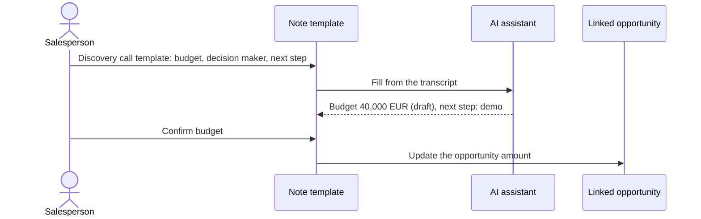

🏠 [Specs](../../../../README.md) › 🧩 [Functional capabilities](../../../README.md) › 🎙️ [F4 Meetings](../../README.md) ›
📝 [Use cases](../README.md) › 📝 [Use cases: FL-F4-14 Video messages, webinars and templates](README.md) ›
📝 UC-F4-30 Choose a note template per meeting type

# 📝 UC-F4-30 Choose a note template per meeting type

**Status:** ✅ specified

## Summary

Each kind of meeting (discovery call, weekly team meeting, one-to-one, candidate interview, supplier review) has a note
template: the named fields the notes must hold, such as budget, decision maker, next step or risks. The AI assistant
fills the fields from the transcript. The values stay drafts until a person reviews them, and only then may they fill
the linked record.

## Personas

- [U03 Sales](../../../../01-users/personas/u03-sales.md)
- [U06 Human resources](../../../../01-users/personas/u06-hr.md)

## Goal

Every meeting of a kind produces the same structured notes, and the facts that matter reach the right record without
retyping.

## Trigger

Setting up meetings, a new kind of meeting, or a team that wants the same notes every time.

## Frequency

A template is made once and used at every meeting of its kind.

## Preconditions

- The meeting kinds exist
  ([UC-F4-08](../06-set-up-meetings-and-calendars/uc-f04-08-set-up-meeting-sources-calendars-and-retention.md),
  [E-F4-01 Meeting](../../data/e-f04-01-meeting.md)).
- The user may edit note templates for their team
  ([BR-F4-18](../../business-rules/br-f04-18-hr-meetings-are-recorded-for-hr-and-the-employee.md) limits HR templates to
  HR).
- The summary templates of the company are set ([E-F4-03 Summary template](../../data/e-f04-03-summary-template.md),
  [BR-F4-13](../../business-rules/br-f04-13-summaries-follow-the-meeting-kind.md)).

## Postconditions

- **Succeeded:** the template is attached to its meeting kind
  ([E-F4-29 Note template](../../data/e-f04-29-note-template.md)), new meetings of that kind get their fields filled as
  drafts, and reviewed fields may fill the linked record.
- **Failed:** meetings keep the company's default summary.

## Main flow

1. The user opens Note templates ([S-F4-27](../../screens/14-video-messages-and-webinars/s-f04-27-note-templates.md))
   and creates a template for a meeting kind: a name, and the fields, each with a label, a type (text, number, date,
   choice, yes or no) and a hint.
2. For a field the user may choose a record field to fill after review, for example Budget to the opportunity's amount
   or Next step to the next task.
3. The user tries the template on a past meeting: the AI assistant fills the fields and shows where in the transcript
   each value comes from.
4. The user saves the template and attaches it to a meeting kind and a team; it applies to new meetings.
5. After a meeting of that kind, the notes show the fields filled by the AI assistant, each marked Draft with its source
   in the transcript.
6. The reviewer confirms or edits each field; confirmed fields lose the Draft mark
   ([BR-F4-35](../../business-rules/br-f04-35-ai-filled-template-fields-stay-drafts-until-reviewed.md)).
7. The reviewer chooses which confirmed fields update the linked record; the update is made as a change of the reviewer.

## Alternative flows

- 3a. The AI assistant finds no value for a field: it stays empty with the note Not said in the meeting.
- 6a. The meeting is published unreviewed: the fields stay marked Not checked
  ([BR-F4-15](../../business-rules/br-f04-15-unreviewed-meetings-publish-as-not-checked.md)).
- 4a. A team has no template for the kind: the company's default summary template applies
  ([BR-F4-13](../../business-rules/br-f04-13-summaries-follow-the-meeting-kind.md)).

## Error flows

- 1e. Two fields have the same label: refused under the second.
- 7e. The linked record's field is locked or the user may not change it: the value is kept in the notes and not copied
  ([BR-F2-25](../../../f02-no-code-configuration/business-rules/br-f02-25-field-rights-apply-on-every-channel.md)).
- 5e. The transcript is too short to fill any field: the notes show the empty template.
- Any step: a service does not answer; the call is retried first
  ([BR-F3-32](../../../f03-assistant/business-rules/br-f03-32-retry-before-an-error.md)), then the message follows the
  error pattern ([D122](../../../../06-decisions/ux/d122-error-message-standard.md)) and the meeting keeps its default
  summary.

## Business rules

- [BR-F4-35 AI-filled template fields stay drafts until reviewed](../../business-rules/br-f04-35-ai-filled-template-fields-stay-drafts-until-reviewed.md)
- [BR-F4-15 Unreviewed meetings publish as not checked](../../business-rules/br-f04-15-unreviewed-meetings-publish-as-not-checked.md)
- [BR-F4-13 Summaries follow the meeting kind](../../business-rules/br-f04-13-summaries-follow-the-meeting-kind.md)
- [BR-F4-20 Scores come with their evidence](../../business-rules/br-f04-20-scores-come-with-their-evidence.md)

## Entities

- [E-F4-29 Note template](../../data/e-f04-29-note-template.md): created, changed
- [E-F4-03 Summary template](../../data/e-f04-03-summary-template.md): read
- [E-F4-17 Meeting summary](../../data/e-f04-17-meeting-summary.md): changed
- [E-F4-01 Meeting](../../data/e-f04-01-meeting.md): read

## Permissions

Users who may edit templates for their team; a template for HR meetings is editable only by HR
([BR-F4-18](../../business-rules/br-f04-18-hr-meetings-are-recorded-for-hr-and-the-employee.md)). Every participant sees
the filled notes within the meeting's visibility.

## Notifications

The reviewer: a meeting whose fields wait for review.

## Audit events

Each template change with its version; each field filled by the AI assistant, confirmed, changed or copied to a record,
with who and when.

## AI involvement

The AI assistant fills the fields from the transcript and shows its source; every value is a draft until a person
confirms it ([BR-F4-35](../../business-rules/br-f04-35-ai-filled-template-fields-stay-drafts-until-reviewed.md),
[BR-F4-20](../../business-rules/br-f04-20-scores-come-with-their-evidence.md)).

## API, MCP and A2A exposure

T5 operations of F4 for templates and notes. An MCP tool may read a meeting's filled fields, never confirm
them. No A2A skill.

## Screens

- [S-F4-27 Note templates](../../screens/14-video-messages-and-webinars/s-f04-27-note-templates.md)

## Flowchart

See [FL-F4-14 Video messages, webinars and templates](../../flows/fl-f04-14-video-messages-and-webinars.md#flowchart).

## Sequence diagram

## Acceptance criteria

1. **Given** a discovery call template **when** a meeting of that kind ends **then** the fields are filled as drafts
   with their source in the transcript.
2. **Given** a draft field **when** the reviewer confirms it **then** it loses the Draft mark.
3. **Given** a draft field **when** the meeting is published unreviewed **then** it stays marked Not checked.
4. **Given** a confirmed budget mapped to the opportunity amount **when** the reviewer copies it **then** the amount
   changes as the reviewer's change.
5. **Given** a field the user may not change on the record **when** the reviewer copies it **then** it is refused.

## Non-functional notes

The fields are filled within 2 minutes of the end of a one-hour meeting.

## Regulatory references

A template for interviews must not collect what the law forbids in hiring
([BR-F9-40](../../../f09-hr-and-projects/business-rules/br-f09-40-no-criterion-the-law-forbids-in-hiring.md)) and its
scoring is high-risk AI ([BR-F4-21](../../business-rules/br-f04-21-candidate-scoring-is-high-risk-ai.md)).

## Related use cases

- [UC-F4-05 Review a meeting](../03-review-a-meeting/uc-f04-05-review-a-meeting.md)
- [UC-F4-09 Prepare a meeting](../07-prepare-and-capture-anywhere/uc-f04-09-prepare-a-meeting.md)
- [UC-F4-12 Score a sales call](../09-score-calls-and-interviews/uc-f04-12-score-a-sales-call.md)
- [UC-F4-13 Interview a candidate](../09-score-calls-and-interviews/uc-f04-13-interview-a-candidate.md)
- [UC-F4-15 Schedule recurring digests](../08-share-and-reuse-outside/uc-f04-15-schedule-recurring-digests.md)

## Open questions

None.

---

⬅️ [UC-F4-29 Host a webinar](uc-f04-29-host-a-webinar.md) · ⬆️ [Up](README.md) ·
➡️ [UC-F4-31 Analyse time spent in meetings](uc-f04-31-analyse-time-spent-in-meetings.md)
