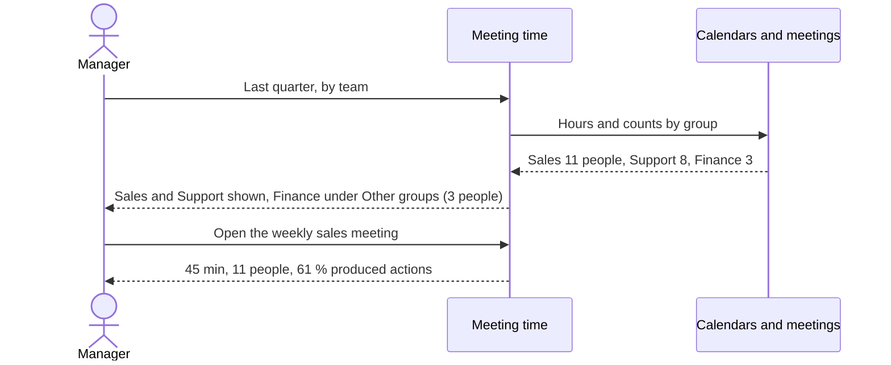

🏠 [Specs](../../../../README.md) › 🧩 [Functional capabilities](../../../README.md) › 🎙️ [F4 Meetings](../../README.md) ›
📝 [Use cases](../README.md) › 📝 [Use cases: FL-F4-14 Video messages, webinars and templates](README.md) ›
📝 UC-F4-31 Analyse time spent in meetings

# 📝 UC-F4-31 Analyse time spent in meetings

**Status:** ✅ specified

## Summary

A manager or the owner sees how much time the teams spend in meetings: hours per week by team, by kind of meeting,
internal or with customers, recurring or one-off, and how it changes over months. The figures are for groups only: a
group of fewer than five people is never shown, and nothing ranks a person.

## Personas

- [U02 Manager](../../../../01-users/personas/u02-manager.md)
- [U13 Owner](../../../../01-users/personas/u13-owner.md)

## Goal

Decide which recurring meetings to shorten or drop with facts instead of impressions.

## Trigger

A team complains about too many meetings, a quarterly review, an organisation change.

## Frequency

Monthly or quarterly.

## Preconditions

- Calendars sync both ways ([BR-F4-17](../../business-rules/br-f04-17-calendars-sync-both-ways.md)) and meetings are
  recorded in SimpleERP ([E-F4-01 Meeting](../../data/e-f04-01-meeting.md),
  [E-F4-22 Meeting agenda](../../data/e-f04-22-meeting-agenda.md)).
- Meeting analytics are switched on for the company, after the staff representatives were informed
  ([S-F4-07](../../screens/06-set-up-meetings-and-calendars/s-f04-07-meeting-settings.md)).
- The reader sees the teams in their scope
  ([BR-F4-24](../../business-rules/br-f04-24-trends-count-only-what-the-reader-may-see-quoted.md)).

## Postconditions

- **Succeeded:** the reader sees the hours and counts by group and period, with groups under five people left out, and
  can export what they see.
- **Failed:** no figure is shown and the screen says why.

## Main flow

1. The reader opens Meeting time
   ([S-F4-28](../../screens/14-video-messages-and-webinars/s-f04-28-meeting-time-analytics.md)) and picks a period and
   the groups to compare: team, site, kind of meeting.
2. SimpleERP computes the hours, the number of meetings, the average length, the share of recurring meetings, and the
   share with outside people, from the calendars and the recorded meetings.
3. Groups of fewer than five people are not shown separately; they are added to a line Other groups, or left out, and
   the screen says so
   ([BR-F4-36](../../business-rules/br-f04-36-meeting-analytics-never-show-groups-under-five-people.md)).
4. The reader compares periods, and sees the recurring meetings that take the most time, as meeting series, never as
   persons.
5. The reader clicks a series to read its length, frequency and the number of attendees, and the share of its time that
   produced agreed actions ([E-F4-04 Action item](../../data/e-f04-04-action-item.md)).
6. The reader exports the figures or pins a chart to their home screen.

## Alternative flows

- 1a. The owner reads the whole company; a manager reads their own teams only.
- 3a. A group grows to five people: it appears from the next computation, with the earlier periods still shown under
  Other groups.
- 5a. The AI assistant proposes the three series that look least useful, with their figures; it never names a
  person.

## Error flows

- 3e. All groups are under five people: the screen shows only the company total and says why.
- 2e. A calendar is not synced: its meetings are missing and the screen names the gap.
- 6e. The reader tries to filter by one person: not offered
  ([BR-F4-36](../../business-rules/br-f04-36-meeting-analytics-never-show-groups-under-five-people.md)).
- Any step: a service does not answer; the call is retried first
  ([BR-F3-32](../../../f03-assistant/business-rules/br-f03-32-retry-before-an-error.md)), then the message follows the
  error pattern ([D122](../../../../06-decisions/ux/d122-error-message-standard.md)) and no figure is shown.

## Business rules

- [BR-F4-36 Meeting analytics never show groups under five people](../../business-rules/br-f04-36-meeting-analytics-never-show-groups-under-five-people.md)
- [BR-F4-24 Trends count only what the reader may see quoted](../../business-rules/br-f04-24-trends-count-only-what-the-reader-may-see-quoted.md)
- [BR-F4-32 Who sees a colleague's calendar](../../business-rules/br-f04-32-who-sees-a-colleagues-calendar.md)
- [BR-F4-17 Calendars sync both ways](../../business-rules/br-f04-17-calendars-sync-both-ways.md)

## Entities

- [E-F4-01 Meeting](../../data/e-f04-01-meeting.md): read
- [E-F4-22 Meeting agenda](../../data/e-f04-22-meeting-agenda.md): read
- [E-F4-26 Employee calendar](../../data/e-f04-26-employee-calendar.md): read
- [E-F4-04 Action item](../../data/e-f04-04-action-item.md): read

## Permissions

The owner reads the company; a manager reads their teams; nobody reads a figure about one person, and a person's own
meeting time is shown only to that person in their calendar
([BR-F4-32](../../business-rules/br-f04-32-who-sees-a-colleagues-calendar.md)).

## Notifications

None: the analysis is read on demand; a monthly digest may be scheduled
([UC-F4-15](../08-share-and-reuse-outside/uc-f04-15-schedule-recurring-digests.md)).

## Audit events

Each analysis opened, with the reader, the scope and the filters; each export.

## AI involvement

The AI assistant may summarise the figures and suggest series to review; it applies the same group minimum and never
names a person ([BR-F4-36](../../business-rules/br-f04-36-meeting-analytics-never-show-groups-under-five-people.md)).

## API, MCP and A2A exposure

T5 read operations for the figures with the group minimum applied on the server; an MCP tool may read the same figures.
No A2A skill.

## Screens

- [S-F4-28 Meeting time analytics](../../screens/14-video-messages-and-webinars/s-f04-28-meeting-time-analytics.md)

## Flowchart

See [FL-F4-14 Video messages, webinars and templates](../../flows/fl-f04-14-video-messages-and-webinars.md#flowchart).

## Sequence diagram

## Acceptance criteria

1. **Given** a team of 3 people **when** the manager opens the analysis **then** it is not shown separately and the
   screen says why.
2. **Given** a team of 11 people **when** the manager opens the analysis **then** its hours and counts are shown.
3. **Given** the manager **when** they look for one person's hours **then** no such filter exists.
4. **Given** a recurring meeting **when** the reader opens it **then** its length, frequency, attendee count and share
   of meetings with actions are shown.
5. **Given** an unsynced calendar **when** the analysis runs **then** the gap is named.

## Non-functional notes

A quarter for 500 people is computed in under 5 seconds.

## Regulatory references

Measuring employees' time with a tool needs prior information of the staff and, in many countries, of their
representatives: the France pack rule on workplace monitoring is written later; GDPR,
[Regulation (EU) 2016/679](https://eur-lex.europa.eu/eli/reg/2016/679/oj), article 5(1)(c) on minimisation.

## Related use cases

- [UC-F4-20 Analyse topics and trends across calls](../11-insights-and-accessibility/uc-f04-20-analyse-topics-and-trends-across-calls.md)
- [UC-F4-21 Book a meeting room and equipment](../12-rooms-and-client-video/uc-f04-21-book-a-meeting-room-and-equipment.md)
- [UC-F4-09 Prepare a meeting](../07-prepare-and-capture-anywhere/uc-f04-09-prepare-a-meeting.md)
- [UC-F4-15 Schedule recurring digests](../08-share-and-reuse-outside/uc-f04-15-schedule-recurring-digests.md)

## Open questions

None.

---

⬅️ [UC-F4-30 Choose a note template per meeting type](uc-f04-30-choose-a-note-template-per-meeting-type.md) ·
⬆️ [Up](README.md)
