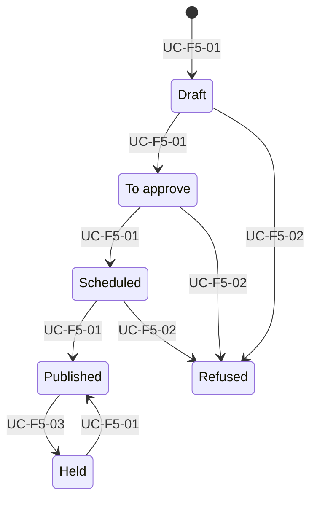

🏠 [Specs](../../../README.md) › 🧩 [Functional capabilities](../../README.md) ›
📣 [F5 Social media and marketing](../README.md) › 🗃️ [Data](README.md) › 🗃️ E-F5-01 Post

# 🗃️ E-F5-01 Post

**Status:** ✅ specified

## Purpose

A post prepared once and published on several networks.

## Fields

| Name | Type | Required | Validation | Default | Example | Personal data | Custom fields |
|---|---|---|---|---|---|---|---|
| text | text per network | yes | each network's limit | - | New kitchen range... | no | no |
| media | files | no | per network's formats | - | 3 images | no | no |
| networks | accounts | yes | - | - | LinkedIn, Instagram | no | no |
| time | date and time | no | - | suggested | 2026-11-12 09:30 | no | no |
| state | draft, to approve, scheduled, published, held, refused | yes | - | draft | scheduled | no | no |
| origin | manual, AI, automatic | yes | - | manual | AI | no | no |

## Relations

As its use cases.

## Lifecycle

## Indexes and search

By network and date.

## Retention

Messages 13 months; posts kept.

## Audit

Changes and publications.

## Import and export

Statistics as a spreadsheet.

## Used by

- [UC-F5-01](../use-cases/01-publish-a-post/uc-f05-01-prepare-and-schedule-a-post.md)
- [UC-F5-02](../use-cases/01-publish-a-post/uc-f05-02-approve-a-post.md)
- [UC-F5-04](../use-cases/01-publish-a-post/uc-f05-04-manage-the-editorial-calendar.md)

## Open questions

None.

---

⬆️ [Up](README.md) · ➡️ [E-F5-02 Social account](e-f05-02-social-account.md)
