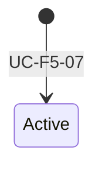

🏠 [Specs](../../../README.md) › 🧩 [Functional capabilities](../../README.md) ›
📣 [F5 Social media and marketing](../README.md) › 🗃️ [Data](README.md) › 🗃️ E-F5-02 Social account

# 🗃️ E-F5-02 Social account

**Status:** ✅ specified

## Purpose

A company account on a network (UC-F5-07).

## Fields

| Name | Type | Required | Validation | Default | Example | Personal data | Custom fields |
|---|---|---|---|---|---|---|---|
| network | network | yes | - | - | LinkedIn | no | no |
| page | text | yes | - | - | Acme Bâtiment | no | no |
| app | shared, own | yes | D250 | shared | own | no | no |
| credential | vault handle | yes | D240 | - | linkedin-acme | no | no |
| approval | yes or no | yes | - | yes | yes | no | no |

## Relations

As its use cases.

## Lifecycle

## Indexes and search

By network and date.

## Retention

Messages 13 months; posts kept.

## Audit

Changes and publications.

## Import and export

Statistics as a spreadsheet.

## Used by

- [UC-F5-07](../use-cases/04-connect-accounts/uc-f05-07-connect-the-company-s-accounts.md)

## Open questions

None.

---

⬅️ [E-F5-01 Post](e-f05-01-post.md) · ⬆️ [Up](README.md) ·
➡️ [E-F5-03 Automatic post rule](e-f05-03-automatic-post-rule.md)
