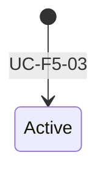

🏠 [Specs](../../../README.md) › 🧩 [Functional capabilities](../../README.md) ›
📣 [F5 Social media and marketing](../README.md) › 🗃️ [Data](README.md) › 🗃️ E-F5-03 Automatic post rule

# 🗃️ E-F5-03 Automatic post rule

**Status:** ✅ specified

## Purpose

An event type set to automatic posting (BR-F5-02).

## Fields

| Name | Type | Required | Validation | Default | Example | Personal data | Custom fields |
|---|---|---|---|---|---|---|---|
| event type | event | yes | - | - | Job opening published | no | no |
| networks | accounts | yes | - | - | LinkedIn | no | no |
| template | text with fields | yes | - | - | We are hiring a {job.title} in {job.city} | no | no |
| daily limit | number | yes | - | 3 | 3 | no | no |
| blocked words | list | no | - | - | free, guaranteed | no | no |
| active | yes or no | yes | - | no | yes | no | no |

## Relations

As its use cases.

## Lifecycle

## Indexes and search

By network and date.

## Retention

Messages 13 months; posts kept.

## Audit

Changes and publications.

## Import and export

Statistics as a spreadsheet.

## Used by

- [UC-F5-03](../use-cases/02-automatic-posts/uc-f05-03-set-up-automatic-posts.md)

## Open questions

None.

---

⬅️ [E-F5-02 Social account](e-f05-02-social-account.md) · ⬆️ [Up](README.md) ·
➡️ [E-F5-04 Social message](e-f05-04-social-message.md)
