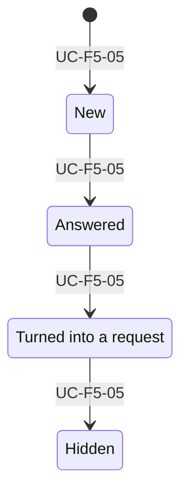

🏠 [Specs](../../../README.md) › 🧩 [Functional capabilities](../../README.md) ›
📣 [F5 Social media and marketing](../README.md) › 🗃️ [Data](README.md) › 🗃️ E-F5-04 Social message

# 🗃️ E-F5-04 Social message

**Status:** ✅ specified

## Purpose

A comment, mention or message in the inbox (BR-F5-05).

## Fields

| Name | Type | Required | Validation | Default | Example | Personal data | Custom fields |
|---|---|---|---|---|---|---|---|
| network | network | yes | - | - | Instagram | no | no |
| kind | comment, mention, message | yes | - | - | comment | no | no |
| sender | text | yes | - | - | @jdurand | yes | no |
| customer | customer | no | matched | - | Durand SA | no | no |
| state | new, answered, turned into a request, hidden | yes | - | new | answered | no | no |

## Relations

As its use cases.

## Lifecycle

## Indexes and search

By network and date.

## Retention

Messages 13 months; posts kept.

## Audit

Changes and publications.

## Import and export

Statistics as a spreadsheet.

## Used by

- [UC-F5-05](../use-cases/03-inbox-and-statistics/uc-f05-05-answer-comments-and-messages.md)
- [UC-F5-20 Message customers on WhatsApp Business](../use-cases/08-pages-forms-surveys-and-whatsapp/uc-f05-20-message-customers-on-whatsapp-business.md)

## Open questions

None.

---

⬅️ [E-F5-03 Automatic post rule](e-f05-03-automatic-post-rule.md) · ⬆️ [Up](README.md) ·
➡️ [E-F5-05 Email or SMS campaign](e-f05-05-email-or-sms-campaign.md)
