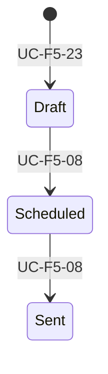

🏠 [Specs](../../../README.md) › 🧩 [Functional capabilities](../../README.md) ›
📣 [F5 Social media and marketing](../README.md) › 🗃️ [Data](README.md) › 🗃️ E-F5-05 Email or SMS campaign

# 🗃️ E-F5-05 Email or SMS campaign

**Status:** ✅ specified

## Purpose

An email or SMS campaign. Its send date and time follow the SMS sending window of
[UC-F5-09](../use-cases/05-benchmark-additions/uc-f05-09-send-sms-campaigns.md)
([D575](../../../06-decisions/foundations/d575-answers-of-2026-11-27-on-the-last-open-points.md),
[D573](../../../06-decisions/foundations/d573-precedence-between-spec-pages.md)).

## Fields

| Name | Type | Required | Validation | Default | Example | Personal data | Custom fields |
|---|---|---|---|---|---|---|---|
| channel | email, SMS | yes | - | - | email | no | no |
| audience | segment | yes | BR-F5-08 | - | Customers Lyon | no | no |
| variants | A, B | no | - | - | 2 subjects | no | no |
| send at | date and time | no | required to be Scheduled; for SMS, inside the sending window ([UC-F5-09](../use-cases/05-benchmark-additions/uc-f05-09-send-sms-campaigns.md)): by default 8:00 to 20:00, never on Sundays or public holidays, as the company may narrow it | now | Saturday 10:00 | no | no |
| state | draft, scheduled, sent | yes | - | draft | sent | no | no |

## Relations

As its use cases.

## Lifecycle

## Indexes and search

By name, date, owner.

## Retention

Kept for the period of its kind of record in the country pack (D293), or else its kind's default in the
[retention schedule](../../../05-non-functional/data-retention.md).

## Audit

Every change.

## Import and export

CSV.

## Used by

- [UC-F5-08](../use-cases/05-benchmark-additions/uc-f05-08-run-email-campaigns.md)
- [UC-F5-09](../use-cases/05-benchmark-additions/uc-f05-09-send-sms-campaigns.md)
- [UC-F5-16 Keep emails delivered](../use-cases/06-audiences-consent-and-journeys/uc-f05-16-keep-emails-delivered.md)
- [UC-F5-23 Track campaign budget, cost per lead and return](../use-cases/09-brand-tests-and-return-on-investment/uc-f05-23-track-campaign-budget-cost-per-lead-and-return.md)

## Open questions

None.

---

⬅️ [E-F5-04 Social message](e-f05-04-social-message.md) · ⬆️ [Up](README.md) ·
➡️ [E-F5-06 Journey](e-f05-06-journey.md)
