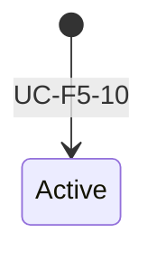

🏠 [Specs](../../../README.md) › 🧩 [Functional capabilities](../../README.md) ›
📣 [F5 Social media and marketing](../README.md) › 🗃️ [Data](README.md) › 🗃️ E-F5-06 Journey

# 🗃️ E-F5-06 Journey

**Status:** ✅ specified

## Purpose

A marketing automation journey.

## Fields

| Name | Type | Required | Validation | Default | Example | Personal data | Custom fields |
|---|---|---|---|---|---|---|---|
| trigger | event or segment | yes | - | - | Signed up | no | no |
| steps | email, SMS, wait, branch, update | yes | - | - | Wait 2 days | no | no |

## Relations

As its use cases.

## Lifecycle

## Indexes and search

By name, date, owner.

## Retention

Kept for the period of its kind of record in the country pack (D293), or else its kind's default in the
[retention schedule](../../../05-non-functional/data-retention.md).

## Audit

Every change.

## Import and export

CSV.

## Used by

- [UC-F5-10](../use-cases/06-audiences-consent-and-journeys/uc-f05-10-automate-marketing-journeys.md)

## Open questions

None.

---

⬅️ [E-F5-05 Email or SMS campaign](e-f05-05-email-or-sms-campaign.md) · ⬆️ [Up](README.md) ·
➡️ [E-F5-07 Registration event](e-f05-07-registration-event.md)
