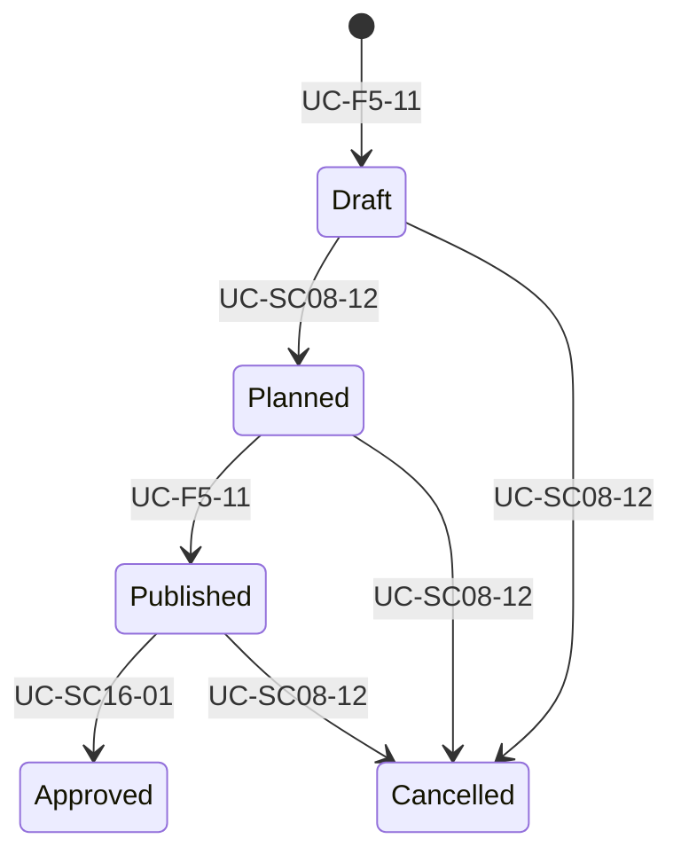

🏠 [Specs](../../../README.md) › 🧩 [Functional capabilities](../../README.md) ›
📣 [F5 Social media and marketing](../README.md) › 🗃️ [Data](README.md) › 🗃️ E-F5-07 Registration event

# 🗃️ E-F5-07 Registration event

**Status:** ✅ specified

## Purpose

An event with registrations.

## Fields

| Name | Type | Required | Validation | Default | Example | Personal data | Custom fields |
|---|---|---|---|---|---|---|---|
| name, dates, place | text | yes | - | - | Open house, 5 Dec | no | no |
| tickets | kinds, prices, capacity | no | - | - | Early bird 20.00 | no | no |
| attendees | contacts | no | - | - | 84 | yes | no |

## Relations

As its use cases.

## Lifecycle

## Indexes and search

By name, date, owner.

## Retention

Kept for the period of its kind of record in the country pack (D293), or else its kind's default in the
[retention schedule](../../../05-non-functional/data-retention.md).

## Audit

Every change.

## Import and export

CSV.

## Used by

- [UC-F5-11](../use-cases/07-events-and-ticketing/uc-f05-11-organise-events-and-sell-tickets.md)
- [UC-F5-17 Set up ticketing for an event](../use-cases/07-events-and-ticketing/uc-f05-17-set-up-ticketing-for-an-event.md)

## Open questions

None.

---

⬅️ [E-F5-06 Journey](e-f05-06-journey.md) · ⬆️ [Up](README.md) · ➡️ [E-F5-08 Survey](e-f05-08-survey.md)
