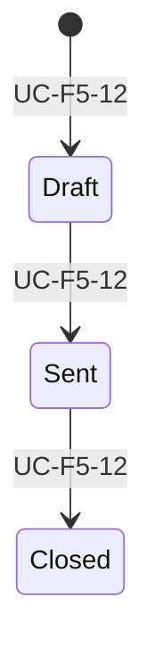

🏠 [Specs](../../../README.md) › 🧩 [Functional capabilities](../../README.md) ›
📣 [F5 Social media and marketing](../README.md) › 🗃️ [Data](README.md) › 🗃️ E-F5-08 Survey

# 🗃️ E-F5-08 Survey

**Status:** ✅ specified

## Purpose

A survey or live poll.

## Fields

| Name | Type | Required | Validation | Default | Example | Personal data | Custom fields |
|---|---|---|---|---|---|---|---|
| questions | list with conditions | yes | - | - | 5 | no | no |
| mode | link, live session | yes | - | link | live | no | no |

## Relations

As its use cases.

## Lifecycle

## Indexes and search

By name, date, owner.

## Retention

Kept for the period of its kind of record in the country pack (D293), or else its kind's default in the
[retention schedule](../../../05-non-functional/data-retention.md).

## Audit

Every change.

## Import and export

CSV.

## Used by

- [UC-F5-12](../use-cases/08-pages-forms-surveys-and-whatsapp/uc-f05-12-run-surveys-and-live-polls.md)
- [UC-F9-28 Run engagement surveys and exit interviews](../../f09-hr-and-projects/use-cases/10-listen-to-employees/uc-f09-28-run-engagement-surveys-and-exit-interviews.md)

## Open questions

None.

---

⬅️ [E-F5-07 Registration event](e-f05-07-registration-event.md) · ⬆️ [Up](README.md) ·
➡️ [E-F5-09 Contact segment](e-f05-09-contact-segment.md)
