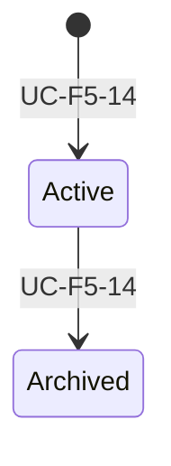

🏠 [Specs](../../../README.md) › 🧩 [Functional capabilities](../../README.md) ›
📣 [F5 Social media and marketing](../README.md) › 🗃️ [Data](README.md) › 🗃️ E-F5-09 Contact segment

# 🗃️ E-F5-09 Contact segment

**Status:** ✅ specified

## Purpose

A set of contacts defined by conditions, static or dynamic.

## Fields

| Name | Type | Required | Validation | Default | Example | Personal data | Custom fields |
|---|---|---|---|---|---|---|---|
| name | text | yes | - | - | Lyon buyers 2026 | no | - |
| conditions | filter | yes | fields the author may see | - | city = Lyon, bought in 2026 | no | - |
| kind | static, dynamic | yes | - | dynamic | dynamic | no | - |
| counts | per channel | no | - | - | email 980, SMS 410 | no | - |

## Relations

Used by Campaigns, Journeys and event invitations.

## Lifecycle

Created, used, archived.

## Indexes and search

By name and use.

## Retention

While used; archived after a year unused.

## Audit

Created, changed, used.

## Import and export

None.

## Used by

- [UC-F5-14 Build a segment of contacts](../use-cases/06-audiences-consent-and-journeys/uc-f05-14-build-a-segment-of-contacts.md)

## Open questions

None.

---

⬅️ [E-F5-08 Survey](e-f05-08-survey.md) · ⬆️ [Up](README.md) ·
➡️ [E-F5-10 Consent and suppression record](e-f05-10-consent-and-suppression-record.md)
