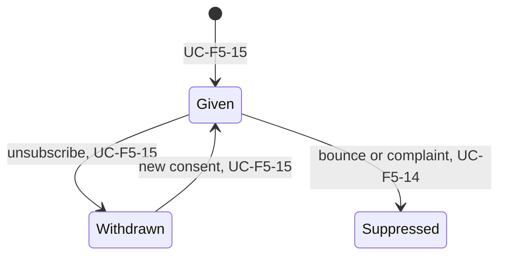

🏠 [Specs](../../../README.md) › 🧩 [Functional capabilities](../../README.md) ›
📣 [F5 Social media and marketing](../README.md) › 🗃️ [Data](README.md) › 🗃️ E-F5-10 Consent and suppression record

# 🗃️ E-F5-10 Consent and suppression record

**Status:** ✅ specified

## Purpose

A contact's marketing consent per channel with its proof, and their suppression. Postal mail needs no prior consent:
its record holds the contact's objection to postal marketing, which
[BR-F5-23](../business-rules/br-f05-23-postal-campaigns-honour-opt-outs.md) checks; push holds the opt-in given on each
device, which [BR-F5-21](../business-rules/br-f05-21-push-needs-the-devices-opt-in.md) checks.

## Fields

| Name | Type | Required | Validation | Default | Example | Personal data | Custom fields |
|---|---|---|---|---|---|---|---|
| contact | contact | yes | - | - | lea@mail.fr | yes | - |
| channel | email, SMS, WhatsApp, postal, push | yes | - | - | email | no | - |
| device | push device | for push | a device of the contact | - | Léa's phone, customer app | yes | - |
| status | given, withdrawn, suppressed | yes | - | - | given | no | - |
| proof | text version, date, source | yes | - | - | form Autumn sale v3, 2026-11-12 | yes | - |
| reason | unsubscribe, objection, bounce, complaint | no | - | - | - | no | - |

## Relations

One per contact and channel, and one per device for push.

## Lifecycle

## Indexes and search

By contact and channel; the consent register.

## Retention

3 years after the last contact
([CR-FR-052 Personal data kept no longer than needed](../../../10-country-packs/france/data-protection/cr-fr-052-storage-limitation.md)).

## Audit

Every change with its source.

## Import and export

Proof exported as PDF or CSV; imports need source and date.

## Used by

- [UC-F5-14 Build a segment of contacts](../use-cases/06-audiences-consent-and-journeys/uc-f05-14-build-a-segment-of-contacts.md)
- [UC-F5-15 Record and prove consent](../use-cases/06-audiences-consent-and-journeys/uc-f05-15-record-and-prove-consent.md)
- [UC-F5-16 Keep emails delivered](../use-cases/06-audiences-consent-and-journeys/uc-f05-16-keep-emails-delivered.md)
- [UC-F5-19 Publish a landing page with a form](../use-cases/08-pages-forms-surveys-and-whatsapp/uc-f05-19-publish-a-landing-page-with-a-form.md)
- [UC-F5-26 Send push notifications](../use-cases/10-referrals-push-and-listening/uc-f05-26-send-push-notifications.md)
- [UC-F5-28 Send postal mail campaigns](../use-cases/10-referrals-push-and-listening/uc-f05-28-send-postal-mail-campaigns.md)

## Open questions

None.

---

⬅️ [E-F5-09 Contact segment](e-f05-09-contact-segment.md) · ⬆️ [Up](README.md) ·
➡️ [E-F5-11 Ticket type and seat map](e-f05-11-ticket-type-and-seat-map.md)
