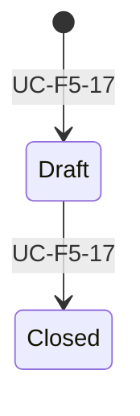

🏠 [Specs](../../../README.md) › 🧩 [Functional capabilities](../../README.md) ›
📣 [F5 Social media and marketing](../README.md) › 🗃️ [Data](README.md) › 🗃️ E-F5-11 Ticket type and seat map

# 🗃️ E-F5-11 Ticket type and seat map

**Status:** ✅ specified

## Purpose

What can be sold for an event: sessions, ticket types, prices, quotas per channel and seats.

## Fields

| Name | Type | Required | Validation | Default | Example | Personal data | Custom fields |
|---|---|---|---|---|---|---|---|
| event | event | yes | - | - | Season 2027 | no | - |
| sessions | dates and times | yes | - | - | 2027-03-12 20:30 | no | - |
| ticket types | name, price, VAT | yes | price set | - | Full 32 EUR | no | - |
| quotas | per channel | yes | sum within capacity | - | online 450 | no | - |
| seat map | seats with categories | no | - | - | 600 seats, 3 categories | no | - |

## Relations

Belongs to an Event (E-F5-07); Tickets are issued from it.

## Lifecycle

Draft, on sale, closed.

## Indexes and search

By event.

## Retention

As the event's records.

## Audit

Changed; sale opened and closed.

## Import and export

None.

## Used by

- [UC-F5-17 Set up ticketing for an event](../use-cases/07-events-and-ticketing/uc-f05-17-set-up-ticketing-for-an-event.md)
- [UC-F5-18 Sell at the box office and scan tickets](../use-cases/07-events-and-ticketing/uc-f05-18-sell-at-the-box-office-and-scan-tickets.md)

## Open questions

None.

---

⬅️ [E-F5-10 Consent and suppression record](e-f05-10-consent-and-suppression-record.md) · ⬆️ [Up](README.md) ·
➡️ [E-F5-12 Event ticket](e-f05-12-event-ticket.md)
