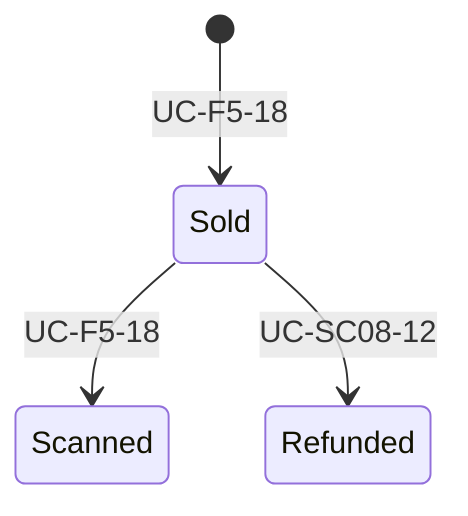

🏠 [Specs](../../../README.md) › 🧩 [Functional capabilities](../../README.md) ›
📣 [F5 Social media and marketing](../README.md) › 🗃️ [Data](README.md) › 🗃️ E-F5-12 Event ticket

# 🗃️ E-F5-12 Event ticket

**Status:** ✅ specified

## Purpose

One sold ticket with its code, seat, session and scan.

## Fields

| Name | Type | Required | Validation | Default | Example | Personal data | Custom fields |
|---|---|---|---|---|---|---|---|
| code | unique code | yes | unique | - | SF-27-3X9K | no | - |
| session, seat | session, seat | yes | sold once | - | 12 Mar, G10 | no | - |
| holder | contact | no | - | - | M. Garnier | yes | - |
| channel | online, box office, partner | yes | - | - | box office | no | - |
| scanned at | date and time | no | once | - | 2027-03-12 20:05 | no | - |

## Relations

Issued from a Ticket type; sold through an order (F6, F10).

## Lifecycle

## Indexes and search

By code, holder and session.

## Retention

As sales records,
[CR-FR-002](../../../10-country-packs/france/accounting/cr-fr-002-accounting-records-kept-ten-years.md).

## Audit

Sold, scanned, refused, refunded.

## Import and export

None.

## Used by

- [UC-F5-18 Sell at the box office and scan tickets](../use-cases/07-events-and-ticketing/uc-f05-18-sell-at-the-box-office-and-scan-tickets.md)

## Open questions

None.

---

⬅️ [E-F5-11 Ticket type and seat map](e-f05-11-ticket-type-and-seat-map.md) · ⬆️ [Up](README.md) ·
➡️ [E-F5-13 Landing page and form](e-f05-13-landing-page-and-form.md)
