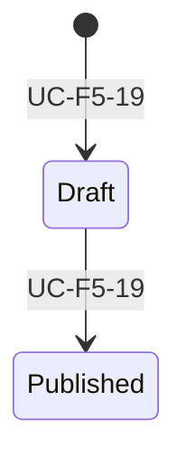

🏠 [Specs](../../../README.md) › 🧩 [Functional capabilities](../../README.md) ›
📣 [F5 Social media and marketing](../README.md) › 🗃️ [Data](README.md) › 🗃️ E-F5-13 Landing page and form

# 🗃️ E-F5-13 Landing page and form

**Status:** ✅ specified

## Purpose

A published page with its form, field mapping and consent texts.

## Fields

| Name | Type | Required | Validation | Default | Example | Personal data | Custom fields |
|---|---|---|---|---|---|---|---|
| address | URL | yes | unique | - | /autumn-sale | no | - |
| form fields | list mapped to lead fields | yes | - | - | name, email | no | - |
| consent texts | per channel | yes | unticked box | - | email v3 | no | - |
| campaign | campaign | no | - | - | Autumn | no | - |

## Relations

Creates Leads (F6) and Consent records.

## Lifecycle

Draft, published, unpublished.

## Indexes and search

By campaign.

## Retention

Submissions as leads.

## Audit

Published, changed.

## Import and export

None.

## Used by

- [UC-F5-19 Publish a landing page with a form](../use-cases/08-pages-forms-surveys-and-whatsapp/uc-f05-19-publish-a-landing-page-with-a-form.md)

## Open questions

None.

---

⬅️ [E-F5-12 Event ticket](e-f05-12-event-ticket.md) · ⬆️ [Up](README.md) ·
➡️ [E-F5-14 WhatsApp template](e-f05-14-whatsapp-template.md)
