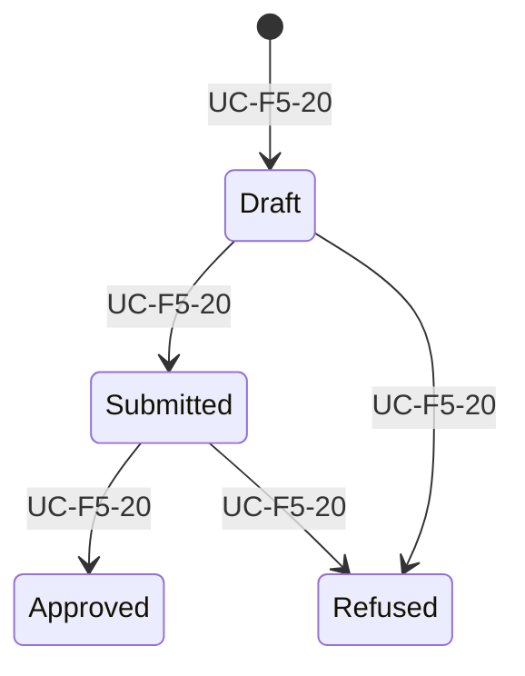

🏠 [Specs](../../../README.md) › 🧩 [Functional capabilities](../../README.md) ›
📣 [F5 Social media and marketing](../README.md) › 🗃️ [Data](README.md) › 🗃️ E-F5-14 WhatsApp template

# 🗃️ E-F5-14 WhatsApp template

**Status:** ✅ specified

## Purpose

A message template submitted to WhatsApp for sending outside the 24-hour window.

## Fields

| Name | Type | Required | Validation | Default | Example | Personal data | Custom fields |
|---|---|---|---|---|---|---|---|
| name | text | yes | - | - | order_ready | no | - |
| text | text with fields | yes | - | - | Your order {number} is ready | no | - |
| status | draft, submitted, approved, refused | yes | - | draft | approved | no | - |

## Relations

Used by rules and campaigns; conversations are Social messages (E-F5-04).

## Lifecycle

Draft, submitted, approved or refused.

## Indexes and search

By name.

## Retention

While used.

## Audit

Submitted, approved, refused.

## Import and export

None.

## Used by

- [UC-F5-20 Message customers on WhatsApp Business](../use-cases/08-pages-forms-surveys-and-whatsapp/uc-f05-20-message-customers-on-whatsapp-business.md)

## Open questions

None.

---

⬅️ [E-F5-13 Landing page and form](e-f05-13-landing-page-and-form.md) · ⬆️ [Up](README.md) ·
➡️ [E-F5-15 Brand asset](e-f05-15-brand-asset.md)
