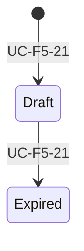

🏠 [Specs](../../../README.md) › 🧩 [Functional capabilities](../../README.md) ›
📣 [F5 Social media and marketing](../README.md) › 🗃️ [Data](README.md) › 🗃️ E-F5-15 Brand asset

# 🗃️ E-F5-15 Brand asset

**Status:** ✅ specified

## Purpose

An item of the brand kit or asset library, with its rights.

## Fields

| Name | Type | Required | Validation | Default | Example | Personal data | Custom fields |
|---|---|---|---|---|---|---|---|
| kind | logo, colour, font, tone, image, video | yes | - | - | image | no | - |
| file or value | file or text | yes | - | - | shop-front.jpg | no | - |
| rights | source, licence, expiry | yes for images | - | - | agency, until 2026-12-31 | no | - |
| AI-generated | yes, no | yes | - | no | no | no | - |

## Relations

Used by posts, emails, pages and document templates.

## Lifecycle

Draft, usable, expired.

## Indexes and search

By kind, tag and rights.

## Retention

While usable; expired kept 1 year.

## Audit

Added, expired, removed.

## Import and export

None.

## Used by

- [UC-F5-21 Keep the brand kit and asset library](../use-cases/09-brand-tests-and-return-on-investment/uc-f05-21-keep-the-brand-kit-and-asset-library.md)

## Open questions

None.

---

⬅️ [E-F5-14 WhatsApp template](e-f05-14-whatsapp-template.md) · ⬆️ [Up](README.md) ·
➡️ [E-F5-16 A/B test](e-f05-16-a-b-test.md)
