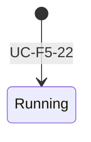

🏠 [Specs](../../../README.md) › 🧩 [Functional capabilities](../../README.md) ›
📣 [F5 Social media and marketing](../README.md) › 🗃️ [Data](README.md) › 🗃️ E-F5-16 A/B test

# 🗃️ E-F5-16 A/B test

**Status:** ✅ specified

## Purpose

Variants of a message, the measure, the test share and the winner.

## Fields

| Name | Type | Required | Validation | Default | Example | Personal data | Custom fields |
|---|---|---|---|---|---|---|---|
| message | post, email, SMS | yes | - | - | email Autumn | no | - |
| variants | list | yes | 2 or more | - | A, B | no | - |
| measure | opens, clicks, conversions, engagement | yes | - | clicks | clicks | no | - |
| share, end time | percent, date | yes | - | 20 % | 20 %, 4 h | no | - |
| winner | variant | no | - | - | B | no | - |

## Relations

Belongs to one Campaign or Post.

## Lifecycle

Running, decided.

## Indexes and search

By campaign.

## Retention

As the campaign.

## Audit

Winner and how.

## Import and export

None.

## Used by

- [UC-F5-22 A/B test posts, emails and SMS](../use-cases/09-brand-tests-and-return-on-investment/uc-f05-22-a-b-test-posts-emails-and-sms.md)

## Open questions

None.

---

⬅️ [E-F5-15 Brand asset](e-f05-15-brand-asset.md) · ⬆️ [Up](README.md) ·
➡️ [E-F5-17 Campaign budget](e-f05-17-campaign-budget.md)
