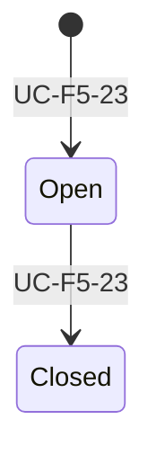

🏠 [Specs](../../../README.md) › 🧩 [Functional capabilities](../../README.md) ›
📣 [F5 Social media and marketing](../README.md) › 🗃️ [Data](README.md) › 🗃️ E-F5-17 Campaign budget

# 🗃️ E-F5-17 Campaign budget

**Status:** ✅ specified

## Purpose

A campaign's budget and spend per channel.

## Fields

| Name | Type | Required | Validation | Default | Example | Personal data | Custom fields |
|---|---|---|---|---|---|---|---|
| campaign | campaign | yes | - | - | Autumn | no | - |
| budget | amount per channel | yes | - | - | 3,000 EUR | no | - |
| spend | amounts with source | no | - | - | 2,400 EUR | no | - |

## Relations

Belongs to a Campaign (E-F5-05); spend may link supplier bills (F8).

## Lifecycle

Open, closed.

## Indexes and search

By campaign and period.

## Retention

10 years with the accounts
([CR-FR-002 Accounting records kept 10 years](../../../10-country-packs/france/accounting/cr-fr-002-accounting-records-kept-ten-years.md)).

## Audit

Budget and spend changed.

## Import and export

None.

## Used by

- [UC-F5-23 Track campaign budget, cost per lead and return](../use-cases/09-brand-tests-and-return-on-investment/uc-f05-23-track-campaign-budget-cost-per-lead-and-return.md)

## Open questions

None.

---

⬅️ [E-F5-16 A/B test](e-f05-16-a-b-test.md) · ⬆️ [Up](README.md) · ➡️ [E-F5-18 Contact](e-f05-18-contact.md)
