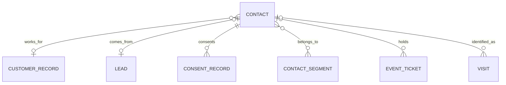
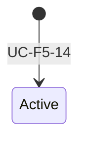

🏠 [Specs](../../../README.md) › 🧩 [Functional capabilities](../../README.md) ›
📣 [F5 Social media and marketing](../README.md) › 🗃️ [Data](README.md) › 🗃️ E-F5-18 Contact

# 🗃️ E-F5-18 Contact

**Status:** ✅ specified

## Purpose

The contact the flow charts name with the words "contacts"
([FL-F5-06](../flows/fl-f05-06-audiences-consent-and-journeys.md)). The owner decided to create it
([D516](../../../06-decisions/foundations/d516-naming-rules-and-the-seven-classes-of-names.md)); its fields are derived
from the specifications and confirmed by the owner (D572).

## Fields

| Name | Type | Required | Validation | Default | Example | Personal data | Custom fields |
|---|---|---|---|---|---|---|---|
| first name | text | no | - | - | Claire | yes | no |
| last name | text | no | - | - | Durand | yes | no |
| customer | customer record (E-F6-01) | no | a customer of the company | - | Durand SA | no | no |
| lead | lead (E-F6-20) | no | a lead of the company | - | Lead from the form Autumn sale | no | no |
| email | email address | no | a valid address, unique per company | - | lea@mail.fr | yes | no |
| mobile phone | phone number | no | a valid phone number | - | +33 6 12 34 56 78 | yes | no |
| postal address | address with its city | no | passes the format check of BR-F5-23 | - | 12 rue Mercière, 69002 Lyon | yes | no |
| address status | valid, invalid | no | invalid after returned mail, valid again once corrected | valid | invalid | no | no |
| tags | list of text | no | - | none | VIP, trade fair 2026 | no | no |
| state | Active | yes | the lifecycle below | Active | Active | no | no |

The title shown in the list is the first and last name, or the email when there is no name, followed by the customer
([S-F5-L18](../screens/00-lists/s-f05-l18-contacts.md)). The fields come from the segment conditions (city, tags,
purchases, events attended, lead score) of
[UC-F5-14](../use-cases/06-audiences-consent-and-journeys/uc-f05-14-build-a-segment-of-contacts.md), the merge fields of [UC-F5-24](../use-cases/10-referrals-push-and-listening/uc-f05-24-create-marketing-cards.md) and
[BR-F5-19](../business-rules/br-f05-19-cards-use-only-consented-personal-data.md), the address and its status of
[UC-F5-28](../use-cases/10-referrals-push-and-listening/uc-f05-28-send-postal-mail-campaigns.md) and
[BR-F5-23](../business-rules/br-f05-23-postal-campaigns-honour-opt-outs.md), and the email that is updated rather than
duplicated in [UC-F5-19](../use-cases/08-pages-forms-surveys-and-whatsapp/uc-f05-19-publish-a-landing-page-with-a-form.md).
Purchases, events attended and the lead score are read from the linked customer, event tickets and lead, not copied
here. The consent per channel lives in [E-F5-10](e-f05-10-consent-and-suppression-record.md), never on the contact.

## Relations

- [E-F6-01 Customer record](../../f06-customers-and-sales/data/e-f06-01-customer-record.md)
- [E-F6-20 Lead](../../f06-customers-and-sales/data/e-f06-20-lead.md)
- [E-F5-10 Consent and suppression record](e-f05-10-consent-and-suppression-record.md)
- [E-F5-09 Contact segment](e-f05-09-contact-segment.md)
- [E-F5-12 Event ticket](e-f05-12-event-ticket.md)
- [E-F18-21 Visit](../../f18-hosted-websites-and-domains/data/e-f18-21-visit.md)

## Lifecycle

## Indexes and search

Unique by email within the company. Searched by name, email, customer and city; filtered by state, tags and address
status ([S-F5-L18](../screens/00-lists/s-f05-l18-contacts.md)).

## Retention

As the other records of its capability.

## Audit

Every change, as the other records of its capability.

## Import and export

CSV or XLSX export of the fields the user may see (T3). An imported list matches contacts by email and updates them
rather than duplicating them; a line brings consent only with its source and date
([UC-F5-15](../use-cases/06-audiences-consent-and-journeys/uc-f05-15-record-and-prove-consent.md)).

## Used by

- [UC-F5-14 Build a segment of contacts](../use-cases/06-audiences-consent-and-journeys/uc-f05-14-build-a-segment-of-contacts.md)
- [UC-F5-15 Record and prove consent](../use-cases/06-audiences-consent-and-journeys/uc-f05-15-record-and-prove-consent.md)

## Open questions

None.

---

⬅️ [E-F5-17 Campaign budget](e-f05-17-campaign-budget.md) · ⬆️ [Up](README.md) ·
➡️ [E-F5-19 Trigger event](e-f05-19-trigger-event.md)
