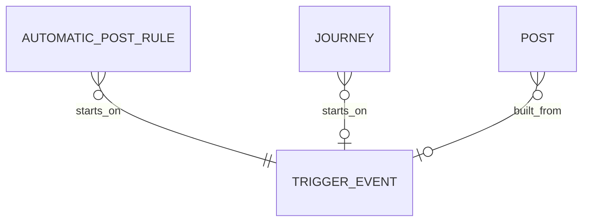
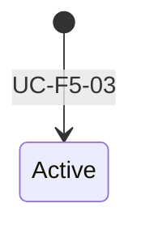

🏠 [Specs](../../../README.md) › 🧩 [Functional capabilities](../../README.md) ›
📣 [F5 Social media and marketing](../README.md) › 🗃️ [Data](README.md) › 🗃️ E-F5-19 Trigger event

# 🗃️ E-F5-19 Trigger event

**Status:** ✅ specified

## Purpose

The trigger event the flow charts name with the words "Event"
([FL-F5-02](../flows/fl-f05-02-automatic-posts.md)). The owner decided to create it
([D516](../../../06-decisions/foundations/d516-naming-rules-and-the-seven-classes-of-names.md)); its fields are derived
from the specifications and confirmed by the owner (D572).

## Fields

| Name | Type | Required | Validation | Default | Example | Personal data | Custom fields |
|---|---|---|---|---|---|---|---|
| name | text | yes | - | - | Job opening published | no | no |
| origin | internal, external | yes | one of the two | internal | external | no | no |
| source | capability, webhook, feed or connected account | no | a capability of SimpleERP for an internal event, a connected source for an external one | - | a feed of the company's blog | no | no |
| fields carried | list of fields | no | the fields a template may use | none | job.title, job.city, job.link | no | no |
| state | Active | yes | the lifecycle below | Active | Active | no | no |

A trigger event is a kind of event that rules start on: internal (a new product, a finished project, a job opening, a
review received) or external (a webhook, a feed item, a mention)
([BR-F5-02](../business-rules/br-f05-02-automatic-posts-follow-their-event-rule.md)). Each time one happens, the
matching rules fill their template with the fields it carries and the post is published or held for approval
([FL-F5-02](../flows/fl-f05-02-automatic-posts.md),
[UC-F5-03](../use-cases/02-automatic-posts/uc-f05-03-set-up-automatic-posts.md)); that log belongs to the posts. The
names and the state come from the list view [S-F5-L19](../screens/00-lists/s-f05-l19-trigger-events.md) and its
mock-up (Quote accepted, Invoice paid, Signed up, Cart left), the fields carried from the template of the automatic post
rule mock-up ({job.title}, {job.city}, {job.link}).

## Relations

- [E-F5-03 Automatic post rule](e-f05-03-automatic-post-rule.md): its event type is a trigger event.
- [E-F5-06 Journey](e-f05-06-journey.md): its trigger is a trigger event or a segment.
- [E-F5-01 Post](e-f05-01-post.md): an automatic post is built from one occurrence.

## Lifecycle

## Indexes and search

Searched by name; filtered by origin and state
([S-F5-L19](../screens/00-lists/s-f05-l19-trigger-events.md)).

## Retention

As the other records of its capability.

## Audit

Every change, as the other records of its capability.

## Import and export

No import. CSV or XLSX export of the fields the user may see (T3).

## Used by

- [UC-F5-03 Set up automatic posts](../use-cases/02-automatic-posts/uc-f05-03-set-up-automatic-posts.md)

## Open questions

None.

---

⬅️ [E-F5-18 Contact](e-f05-18-contact.md) · ⬆️ [Up](README.md) · ➡️ [E-F5-20 Waiting list](e-f05-20-waiting-list.md)
