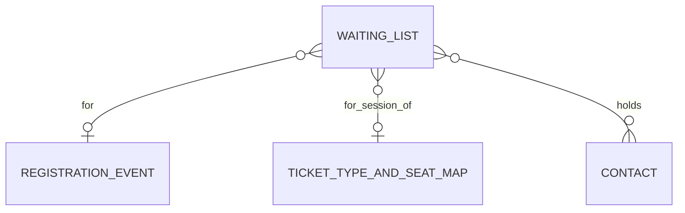
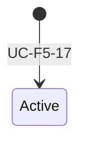

🏠 [Specs](../../../README.md) › 🧩 [Functional capabilities](../../README.md) ›
📣 [F5 Social media and marketing](../README.md) › 🗃️ [Data](README.md) › 🗃️ E-F5-20 Waiting list

# 🗃️ E-F5-20 Waiting list

**Status:** ✅ specified

## Purpose

The waiting list the flow charts name with the words "Waiting list"
([FL-F5-07](../flows/fl-f05-07-events-and-ticketing.md)). The owner decided to create it
([D516](../../../06-decisions/foundations/d516-naming-rules-and-the-seven-classes-of-names.md)); its fields are derived
from the specifications and confirmed by the owner (D572).

## Fields

| Name | Type | Required | Validation | Default | Example | Personal data | Custom fields |
|---|---|---|---|---|---|---|---|
| name | text | yes | - | - | Open day Lyon yard | no | no |
| event | registration event (E-F5-07) | no | an event of the company | - | Open day, 5 Dec | no | no |
| session | session of the ticket type and seat map (E-F5-11) | no | a session of the event | - | 2027-03-12 20:30 | no | no |
| people waiting | list of contacts (E-F5-18) | no | in the order they joined | none | Lea Roux, Paul Morel | yes | no |
| opened at | date and time | no | when the last place or quota is taken | - | 2026-11-28 14:10 | no | no |
| state | Active | yes | the lifecycle below | Active | Active | no | no |

The list opens when an event or one of its sessions is sold out: the next person to register joins it instead of
getting a ticket ([FL-F5-07](../flows/fl-f05-07-events-and-ticketing.md),
[UC-F5-11](../use-cases/07-events-and-ticketing/uc-f05-11-organise-events-and-sell-tickets.md), error flow 3e and
acceptance criterion 1). Sessions, capacity and quotas come from
[UC-F5-17](../use-cases/07-events-and-ticketing/uc-f05-17-set-up-ticketing-for-an-event.md) and
[BR-F5-12](../business-rules/br-f05-12-one-seat-one-ticket-across-every-channel.md). A health practice offers a
cancelled slot to the same list
([UC-SC09-02](../../../08-sectors/sc09-health-practices/use-cases/01-appointments/uc-sc09-02-remind-patients-and-handle-no-shows.md)).
The name and the state come from the list view [S-F5-L20](../screens/00-lists/s-f05-l20-waiting-lists.md) and its
mock-up (Open day Lyon yard, Gala 2027).

## Relations

- [E-F5-07 Registration event](e-f05-07-registration-event.md)
- [E-F5-11 Ticket type and seat map](e-f05-11-ticket-type-and-seat-map.md)
- [E-F5-18 Contact](e-f05-18-contact.md)

## Lifecycle

## Indexes and search

Searched by name; filtered by event and state ([S-F5-L20](../screens/00-lists/s-f05-l20-waiting-lists.md)).

## Retention

As the other records of its capability.

## Audit

Every change, as the other records of its capability.

## Import and export

No import. CSV or XLSX export of the fields the user may see (T3).

## Used by

- [UC-F5-17 Set up ticketing for an event](../use-cases/07-events-and-ticketing/uc-f05-17-set-up-ticketing-for-an-event.md)

## Open questions

None.

---

⬅️ [E-F5-19 Trigger event](e-f05-19-trigger-event.md) · ⬆️ [Up](README.md) ·
➡️ [E-F5-21 Marketing card](e-f05-21-marketing-card.md)
