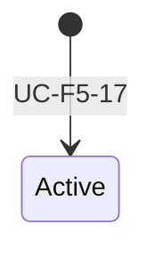

🏠 [Specs](../../../README.md) › 🧩 [Functional capabilities](../../README.md) ›
📣 [F5 Social media and marketing](../README.md) › 🗃️ [Data](README.md) › 🗃️ E-F5-20 Waiting list

# 🗃️ E-F5-20 Waiting list

**Status:** 🔄 waiting for the owner

## Purpose

(Proposed) The waiting list the flow charts name with the words "Waiting list"
([FL-F5-07](../flows/fl-f05-07-events-and-ticketing.md)). The owner decided to create it
([D516](../../../06-decisions/foundations/d516-naming-rules-and-the-seven-classes-of-names.md)); what it holds waits for
the owner's confirmation.

## Fields

(Proposed) To define with the owner: the flow charts name the record, not its fields.

## Relations

(Proposed) To define with the owner, from the use cases below.

## Lifecycle

## Indexes and search

(Proposed) To define with the owner.

## Retention

(Proposed) As the other records of its capability, to confirm with the owner.

## Audit

(Proposed) Every change, as the other records of its capability.

## Import and export

(Proposed) To define with the owner.

## Used by

- [UC-F5-17 Set up ticketing for an event](../use-cases/07-events-and-ticketing/uc-f05-17-set-up-ticketing-for-an-event.md)

## Open questions

(Proposed) Its fields, relations and states wait for the owner (waiting list, step 36e).

---

⬅️ [E-F5-19 Trigger event](e-f05-19-trigger-event.md) · ⬆️ [Up](README.md) ·
➡️ [E-F5-21 Marketing card](e-f05-21-marketing-card.md)
