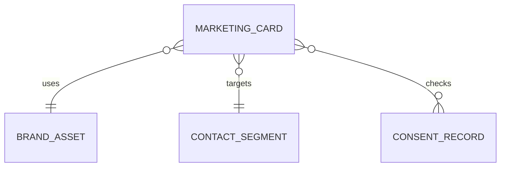
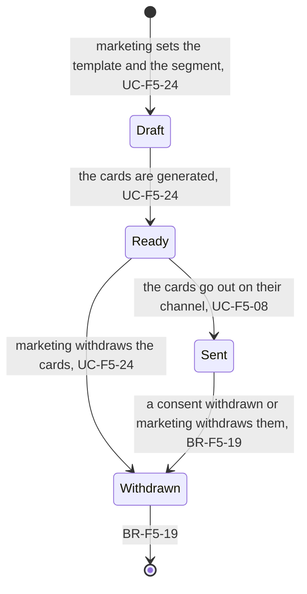

🏠 [Specs](../../../README.md) › 🧩 [Functional capabilities](../../README.md) ›
📣 [F5 Social media and marketing](../README.md) › 🗃️ [Data](README.md) › 🗃️ E-F5-21 Marketing card

# 🗃️ E-F5-21 Marketing card

**Status:** ✅ specified

## Purpose

A card campaign: the template, the segment, the merge fields and the cards generated from them, each with its tracked
link ([D524](../../../06-decisions/f05-social-media/d524-benchmark-gaps-f05-social-media.md)).

## Fields

| Name | Type | Required | Validation | Default | Example | Personal data | Custom fields |
|---|---|---|---|---|---|---|---|
| name | text | yes | unique per company | - | Thank-you, September buyers | no | no |
| template | brand asset (E-F5-15) | yes | a card template of the brand kit | - | Thank-you 1080x1080 | no | no |
| segment | contact segment (E-F5-09) | yes | a segment of the company | - | Buyers, September | no | no |
| merge fields | list of text | no | each field exists on the contact | none | first name, last order | no | no |
| channel | email, SMS, post or export | yes | one of the four | export | email | no | no |
| cards generated | number | no | 0 or more | 0 | 1,242 | no | no |
| generic cards | number | no | 0 or more | 0 | 62 | no | no |
| expiry date | date | no | after today | 30 days after generation | 2026-12-15 | no | no |
| state | Draft, Ready, Sent, Withdrawn | yes | the lifecycle below | Draft | Ready | no | no |
| owner | user | yes | a user of the company | the creator | Claire P. | yes | no |

## Relations

- [E-F5-15 Brand asset](e-f05-15-brand-asset.md)
- [E-F5-09 Contact segment](e-f05-09-contact-segment.md)
- [E-F5-10 Consent and suppression record](e-f05-10-consent-and-suppression-record.md)

## Lifecycle

## Indexes and search

By name, template, segment, state and date of generation.

## Retention

The campaign is kept 3 years after its last card; the cards of a withdrawn campaign are dropped after 30 days
and only the counts stay.

## Audit

Every generation, withdrawal and change of merge fields, with who, when, the old and the new value.

## Import and export

No import. The generated cards are exported as image files with their links, in a zip.

## Used by

- [UC-F5-24](../use-cases/10-referrals-push-and-listening/uc-f05-24-create-marketing-cards.md)

## Open questions

None.

---

⬅️ [E-F5-20 Waiting list](e-f05-20-waiting-list.md) · ⬆️ [Up](README.md) · ➡️ [E-F5-22 Referral](e-f05-22-referral.md)
