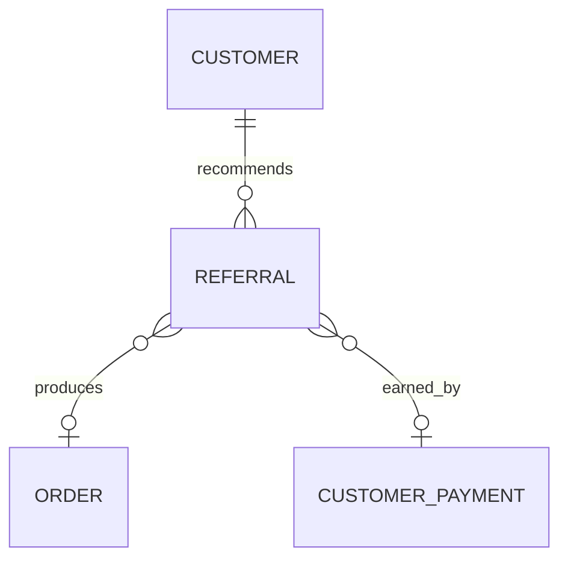
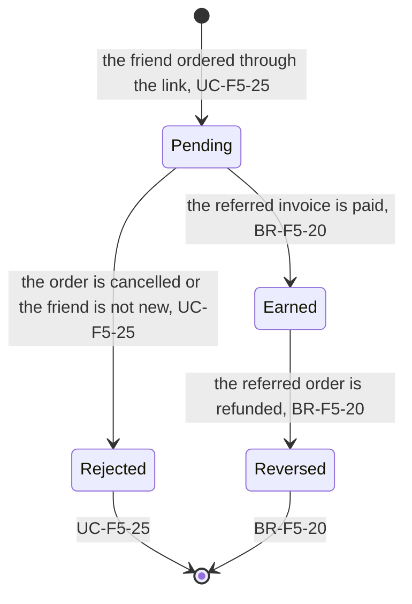

🏠 [Specs](../../../README.md) › 🧩 [Functional capabilities](../../README.md) ›
📣 [F5 Social media and marketing](../README.md) › 🗃️ [Data](README.md) › 🗃️ E-F5-22 Referral

# 🗃️ E-F5-22 Referral

**Status:** ✅ specified

## Purpose

A referral: who recommended, who was recommended, the order it produced and the reward
([D524](../../../06-decisions/f05-social-media/d524-benchmark-gaps-f05-social-media.md)).

## Fields

| Name | Type | Required | Validation | Default | Example | Personal data | Custom fields |
|---|---|---|---|---|---|---|---|
| referrer | customer (E-F6-01) | yes | an active customer | - | Sonia M. | yes | no |
| friend | customer (E-F6-01) | yes | a new customer, not the referrer | - | Karim D. | yes | no |
| order | order (E-F6-04) | no | an order of the friend | - | SO-2041 | no | no |
| code | text | yes | unique | generated | SONIA-20 | no | no |
| reward | amount with currency or text | no | at most the programme's reward | from the programme | 20 EUR credit | no | no |
| paid on | date | no | the date of the payment that earned it | - | 2026-11-02 | no | no |
| held reason | text | no | set when marketing must check | - | same delivery address | no | no |
| state | Pending, Earned, Rejected, Reversed | yes | the lifecycle below | Pending | Earned | no | no |
| owner | user | yes | a user of the company | the creator | Claire P. | yes | no |

## Relations

- [E-F6-01 Customer record](../../f06-customers-and-sales/data/e-f06-01-customer-record.md)
- [E-F6-04 Order](../../f06-customers-and-sales/data/e-f06-04-order.md)
- [E-F6-06 Customer payment](../../f06-customers-and-sales/data/e-f06-06-customer-payment.md)

## Lifecycle

## Indexes and search

By referrer, friend, order, state and date.

## Retention

Kept 3 years after the last reward, the term of customer records
([BR-F6-03](../../f06-customers-and-sales/business-rules/br-f06-03-portal-shows-only-the-customer-s-own.md)); the
friend's name is erased with their customer record.

## Audit

Every state change with the order and payment that caused it; every reward granted or withdrawn.

## Import and export

No import. The referrals are exported as a CSV with their rewards.

## Used by

- [UC-F5-25](../use-cases/10-referrals-push-and-listening/uc-f05-25-run-a-customer-referral-programme.md)

## Open questions

None.

---

⬅️ [E-F5-21 Marketing card](e-f05-21-marketing-card.md) · ⬆️ [Up](README.md) ·
➡️ [E-F5-23 Push campaign](e-f05-23-push-campaign.md)
