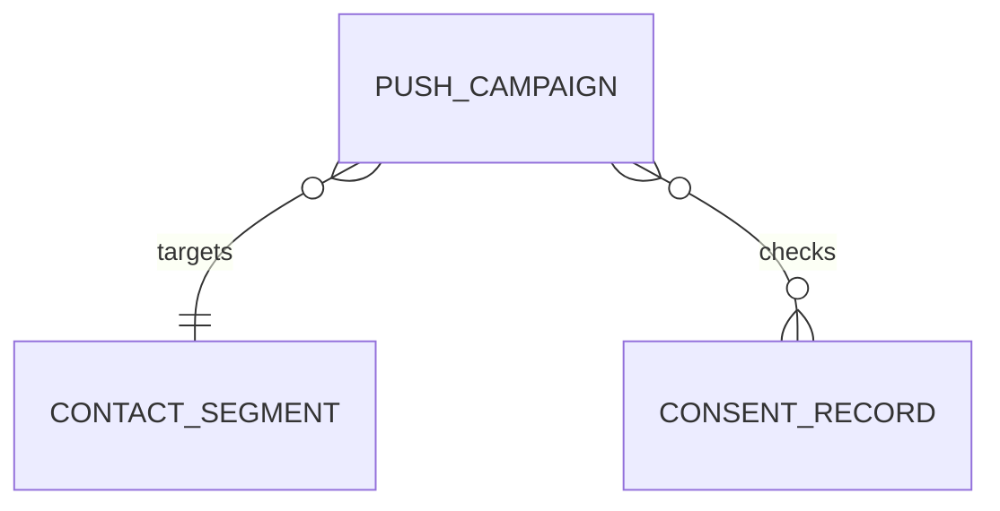
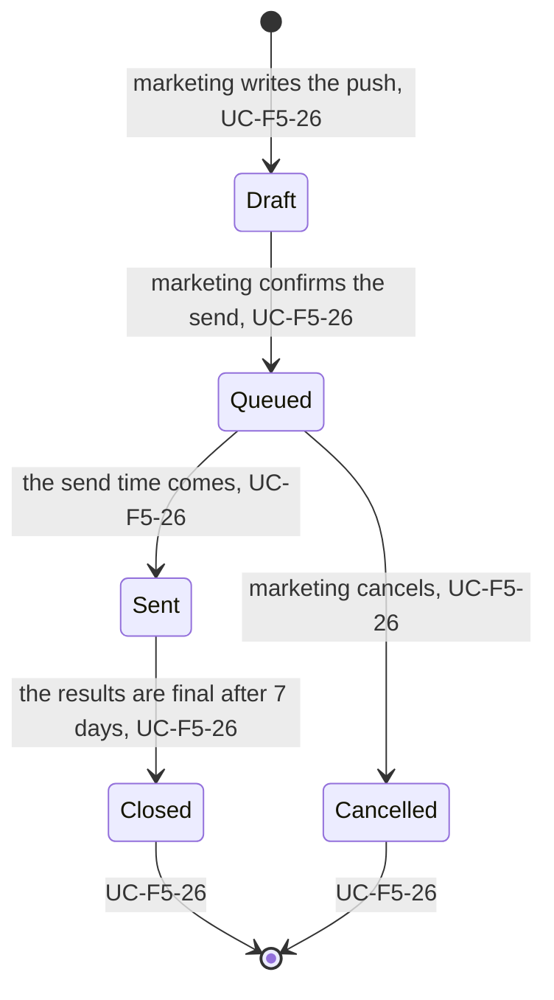

🏠 [Specs](../../../README.md) › 🧩 [Functional capabilities](../../README.md) ›
📣 [F5 Social media and marketing](../README.md) › 🗃️ [Data](README.md) › 🗃️ E-F5-23 Push campaign

# 🗃️ E-F5-23 Push campaign

**Status:** ✅ specified

## Purpose

A push campaign: the message, the segment, the send time and the counts
([D524](../../../06-decisions/f05-social-media/d524-benchmark-gaps-f05-social-media.md)).

## Fields

| Name | Type | Required | Validation | Default | Example | Personal data | Custom fields |
|---|---|---|---|---|---|---|---|
| name | text | yes | unique per company | - | Autumn offer | no | no |
| title | text | yes | at most 50 characters | - | 10 percent on autumn plants | no | no |
| text | text | yes | at most 140 characters | - | Until Sunday, with your loyalty card. | no | no |
| link | tracked link | no | a tracked link of the company | - | shop/autumn | no | no |
| segment | contact segment (E-F5-09) | yes | a segment of the company | - | Loyal customers | no | no |
| send time | date and time | yes | in the future when scheduled | now | 2026-11-15 09:00 | no | no |
| devices reached | number | no | 0 or more | 0 | 842 | no | no |
| devices left out | number | no | 0 or more | 0 | 120 | no | no |
| delivered, opened, clicked | three numbers | no | 0 or more | 0 | 811, 203, 74 | no | no |
| state | Draft, Queued, Sent, Cancelled, Closed | yes | the lifecycle below | Draft | Queued | no | no |
| owner | user | yes | a user of the company | the creator | Claire P. | yes | no |

## Relations

- [E-F5-09 Contact segment](e-f05-09-contact-segment.md)
- [E-F5-10 Consent and suppression record](e-f05-10-consent-and-suppression-record.md)

## Lifecycle

## Indexes and search

By name, segment, state and send time.

## Retention

Kept 3 years with its counts; device tokens are never kept in the campaign.

## Audit

Every send and cancellation, with who, when, the segment and the counts.

## Import and export

No import. The results are exported as a CSV per campaign.

## Used by

- [UC-F5-26](../use-cases/10-referrals-push-and-listening/uc-f05-26-send-push-notifications.md)

## Open questions

None.

---

⬅️ [E-F5-22 Referral](e-f05-22-referral.md) · ⬆️ [Up](README.md) ·
➡️ [E-F5-24 Brand mention](e-f05-24-brand-mention.md)
