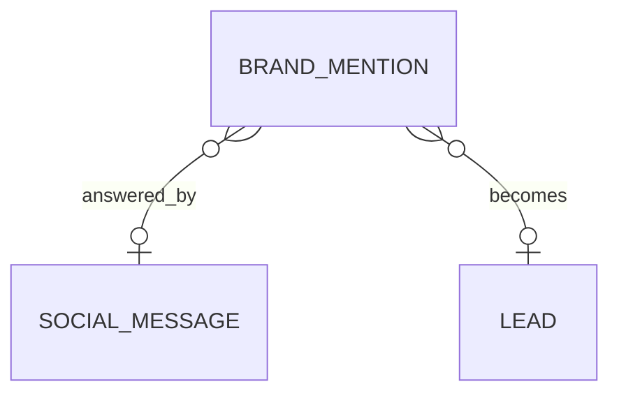
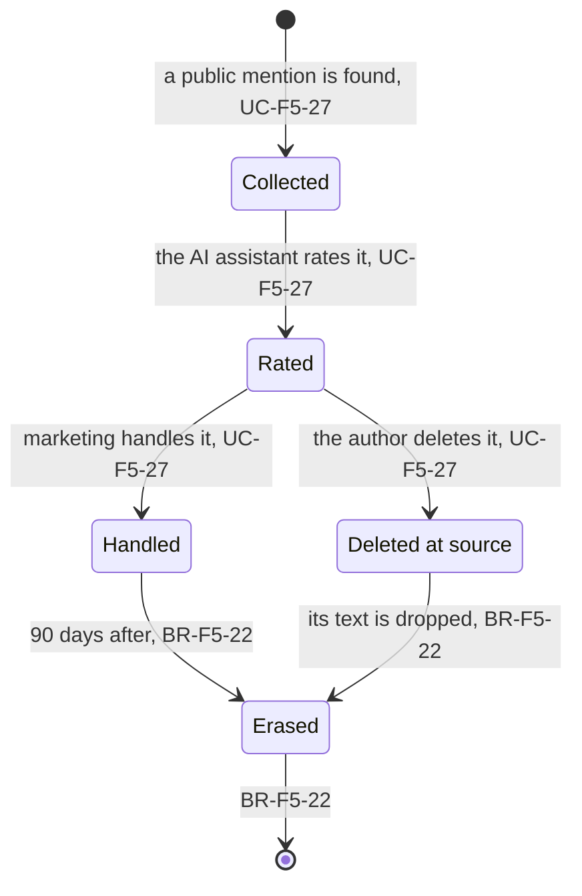

🏠 [Specs](../../../README.md) › 🧩 [Functional capabilities](../../README.md) ›
📣 [F5 Social media and marketing](../README.md) › 🗃️ [Data](README.md) › 🗃️ E-F5-24 Brand mention

# 🗃️ E-F5-24 Brand mention

**Status:** ✅ specified

## Purpose

A public mention of the brand: where it was said, what, by whom in public, its tone and reach
([D524](../../../06-decisions/f05-social-media/d524-benchmark-gaps-f05-social-media.md)).

## Fields

| Name | Type | Required | Validation | Default | Example | Personal data | Custom fields |
|---|---|---|---|---|---|---|---|
| source | text | yes | an allowed public source | - | review site | no | no |
| link | address | yes | the public address of the mention | - | reviews.example/42 | no | no |
| author | text | no | the public name only | - | a customer | yes | no |
| excerpt | text | no | at most 500 characters | - | Table arrived late and scratched | yes | no |
| watched term | text | yes | one of the watched terms | - | Atelier Verdier | no | no |
| tone | positive, neutral, negative, not rated | yes | one of the four | not rated | negative | no | no |
| topic | text | no | - | - | delivery | no | no |
| reach | number | no | 0 or more | 0 | 1,200 | no | no |
| collected at | date and time | yes | - | now | 2026-11-14 09:12 | no | no |
| state | Collected, Rated, Handled, Deleted at source, Erased | yes | the lifecycle below | Collected | Rated | no | no |
| owner | user | yes | a user of the company | the creator | Claire P. | yes | no |

## Relations

- [E-F5-04 Social message](e-f05-04-social-message.md)
- [E-F6-20 Lead](../../f06-customers-and-sales/data/e-f06-20-lead.md)

## Lifecycle

## Indexes and search

By source, tone, topic, watched term, reach and date.

## Retention

A mention that names a person is kept 90 days, then only the counts stay; a mention without a person is kept
2 years.

## Audit

Every collection, rating, correction and handling, with who or what, when, the old and the new value.

## Import and export

No import. The mentions of a period are exported as a CSV without author names.

## Used by

- [UC-F5-27](../use-cases/10-referrals-push-and-listening/uc-f05-27-listen-to-brand-mentions.md)

## Open questions

None.

---

⬅️ [E-F5-23 Push campaign](e-f05-23-push-campaign.md) · ⬆️ [Up](README.md) ·
➡️ [E-F5-25 Postal campaign](e-f05-25-postal-campaign.md)
