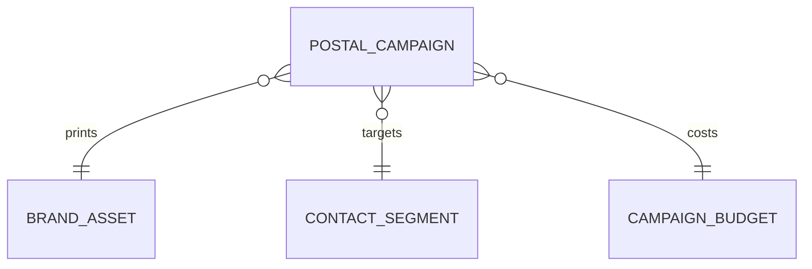
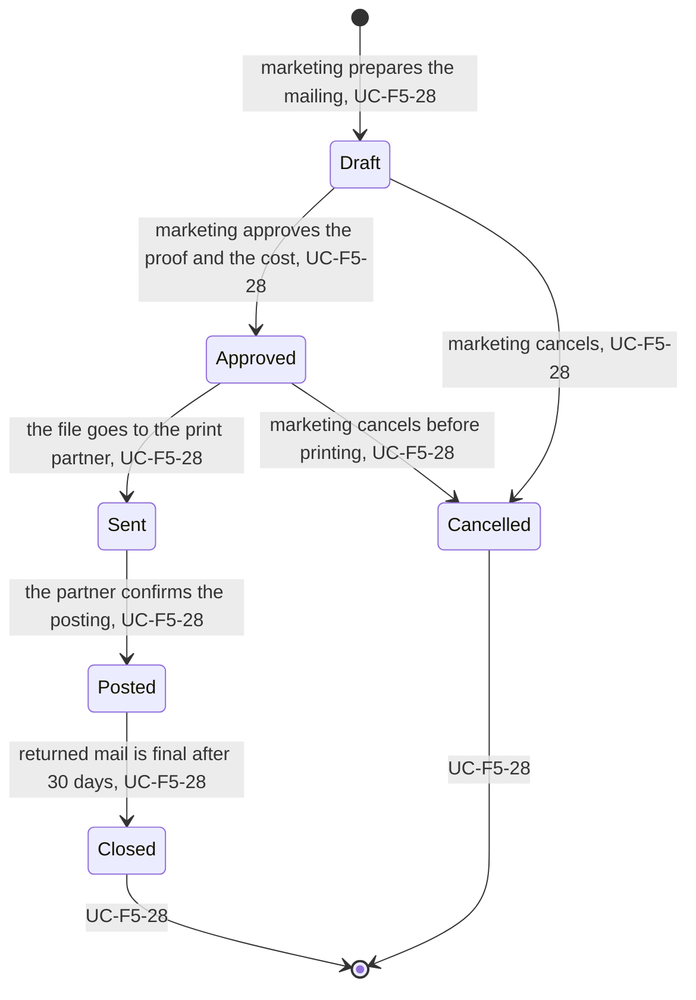

🏠 [Specs](../../../README.md) › 🧩 [Functional capabilities](../../README.md) ›
📣 [F5 Social media and marketing](../README.md) › 🗃️ [Data](README.md) › 🗃️ E-F5-25 Postal campaign

# 🗃️ E-F5-25 Postal campaign

**Status:** ✅ specified

## Purpose

A postal mailing: the letter, the segment, the contacts left out, the cost and the posting
([D524](../../../06-decisions/f05-social-media/d524-benchmark-gaps-f05-social-media.md)).

## Fields

| Name | Type | Required | Validation | Default | Example | Personal data | Custom fields |
|---|---|---|---|---|---|---|---|
| name | text | yes | unique per company | - | Welcome pack | no | no |
| letter | brand asset (E-F5-15) | yes | a letter template | - | Welcome A4 v1 | no | no |
| segment | contact segment (E-F5-09) | yes | a segment of the company | - | New customers | no | no |
| letters planned | number | no | 0 or more | 0 | 1,310 | no | no |
| contacts left out | list of contact and reason | no | - | none | 30 objections | no | no |
| cost | amount with currency | no | within the campaign budget | - | 1,180 EUR | no | no |
| posting date | date | yes | a working day after today | - | 2026-11-20 | no | no |
| posted, returned | two numbers | no | 0 or more | 0 | 1,310, 23 | no | no |
| state | Draft, Approved, Sent, Cancelled, Posted, Closed | yes | the lifecycle below | Draft | Approved | no | no |
| owner | user | yes | a user of the company | the creator | Claire P. | yes | no |

## Relations

- [E-F5-15 Brand asset](e-f05-15-brand-asset.md)
- [E-F5-09 Contact segment](e-f05-09-contact-segment.md)
- [E-F5-17 Campaign budget](e-f05-17-campaign-budget.md)

## Lifecycle

## Indexes and search

By name, segment, state, posting date and cost.

## Retention

Kept 3 years; the list of contacts left out keeps the reason and no address.

## Audit

Every approval, sending and cancellation, with who, when and the counts; every opt-out applied.

## Import and export

No import. The mailing file sent to the partner is kept with the campaign for 90 days.

## Used by

- [UC-F5-28](../use-cases/10-referrals-push-and-listening/uc-f05-28-send-postal-mail-campaigns.md)

## Open questions

None.

---

⬅️ [E-F5-24 Brand mention](e-f05-24-brand-mention.md) · ⬆️ [Up](README.md)
