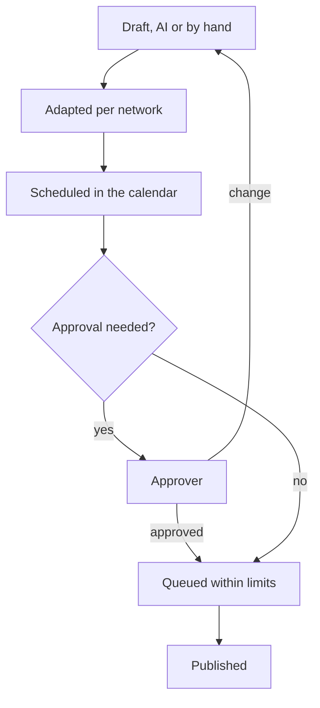

🏠 [Specs](../../../README.md) › 🧩 [Functional capabilities](../../README.md) ›
📣 [F5 Social media and marketing](../README.md) › 🔀 [Flows](README.md) › 🔀 FL-F5-01 Publish a post

# 🔀 FL-F5-01 Publish a post

**Status:** ✅ specified

## Summary

Covers UC-F5-01, UC-F5-02, UC-F5-04.

## Personas

See each use case.

## Flowchart

## Sequence diagram

See each use case.

## Steps

| Step | Persona | Screen | Use case | What happens |
|---|---|---|---|---|
| 1 | See [UC-F5-01](../use-cases/01-publish-a-post/uc-f05-01-prepare-and-schedule-a-post.md) | [S-F5-01](../screens/01-publish-a-post/s-f05-01-post-composer.md) | [UC-F5-01](../use-cases/01-publish-a-post/uc-f05-01-prepare-and-schedule-a-post.md) | Prepare and schedule a post |
| 2 | See [UC-F5-02](../use-cases/01-publish-a-post/uc-f05-02-approve-a-post.md) | [S-F5-02](../screens/01-publish-a-post/s-f05-02-approval.md) | [UC-F5-02](../use-cases/01-publish-a-post/uc-f05-02-approve-a-post.md) | Approve a post |
| 3 | See [UC-F5-04](../use-cases/01-publish-a-post/uc-f05-04-manage-the-editorial-calendar.md) | [S-F5-04](../screens/01-publish-a-post/s-f05-04-automatic-post-rules.md) | [UC-F5-04](../use-cases/01-publish-a-post/uc-f05-04-manage-the-editorial-calendar.md) | Manage the editorial calendar |

### Entities and screens

| Entity | States in this flow | Shown at step and screen | Aggregated view |
|---|---|---|---|
| [E-F5-01 Post](../data/e-f05-01-post.md) | Draft, To approve, Scheduled, Published, Held | 1 [S-F5-01](../screens/01-publish-a-post/s-f05-01-post-composer.md); 2 [S-F5-02](../screens/01-publish-a-post/s-f05-02-approval.md); 3 [S-F5-04](../screens/01-publish-a-post/s-f05-04-automatic-post-rules.md) | Posts |
| [E-F3-15 Agent](../../f03-assistant/data/e-f03-15-agent.md) | Paid, Paused | Shown elsewhere: [S-F3-14 Agents](../../f03-assistant/screens/10-benchmark-additions/s-f03-14-agents.md) | Agents |
| [E-F5-02 Social account](../data/e-f05-02-social-account.md) | Active | Shown elsewhere: [S-F5-07 Social accounts](../screens/04-connect-accounts/s-f05-07-social-accounts.md) | Social accounts |

## Errors

As each use case.

## Images

Every step and error, for each persona taking part, in light and dark mode (D120). Steps are numbered as in the Steps
table; E rows are the error cases.

| Step | Persona | Device | Light | Dark |
|---|---|---|---|---|
| 1 | U12 | desktop | [light](../images/01-publish-a-post/u12-marketing/1-prepare-and-schedule-desktop-light.png) | [dark](../images/01-publish-a-post/u12-marketing/1-prepare-and-schedule-desktop-dark.png) |
| 2 | U13 | desktop | [light](../images/01-publish-a-post/u13-owner/2-approve-desktop-light.png) | [dark](../images/01-publish-a-post/u13-owner/2-approve-desktop-dark.png) |
| 2 | U13 | phone | [light](../images/01-publish-a-post/u13-owner/2-approve-phone-light.png) | [dark](../images/01-publish-a-post/u13-owner/2-approve-phone-dark.png) |
| 3 | U12 | desktop | [light](../images/01-publish-a-post/u12-marketing/3-editorial-calendar-desktop-light.png) | [dark](../images/01-publish-a-post/u12-marketing/3-editorial-calendar-desktop-dark.png) |
| E1 | U12 | desktop | [light](../images/01-publish-a-post/u12-marketing/e1-network-refuses-format-desktop-light.png) | [dark](../images/01-publish-a-post/u12-marketing/e1-network-refuses-format-desktop-dark.png) |
| E1 | U12 | phone | [light](../images/01-publish-a-post/u12-marketing/e1-network-refuses-format-phone-light.png) | [dark](../images/01-publish-a-post/u12-marketing/e1-network-refuses-format-phone-dark.png) |

## Open questions

None.

---

⬆️ [Up](README.md) · ➡️ [FL-F5-02 Automatic posts](fl-f05-02-automatic-posts.md)
