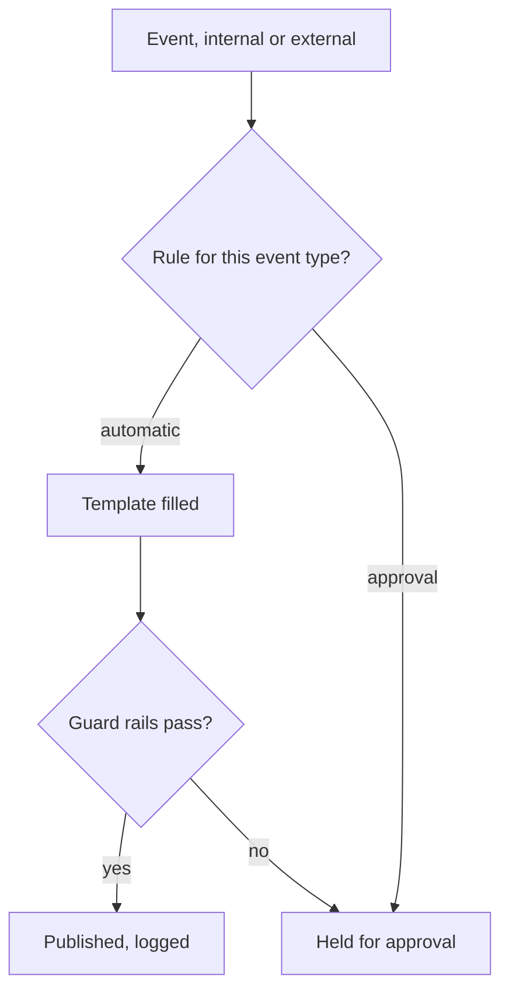

🏠 [Specs](../../../README.md) › 🧩 [Functional capabilities](../../README.md) ›
📣 [F5 Social media and marketing](../README.md) › 🔀 [Flows](README.md) › 🔀 FL-F5-02 Automatic posts

# 🔀 FL-F5-02 Automatic posts

**Status:** ✅ specified

## Summary

Covers UC-F5-03.

## Personas

See each use case.

## Flowchart

## Sequence diagram

See each use case.

## Steps

| Step | Persona | Screen | Use case | What happens |
|---|---|---|---|---|
| 1 | See [UC-F5-03](../use-cases/02-automatic-posts/uc-f05-03-set-up-automatic-posts.md) | [S-F5-03](../screens/02-automatic-posts/s-f05-03-editorial-calendar.md) | [UC-F5-03](../use-cases/02-automatic-posts/uc-f05-03-set-up-automatic-posts.md) | Set up automatic posts |

### Entities and screens

| Entity | States in this flow | Shown at step and screen | Aggregated view |
|---|---|---|---|
| [E-F5-19 Trigger event](../data/e-f05-19-trigger-event.md) | Active | Shown elsewhere: [S-F5-04 Automatic post rules](../screens/01-publish-a-post/s-f05-04-automatic-post-rules.md) | Trigger events |
| [E-F5-03 Automatic post rule](../data/e-f05-03-automatic-post-rule.md) | Active | Shown elsewhere: [S-F5-04 Automatic post rules](../screens/01-publish-a-post/s-f05-04-automatic-post-rules.md) | Automatic post rules |

## Errors

As each use case.

## Images

Every step and error, for each persona taking part, in light and dark mode (D120). Steps are numbered as in the Steps
table; E rows are the error cases.

| Step | Persona | Device | Light | Dark |
|---|---|---|---|---|
| 1 | U12 | desktop | [light](../images/02-automatic-posts/u12-marketing/1-automatic-rule-desktop-light.png) | [dark](../images/02-automatic-posts/u12-marketing/1-automatic-rule-desktop-dark.png) |
| E1 | U12 | desktop | [light](../images/02-automatic-posts/u12-marketing/e1-held-blocked-word-desktop-light.png) | [dark](../images/02-automatic-posts/u12-marketing/e1-held-blocked-word-desktop-dark.png) |
| E1 | U12 | phone | [light](../images/02-automatic-posts/u12-marketing/e1-held-blocked-word-phone-light.png) | [dark](../images/02-automatic-posts/u12-marketing/e1-held-blocked-word-phone-dark.png) |

## Open questions

None.

---

⬅️ [FL-F5-01 Publish a post](fl-f05-01-publish-a-post.md) · ⬆️ [Up](README.md) ·
➡️ [FL-F5-03 Inbox and statistics](fl-f05-03-inbox-and-statistics.md)
