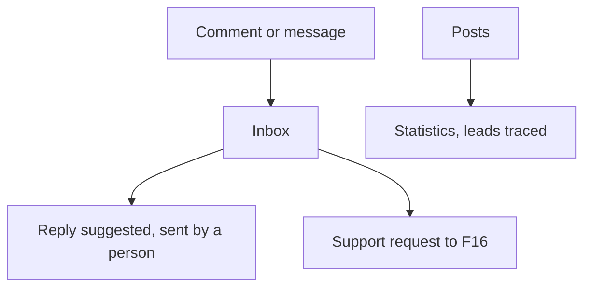

🏠 [Specs](../../../README.md) › 🧩 [Functional capabilities](../../README.md) ›
📣 [F5 Social media and marketing](../README.md) › 🔀 [Flows](README.md) › 🔀 FL-F5-03 Inbox and statistics

# 🔀 FL-F5-03 Inbox and statistics

**Status:** ✅ specified

## Summary

Covers UC-F5-05, UC-F5-06.

## Personas

See each use case.

## Flowchart

## Sequence diagram

See each use case.

## Steps

| Step | Persona | Screen | Use case | What happens |
|---|---|---|---|---|
| 1 | See [UC-F5-05](../use-cases/03-inbox-and-statistics/uc-f05-05-answer-comments-and-messages.md) | [S-F5-05](../screens/03-inbox-and-statistics/s-f05-05-social-inbox.md) | [UC-F5-05](../use-cases/03-inbox-and-statistics/uc-f05-05-answer-comments-and-messages.md) | Answer comments and messages |
| 2 | See [UC-F5-06](../use-cases/03-inbox-and-statistics/uc-f05-06-read-statistics.md) | [S-F5-06](../screens/03-inbox-and-statistics/s-f05-06-social-statistics.md) | [UC-F5-06](../use-cases/03-inbox-and-statistics/uc-f05-06-read-statistics.md) | Read statistics |

### Entities and screens

| Entity | States in this flow | Shown at step and screen | Aggregated view |
|---|---|---|---|
| [E-F5-04 Social message](../data/e-f05-04-social-message.md) | New, Answered, Turned into a request, Hidden | 1 [S-F5-05](../screens/03-inbox-and-statistics/s-f05-05-social-inbox.md) | Social messages |
| [E-F20-01 Support request](../../f20-hosted-support-assistant/data/e-f20-01-support-request.md) | Active | Shown elsewhere: [S-F20-01 Support chat](../../f20-hosted-support-assistant/screens/01-talk-it-through/s-f20-01-support-chat.md) | Support requests |
| [E-F16-01 Customer request](../../f16-customer-support-agents/data/e-f16-01-customer-request.md) | New, In progress, Resolved, Waiting, Escalated | Shown elsewhere: [S-F16-11 My requests](../../f16-customer-support-agents/screens/05-customer-side/s-f16-11-my-requests.md) | Customer requests |
| [E-F5-01 Post](../data/e-f05-01-post.md) | Draft, To approve, Refused, Scheduled, Published, Held | 1 [S-F5-05](../screens/03-inbox-and-statistics/s-f05-05-social-inbox.md); 2 [S-F5-06](../screens/03-inbox-and-statistics/s-f05-06-social-statistics.md) | Posts |
| [E-F6-20 Lead](../../f06-customers-and-sales/data/e-f06-20-lead.md) | Active | 1 [S-F5-05](../screens/03-inbox-and-statistics/s-f05-05-social-inbox.md) | Leads |

## Errors

As each use case.

## Images

Every step and error, for each persona taking part, in light and dark mode (D120). Steps are numbered as in the Steps
table; E rows are the error cases.

| Step | Persona | Device | Light | Dark |
|---|---|---|---|---|
| 1 | U12 | desktop | [light](../images/03-inbox-and-statistics/u12-marketing/1-social-inbox-desktop-light.png) | [dark](../images/03-inbox-and-statistics/u12-marketing/1-social-inbox-desktop-dark.png) |
| 1 | U12 | phone | [light](../images/03-inbox-and-statistics/u12-marketing/1-social-inbox-phone-light.png) | [dark](../images/03-inbox-and-statistics/u12-marketing/1-social-inbox-phone-dark.png) |
| 2 | U13 | desktop | [light](../images/03-inbox-and-statistics/u13-owner/2-statistics-desktop-light.png) | [dark](../images/03-inbox-and-statistics/u13-owner/2-statistics-desktop-dark.png) |
| E1 | U13 | desktop | [light](../images/03-inbox-and-statistics/u13-owner/e1-stats-unavailable-desktop-light.png) | [dark](../images/03-inbox-and-statistics/u13-owner/e1-stats-unavailable-desktop-dark.png) |
| E1 | U13 | phone | [light](../images/03-inbox-and-statistics/u13-owner/e1-stats-unavailable-phone-light.png) | [dark](../images/03-inbox-and-statistics/u13-owner/e1-stats-unavailable-phone-dark.png) |

## Open questions

None.

---

⬅️ [FL-F5-02 Automatic posts](fl-f05-02-automatic-posts.md) · ⬆️ [Up](README.md) ·
➡️ [FL-F5-04 Connect accounts](fl-f05-04-connect-accounts.md)
