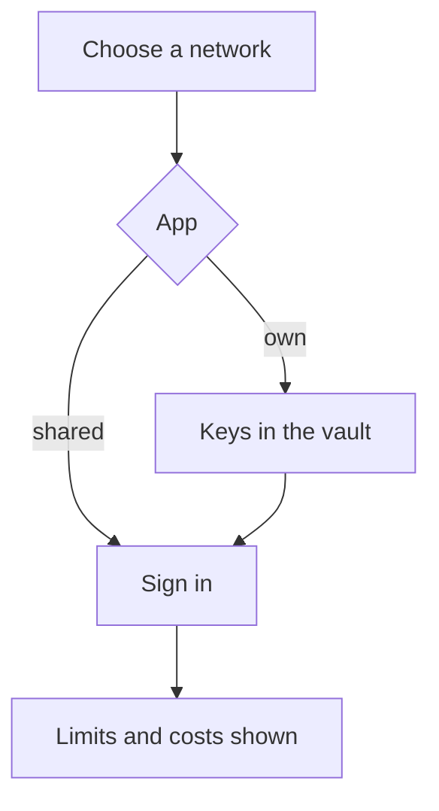

🏠 [Specs](../../../README.md) › 🧩 [Functional capabilities](../../README.md) ›
📣 [F5 Social media and marketing](../README.md) › 🔀 [Flows](README.md) › 🔀 FL-F5-04 Connect accounts

# 🔀 FL-F5-04 Connect accounts

**Status:** ✅ specified

## Summary

Covers UC-F5-07.

## Personas

See each use case.

## Flowchart

## Sequence diagram

See each use case.

## Steps

| Step | Persona | Screen | Use case | What happens |
|---|---|---|---|---|
| 1 | See [UC-F5-07](../use-cases/04-connect-accounts/uc-f05-07-connect-the-company-s-accounts.md) | [S-F5-07](../screens/04-connect-accounts/s-f05-07-social-accounts.md) | [UC-F5-07](../use-cases/04-connect-accounts/uc-f05-07-connect-the-company-s-accounts.md) | Connect the company's accounts |

### Entities and screens

| Entity | States in this flow | Shown at step and screen | Aggregated view |
|---|---|---|---|
| [E-F5-02 Social account](../data/e-f05-02-social-account.md) | Active | 1 [S-F5-07](../screens/04-connect-accounts/s-f05-07-social-accounts.md) | Social accounts |
| [E-T12-02 Credential](../../../03-technical/t12-connectors-and-scrapers/data/e-t12-02-credential.md) | Active | Shown elsewhere: [S-T12-02 Credential](../../../03-technical/t12-connectors-and-scrapers/screens/s-t12-02-credential.md), from the admin list [S-T12-L02](../../../03-technical/t12-connectors-and-scrapers/screens/00-lists/s-t12-l02-credentials.md) | Credentials |

## Errors

As each use case.

## Images

Every step and error, for each persona taking part, in light and dark mode (D120). Steps are numbered as in the Steps
table; E rows are the error cases.

| Step | Persona | Device | Light | Dark |
|---|---|---|---|---|
| 1 | U07 | desktop | [light](../images/04-connect-accounts/u07-administrator/1-connect-accounts-desktop-light.png) | [dark](../images/04-connect-accounts/u07-administrator/1-connect-accounts-desktop-dark.png) |
| E1 | U07 | desktop | [light](../images/04-connect-accounts/u07-administrator/e1-app-not-reviewed-desktop-light.png) | [dark](../images/04-connect-accounts/u07-administrator/e1-app-not-reviewed-desktop-dark.png) |

## Open questions

None.

---

⬅️ [FL-F5-03 Inbox and statistics](fl-f05-03-inbox-and-statistics.md) · ⬆️ [Up](README.md) ·
➡️ [FL-F5-05 Email and SMS campaigns](fl-f05-05-benchmark-additions.md)
