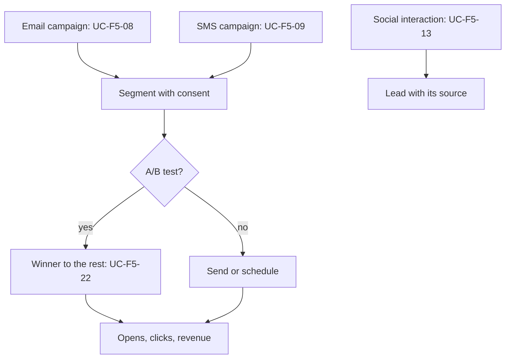

🏠 [Specs](../../../README.md) › 🧩 [Functional capabilities](../../README.md) ›
📣 [F5 Social media and marketing](../README.md) › 🔀 [Flows](README.md) › 🔀 FL-F5-05 Email and SMS campaigns

# 🔀 FL-F5-05 Email and SMS campaigns

**Status:** ✅ specified

## Summary

Email and SMS campaigns to consented segments, and social interactions turned into leads. Journeys, events and surveys
moved to their own flows (D462).

## Personas

- [U03 Sales](../../../01-users/personas/u03-sales.md)
- [U12 Marketing and communication](../../../01-users/personas/u12-marketing.md)

## Flowchart

## Sequence diagram

See each use case.

## Steps

| Step | Persona | Screen | Use case | What happens |
|---|---|---|---|---|
| 1 | [U12](../../../01-users/personas/u12-marketing.md) | [S-F5-08](../screens/05-benchmark-additions/s-f05-08-email-campaign.md) | [UC-F5-08](../use-cases/05-benchmark-additions/uc-f05-08-run-email-campaigns.md) | Build, test and send an email campaign |
| 2 | [U12](../../../01-users/personas/u12-marketing.md) | [S-F5-09](../screens/05-benchmark-additions/s-f05-09-sms-campaign.md) | [UC-F5-09](../use-cases/05-benchmark-additions/uc-f05-09-send-sms-campaigns.md) | Send an SMS campaign |
| 3 | [U03](../../../01-users/personas/u03-sales.md) | [S-F5-13](../screens/05-benchmark-additions/s-f05-13-social-leads.md) | [UC-F5-13](../use-cases/05-benchmark-additions/uc-f05-13-turn-social-interactions-into-leads.md) | Turn a social interaction into a lead |

### Entities and screens

| Entity | States in this flow | Shown at step and screen | Aggregated view |
|---|---|---|---|
| [E-F5-05 Email or SMS campaign](../data/e-f05-05-email-or-sms-campaign.md) | Draft, Scheduled, Sent | 1 [S-F5-08](../screens/05-benchmark-additions/s-f05-08-email-campaign.md); 2 [S-F5-09](../screens/05-benchmark-additions/s-f05-09-sms-campaign.md) | Email or SMS campaigns |
| [E-F5-09 Contact segment](../data/e-f05-09-contact-segment.md) | Active, Archived | Shown elsewhere: [S-F5-14 Segments](../screens/06-audiences-consent-and-journeys/s-f05-14-segments.md) | Contact segments |
| [E-F5-10 Consent and suppression record](../data/e-f05-10-consent-and-suppression-record.md) | Given, Withdrawn, Suppressed | Shown elsewhere: [S-F5-15 Consent register](../screens/06-audiences-consent-and-journeys/s-f05-15-consent-register.md) | Consent and suppression records |
| [E-F5-16 A/B test](../data/e-f05-16-a-b-test.md) | Running | Shown elsewhere: [S-F5-22 A/B test](../screens/09-brand-tests-and-return-on-investment/s-f05-22-a-b-test.md) | A/B tests |
| [E-F5-04 Social message](../data/e-f05-04-social-message.md) | New, Answered, Turned into a request, Hidden | Shown elsewhere: [S-F5-05 Social inbox](../screens/03-inbox-and-statistics/s-f05-05-social-inbox.md) | Social messages |
| [E-F6-20 Lead](../../f06-customers-and-sales/data/e-f06-20-lead.md) | Active | 3 [S-F5-13](../screens/05-benchmark-additions/s-f05-13-social-leads.md) | Leads |

## Errors

A sending domain not verified, no consented contact, SMS credit exhausted (BR-F5-08, BR-F5-11).

## Images

Every step and error, for each persona taking part, in light and dark mode (D120). Steps are numbered as in the Steps
table; E rows are the error cases.

| Step | Persona | Device | Light | Dark |
|---|---|---|---|---|
| 1 | U12 | desktop | [light](../images/05-benchmark-additions/u12-marketing/1-email-desktop-light.png) | [dark](../images/05-benchmark-additions/u12-marketing/1-email-desktop-dark.png) |
| 1 | U12 | phone | [light](../images/05-benchmark-additions/u12-marketing/1-email-phone-light.png) | [dark](../images/05-benchmark-additions/u12-marketing/1-email-phone-dark.png) |
| 2 | U12 | desktop | [light](../images/05-benchmark-additions/u12-marketing/2-sms-desktop-light.png) | [dark](../images/05-benchmark-additions/u12-marketing/2-sms-desktop-dark.png) |
| 2 | U12 | phone | [light](../images/05-benchmark-additions/u12-marketing/2-sms-phone-light.png) | [dark](../images/05-benchmark-additions/u12-marketing/2-sms-phone-dark.png) |
| 3 | U12 | desktop | [light](../images/05-benchmark-additions/u12-marketing/3-journey-desktop-light.png) | [dark](../images/05-benchmark-additions/u12-marketing/3-journey-desktop-dark.png) |
| 3 | U03 | desktop | [light](../images/05-benchmark-additions/u03-sales/3-journey-desktop-light.png) | [dark](../images/05-benchmark-additions/u03-sales/3-journey-desktop-dark.png) |
| 3 | U03 | phone | [light](../images/05-benchmark-additions/u03-sales/3-journey-phone-light.png) | [dark](../images/05-benchmark-additions/u03-sales/3-journey-phone-dark.png) |
| 3 | U03 | tablet | [light](../images/05-benchmark-additions/u03-sales/3-journey-tablet-light.png) | [dark](../images/05-benchmark-additions/u03-sales/3-journey-tablet-dark.png) |
| 4 | U12 | desktop | [light](../images/05-benchmark-additions/u12-marketing/4-event-desktop-light.png) | [dark](../images/05-benchmark-additions/u12-marketing/4-event-desktop-dark.png) |
| 5 | U12 | desktop | [light](../images/05-benchmark-additions/u12-marketing/5-survey-desktop-light.png) | [dark](../images/05-benchmark-additions/u12-marketing/5-survey-desktop-dark.png) |
| 6 | U12 | desktop | [light](../images/05-benchmark-additions/u12-marketing/6-social-leads-desktop-light.png) | [dark](../images/05-benchmark-additions/u12-marketing/6-social-leads-desktop-dark.png) |
| E1 | U12 | desktop | [light](../images/05-benchmark-additions/u12-marketing/e1-no-consent-desktop-light.png) | [dark](../images/05-benchmark-additions/u12-marketing/e1-no-consent-desktop-dark.png) |
| E1 | U12 | phone | [light](../images/05-benchmark-additions/u12-marketing/e1-no-consent-phone-light.png) | [dark](../images/05-benchmark-additions/u12-marketing/e1-no-consent-phone-dark.png) |

## Open questions

None.

---

⬅️ [FL-F5-04 Connect accounts](fl-f05-04-connect-accounts.md) · ⬆️ [Up](README.md) ·
➡️ [FL-F5-06 Audiences, consent and journeys](fl-f05-06-audiences-consent-and-journeys.md)
