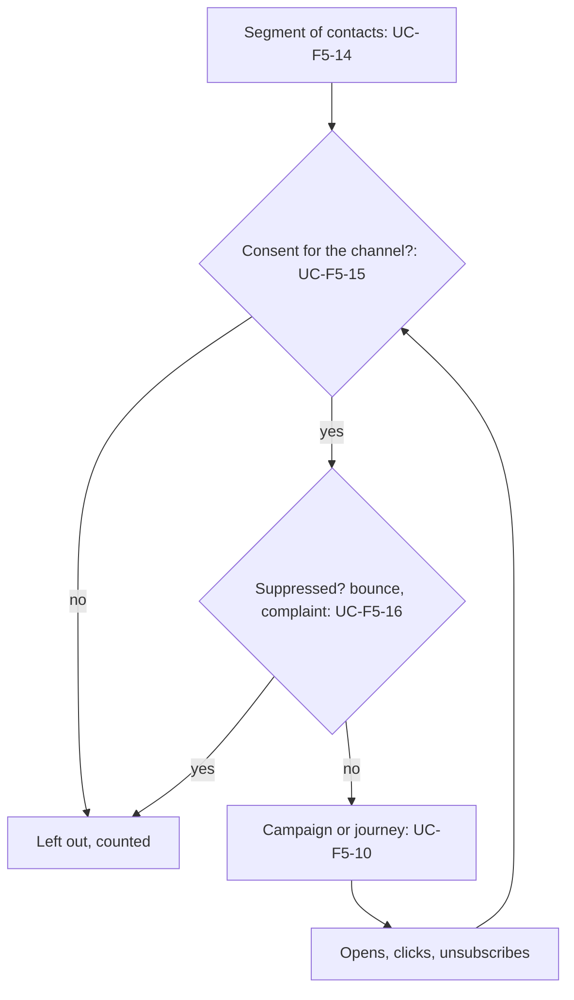

🏠 [Specs](../../../README.md) › 🧩 [Functional capabilities](../../README.md) ›
📣 [F5 Social media and marketing](../README.md) › 🔀 [Flows](README.md) › 🔀 FL-F5-06 Audiences, consent and journeys

# 🔀 FL-F5-06 Audiences, consent and journeys

**Status:** ✅ specified

## Summary

Who receives marketing: segments of contacts, consent proven per channel, deliverability kept healthy, and journeys that
react to what contacts do.

## Personas

- [U12 Marketing and communication](../../../01-users/personas/u12-marketing.md)

## Flowchart

## Sequence diagram

- [UC-F5-14 Build a segment of contacts](../use-cases/06-audiences-consent-and-journeys/uc-f05-14-build-a-segment-of-contacts.md#sequence-diagram)

## Steps

| Step | Persona | Screen | Use case | What happens |
|---|---|---|---|---|
| 1 | [U12](../../../01-users/personas/u12-marketing.md) | [S-F5-14](../screens/06-audiences-consent-and-journeys/s-f05-14-segments.md) | [UC-F5-14](../use-cases/06-audiences-consent-and-journeys/uc-f05-14-build-a-segment-of-contacts.md) | Build a segment of contacts |
| 2 | [U12](../../../01-users/personas/u12-marketing.md) | [S-F5-15](../screens/06-audiences-consent-and-journeys/s-f05-15-consent-register.md) | [UC-F5-15](../use-cases/06-audiences-consent-and-journeys/uc-f05-15-record-and-prove-consent.md) | Check and prove consent per channel |
| 3 | [U12](../../../01-users/personas/u12-marketing.md) | [S-F5-16](../screens/06-audiences-consent-and-journeys/s-f05-16-deliverability.md) | [UC-F5-16](../use-cases/06-audiences-consent-and-journeys/uc-f05-16-keep-emails-delivered.md) | Handle bounces, complaints and the sending domain |
| 4 | [U12](../../../01-users/personas/u12-marketing.md) | [S-F5-10](../screens/06-audiences-consent-and-journeys/s-f05-10-journey-designer.md) | [UC-F5-10](../use-cases/06-audiences-consent-and-journeys/uc-f05-10-automate-marketing-journeys.md) | Run a journey on the segment |

### Entities and screens

| Entity | States in this flow | Shown at step and screen | Aggregated view |
|---|---|---|---|
| [E-F5-09 Contact segment](../data/e-f05-09-contact-segment.md) | Active, Archived | 1 [S-F5-14](../screens/06-audiences-consent-and-journeys/s-f05-14-segments.md) | Contact segments |
| [E-F5-18 Contact](../data/e-f05-18-contact.md) | Active | 1 [S-F5-14](../screens/06-audiences-consent-and-journeys/s-f05-14-segments.md); 2 [S-F5-15](../screens/06-audiences-consent-and-journeys/s-f05-15-consent-register.md) | Contacts |
| [E-F5-10 Consent and suppression record](../data/e-f05-10-consent-and-suppression-record.md) | Given, Withdrawn, Suppressed | 1 [S-F5-14](../screens/06-audiences-consent-and-journeys/s-f05-14-segments.md); 2 [S-F5-15](../screens/06-audiences-consent-and-journeys/s-f05-15-consent-register.md); 3 [S-F5-16](../screens/06-audiences-consent-and-journeys/s-f05-16-deliverability.md) | Consent and suppression records |
| [E-F5-05 Email or SMS campaign](../data/e-f05-05-email-or-sms-campaign.md) | Draft, Scheduled, Sent | 3 [S-F5-16](../screens/06-audiences-consent-and-journeys/s-f05-16-deliverability.md) | Email or SMS campaigns |
| [E-F5-06 Journey](../data/e-f05-06-journey.md) | Active | 4 [S-F5-10](../screens/06-audiences-consent-and-journeys/s-f05-10-journey-designer.md) | Journeys |

## Errors

A segment with no consented contact, a sending domain failing its checks, a journey loop (BR-F5-09 to BR-F5-11).

## Images

Every step and error, for each persona taking part, in light and dark mode (D120). Steps are numbered as in the Steps
table; E rows are the error cases.

| Step | Persona | Device | Light | Dark |
|---|---|---|---|---|
| 1 | U12 | desktop | [light](../images/06-audiences-consent-and-journeys/u12-marketing/1-segments-desktop-light.png) | [dark](../images/06-audiences-consent-and-journeys/u12-marketing/1-segments-desktop-dark.png) |
| 1 | U12 | phone | [light](../images/06-audiences-consent-and-journeys/u12-marketing/1-segments-phone-light.png) | [dark](../images/06-audiences-consent-and-journeys/u12-marketing/1-segments-phone-dark.png) |
| 2 | U12 | desktop | [light](../images/06-audiences-consent-and-journeys/u12-marketing/2-consent-register-desktop-light.png) | [dark](../images/06-audiences-consent-and-journeys/u12-marketing/2-consent-register-desktop-dark.png) |
| 2 | U12 | phone | [light](../images/06-audiences-consent-and-journeys/u12-marketing/2-consent-register-phone-light.png) | [dark](../images/06-audiences-consent-and-journeys/u12-marketing/2-consent-register-phone-dark.png) |
| 3 | U12 | desktop | [light](../images/06-audiences-consent-and-journeys/u12-marketing/3-deliverability-desktop-light.png) | [dark](../images/06-audiences-consent-and-journeys/u12-marketing/3-deliverability-desktop-dark.png) |
| 3 | U12 | phone | [light](../images/06-audiences-consent-and-journeys/u12-marketing/3-deliverability-phone-light.png) | [dark](../images/06-audiences-consent-and-journeys/u12-marketing/3-deliverability-phone-dark.png) |
| 4 | U12 | desktop | [light](../images/06-audiences-consent-and-journeys/u12-marketing/4-journey-designer-desktop-light.png) | [dark](../images/06-audiences-consent-and-journeys/u12-marketing/4-journey-designer-desktop-dark.png) |
| 4 | U12 | phone | [light](../images/06-audiences-consent-and-journeys/u12-marketing/4-journey-designer-phone-light.png) | [dark](../images/06-audiences-consent-and-journeys/u12-marketing/4-journey-designer-phone-dark.png) |
| E1 | U12 | desktop | [light](../images/06-audiences-consent-and-journeys/u12-marketing/e1-segments-refused-desktop-light.png) | [dark](../images/06-audiences-consent-and-journeys/u12-marketing/e1-segments-refused-desktop-dark.png) |
| E1 | U12 | phone | [light](../images/06-audiences-consent-and-journeys/u12-marketing/e1-segments-refused-phone-light.png) | [dark](../images/06-audiences-consent-and-journeys/u12-marketing/e1-segments-refused-phone-dark.png) |

## Open questions

None.

---

⬅️ [FL-F5-05 Email and SMS campaigns](fl-f05-05-benchmark-additions.md) · ⬆️ [Up](README.md) ·
➡️ [FL-F5-07 Events and ticketing](fl-f05-07-events-and-ticketing.md)
