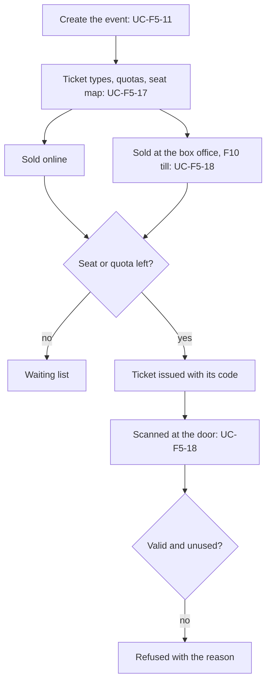

🏠 [Specs](../../../README.md) › 🧩 [Functional capabilities](../../README.md) ›
📣 [F5 Social media and marketing](../README.md) › 🔀 [Flows](README.md) › 🔀 FL-F5-07 Events and ticketing

# 🔀 FL-F5-07 Events and ticketing

**Status:** ✅ specified

## Summary

The one events and ticketing model of D457: an event with sessions, ticket types, quotas and seat maps, sold online, at
the box office through the F10 till and by partners, and checked at the door. SC08 and SC16 use it.

## Personas

- [U09 Customer](../../../01-users/personas/u09-customer.md)
- [U12 Marketing and communication](../../../01-users/personas/u12-marketing.md)
- [U43 Event producer](../../../01-users/personas/u43-event-producer.md)
- [U44 Box-office agent](../../../01-users/personas/u44-box-office-agent.md)

## Flowchart

## Sequence diagram

- [UC-F5-17 Set up ticketing for an event](../use-cases/07-events-and-ticketing/uc-f05-17-set-up-ticketing-for-an-event.md#sequence-diagram)

## Steps

| Step | Persona | Screen | Use case | What happens |
|---|---|---|---|---|
| 1 | [U12](../../../01-users/personas/u12-marketing.md) | [S-F5-11](../screens/07-events-and-ticketing/s-f05-11-event.md) | [UC-F5-11](../use-cases/07-events-and-ticketing/uc-f05-11-organise-events-and-sell-tickets.md) | Create the event and its page |
| 2 | [U43](../../../01-users/personas/u43-event-producer.md) | [S-F5-17](../screens/07-events-and-ticketing/s-f05-17-ticketing-setup.md) | [UC-F5-17](../use-cases/07-events-and-ticketing/uc-f05-17-set-up-ticketing-for-an-event.md) | Set ticket types, quotas and the seat map |
| 3 | [U09](../../../01-users/personas/u09-customer.md) | [S-F5-11](../screens/07-events-and-ticketing/s-f05-11-event.md) | [UC-F5-11](../use-cases/07-events-and-ticketing/uc-f05-11-organise-events-and-sell-tickets.md) | A customer buys tickets online |
| 4 | [U44](../../../01-users/personas/u44-box-office-agent.md) | [S-F5-18](../screens/07-events-and-ticketing/s-f05-18-ticket-scan.md) | [UC-F5-18](../use-cases/07-events-and-ticketing/uc-f05-18-sell-at-the-box-office-and-scan-tickets.md) | Sell at the box office and scan at the door |

### Entities and screens

| Entity | States in this flow | Shown at step and screen | Aggregated view |
|---|---|---|---|
| [E-F5-07 Registration event](../data/e-f05-07-registration-event.md) | Draft, Planned, Cancelled, Published, Approved | 1, 3 [S-F5-11](../screens/07-events-and-ticketing/s-f05-11-event.md); 2 [S-F5-17](../screens/07-events-and-ticketing/s-f05-17-ticketing-setup.md) | Registration events |
| [E-F5-11 Ticket type and seat map](../data/e-f05-11-ticket-type-and-seat-map.md) | Draft, Closed | 1, 3 [S-F5-11](../screens/07-events-and-ticketing/s-f05-11-event.md); 2 [S-F5-17](../screens/07-events-and-ticketing/s-f05-17-ticketing-setup.md); 4 [S-F5-18](../screens/07-events-and-ticketing/s-f05-18-ticket-scan.md) | Ticket type and seat maps |
| [E-F5-12 Event ticket](../data/e-f05-12-event-ticket.md) | Sold, Scanned | 4 [S-F5-18](../screens/07-events-and-ticketing/s-f05-18-ticket-scan.md) | Event tickets |
| [E-F10-01 Point of sale](../../f10-point-of-sale/data/e-f10-01-point-of-sale.md) | Active | Shown elsewhere: [S-F10-15 Point of sale settings](../../f10-point-of-sale/screens/07-set-up-and-report/s-f10-15-point-of-sale-settings.md) | Point of sales |
| [E-F5-20 Waiting list](../data/e-f05-20-waiting-list.md) | Active | 1, 3 [S-F5-11](../screens/07-events-and-ticketing/s-f05-11-event.md); 2 [S-F5-17](../screens/07-events-and-ticketing/s-f05-17-ticketing-setup.md) | Waiting lists |

## Errors

Sold out, a seat taken by another channel, a ticket already scanned (BR-F5-12, BR-F5-13).

## Images

Every step and error, for each persona taking part, in light and dark mode (D120). Steps are numbered as in the Steps
table; E rows are the error cases.

| Step | Persona | Device | Light | Dark |
|---|---|---|---|---|
| 1 | U12 | desktop | [light](../images/07-events-and-ticketing/u12-marketing/1-event-desktop-light.png) | [dark](../images/07-events-and-ticketing/u12-marketing/1-event-desktop-dark.png) |
| 1 | U12 | phone | [light](../images/07-events-and-ticketing/u12-marketing/1-event-phone-light.png) | [dark](../images/07-events-and-ticketing/u12-marketing/1-event-phone-dark.png) |
| 2 | U43 | desktop | [light](../images/07-events-and-ticketing/u43-event-producer/2-ticketing-setup-desktop-light.png) | [dark](../images/07-events-and-ticketing/u43-event-producer/2-ticketing-setup-desktop-dark.png) |
| 2 | U43 | phone | [light](../images/07-events-and-ticketing/u43-event-producer/2-ticketing-setup-phone-light.png) | [dark](../images/07-events-and-ticketing/u43-event-producer/2-ticketing-setup-phone-dark.png) |
| 3 | U09 | phone | [light](../images/07-events-and-ticketing/u09-customer/3-event-phone-light.png) | [dark](../images/07-events-and-ticketing/u09-customer/3-event-phone-dark.png) |
| 4 | U44 | desktop | [light](../images/07-events-and-ticketing/u44-box-office-agent/4-ticket-scan-desktop-light.png) | [dark](../images/07-events-and-ticketing/u44-box-office-agent/4-ticket-scan-desktop-dark.png) |
| 4 | U44 | phone | [light](../images/07-events-and-ticketing/u44-box-office-agent/4-ticket-scan-phone-light.png) | [dark](../images/07-events-and-ticketing/u44-box-office-agent/4-ticket-scan-phone-dark.png) |
| E1 | U12 | desktop | [light](../images/07-events-and-ticketing/u12-marketing/e1-event-refused-desktop-light.png) | [dark](../images/07-events-and-ticketing/u12-marketing/e1-event-refused-desktop-dark.png) |
| E1 | U12 | phone | [light](../images/07-events-and-ticketing/u12-marketing/e1-event-refused-phone-light.png) | [dark](../images/07-events-and-ticketing/u12-marketing/e1-event-refused-phone-dark.png) |

## Open questions

None.

---

⬅️ [FL-F5-06 Audiences, consent and journeys](fl-f05-06-audiences-consent-and-journeys.md) · ⬆️ [Up](README.md) ·
➡️ [FL-F5-08 Pages, forms, surveys and WhatsApp](fl-f05-08-pages-forms-surveys-and-whatsapp.md)
