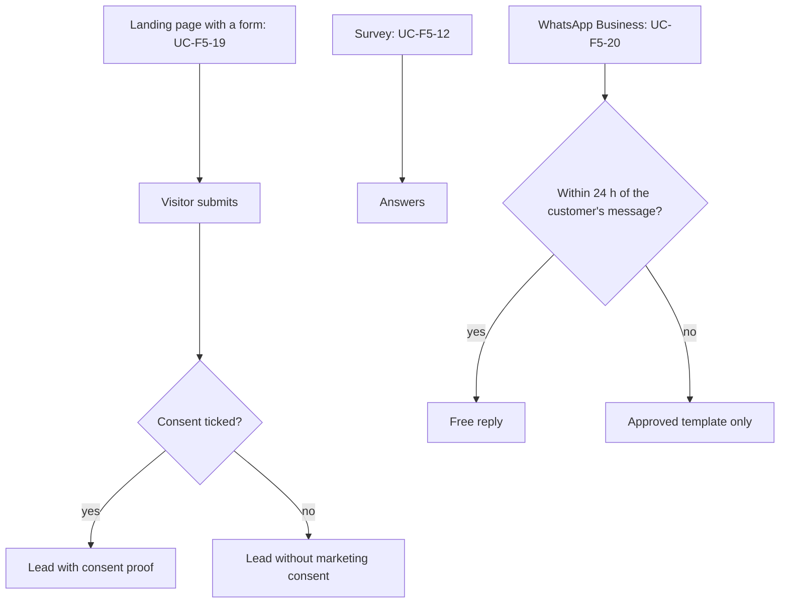

🏠 [Specs](../../../README.md) › 🧩 [Functional capabilities](../../README.md) ›
📣 [F5 Social media and marketing](../README.md) › 🔀 [Flows](README.md) › 🔀 FL-F5-08 Pages, forms, surveys and WhatsApp

# 🔀 FL-F5-08 Pages, forms, surveys and WhatsApp

**Status:** ✅ specified

## Summary

Landing pages with forms that create leads with their consent, surveys, and conversations on WhatsApp Business.

## Personas

- [U09 Customer](../../../01-users/personas/u09-customer.md)
- [U12 Marketing and communication](../../../01-users/personas/u12-marketing.md)

## Flowchart

## Sequence diagram

- [UC-F5-19 Publish a landing page with a form](../use-cases/08-pages-forms-surveys-and-whatsapp/uc-f05-19-publish-a-landing-page-with-a-form.md#sequence-diagram)

## Steps

| Step | Persona | Screen | Use case | What happens |
|---|---|---|---|---|
| 1 | [U12](../../../01-users/personas/u12-marketing.md) | [S-F5-19](../screens/08-pages-forms-surveys-and-whatsapp/s-f05-19-landing-page-editor.md) | [UC-F5-19](../use-cases/08-pages-forms-surveys-and-whatsapp/uc-f05-19-publish-a-landing-page-with-a-form.md) | Publish a landing page with a form |
| 2 | [U09](../../../01-users/personas/u09-customer.md) | [S-F5-19](../screens/08-pages-forms-surveys-and-whatsapp/s-f05-19-landing-page-editor.md) | [UC-F5-19](../use-cases/08-pages-forms-surveys-and-whatsapp/uc-f05-19-publish-a-landing-page-with-a-form.md) | A visitor submits the form |
| 3 | [U12](../../../01-users/personas/u12-marketing.md) | [S-F5-12](../screens/08-pages-forms-surveys-and-whatsapp/s-f05-12-survey.md) | [UC-F5-12](../use-cases/08-pages-forms-surveys-and-whatsapp/uc-f05-12-run-surveys-and-live-polls.md) | Run a survey |
| 4 | [U12](../../../01-users/personas/u12-marketing.md) | [S-F5-20](../screens/08-pages-forms-surveys-and-whatsapp/s-f05-20-whatsapp-business.md) | [UC-F5-20](../use-cases/08-pages-forms-surveys-and-whatsapp/uc-f05-20-message-customers-on-whatsapp-business.md) | Answer and message customers on WhatsApp |

### Entities and screens

| Entity | States in this flow | Shown at step and screen | Aggregated view |
|---|---|---|---|
| [E-F5-13 Landing page and form](../data/e-f05-13-landing-page-and-form.md) | Draft, Published | 1, 2 [S-F5-19](../screens/08-pages-forms-surveys-and-whatsapp/s-f05-19-landing-page-editor.md) | Landing page and forms |
| [E-F5-10 Consent and suppression record](../data/e-f05-10-consent-and-suppression-record.md) | Given, Withdrawn, Suppressed | 1, 2 [S-F5-19](../screens/08-pages-forms-surveys-and-whatsapp/s-f05-19-landing-page-editor.md) | Consent and suppression records |
| [E-F6-20 Lead](../../f06-customers-and-sales/data/e-f06-20-lead.md) | Active | 1, 2 [S-F5-19](../screens/08-pages-forms-surveys-and-whatsapp/s-f05-19-landing-page-editor.md) | Leads |
| [E-F5-08 Survey](../data/e-f05-08-survey.md) | Draft, Sent, Closed | 3 [S-F5-12](../screens/08-pages-forms-surveys-and-whatsapp/s-f05-12-survey.md) | Surveys |
| [E-F5-02 Social account](../data/e-f05-02-social-account.md) | Active | Shown elsewhere: [S-F5-07 Social accounts](../screens/04-connect-accounts/s-f05-07-social-accounts.md) | Social accounts |
| [E-F5-04 Social message](../data/e-f05-04-social-message.md) | New, Answered, Turned into a request, Hidden | 4 [S-F5-20](../screens/08-pages-forms-surveys-and-whatsapp/s-f05-20-whatsapp-business.md) | Social messages |
| [E-F5-14 WhatsApp template](../data/e-f05-14-whatsapp-template.md) | Draft, Submitted, Refused, Approved | 4 [S-F5-20](../screens/08-pages-forms-surveys-and-whatsapp/s-f05-20-whatsapp-business.md) | WhatsApp templates |

## Errors

A form without a consent text, a spam submission, a WhatsApp template refused (BR-F5-14, BR-F5-15).

## Images

Every step and error, for each persona taking part, in light and dark mode (D120). Steps are numbered as in the Steps
table; E rows are the error cases.

| Step | Persona | Device | Light | Dark |
|---|---|---|---|---|
| 1 | U12 | desktop | [light](../images/08-pages-forms-surveys-and-whatsapp/u12-marketing/1-landing-page-editor-desktop-light.png) | [dark](../images/08-pages-forms-surveys-and-whatsapp/u12-marketing/1-landing-page-editor-desktop-dark.png) |
| 1 | U12 | phone | [light](../images/08-pages-forms-surveys-and-whatsapp/u12-marketing/1-landing-page-editor-phone-light.png) | [dark](../images/08-pages-forms-surveys-and-whatsapp/u12-marketing/1-landing-page-editor-phone-dark.png) |
| 2 | U09 | phone | [light](../images/08-pages-forms-surveys-and-whatsapp/u09-customer/2-landing-page-editor-phone-light.png) | [dark](../images/08-pages-forms-surveys-and-whatsapp/u09-customer/2-landing-page-editor-phone-dark.png) |
| 3 | U12 | desktop | [light](../images/08-pages-forms-surveys-and-whatsapp/u12-marketing/3-survey-desktop-light.png) | [dark](../images/08-pages-forms-surveys-and-whatsapp/u12-marketing/3-survey-desktop-dark.png) |
| 3 | U12 | phone | [light](../images/08-pages-forms-surveys-and-whatsapp/u12-marketing/3-survey-phone-light.png) | [dark](../images/08-pages-forms-surveys-and-whatsapp/u12-marketing/3-survey-phone-dark.png) |
| 4 | U12 | desktop | [light](../images/08-pages-forms-surveys-and-whatsapp/u12-marketing/4-whatsapp-business-desktop-light.png) | [dark](../images/08-pages-forms-surveys-and-whatsapp/u12-marketing/4-whatsapp-business-desktop-dark.png) |
| 4 | U12 | phone | [light](../images/08-pages-forms-surveys-and-whatsapp/u12-marketing/4-whatsapp-business-phone-light.png) | [dark](../images/08-pages-forms-surveys-and-whatsapp/u12-marketing/4-whatsapp-business-phone-dark.png) |
| E1 | U12 | desktop | [light](../images/08-pages-forms-surveys-and-whatsapp/u12-marketing/e1-landing-page-editor-refused-desktop-light.png) | [dark](../images/08-pages-forms-surveys-and-whatsapp/u12-marketing/e1-landing-page-editor-refused-desktop-dark.png) |
| E1 | U12 | phone | [light](../images/08-pages-forms-surveys-and-whatsapp/u12-marketing/e1-landing-page-editor-refused-phone-light.png) | [dark](../images/08-pages-forms-surveys-and-whatsapp/u12-marketing/e1-landing-page-editor-refused-phone-dark.png) |

## Open questions

None.

---

⬅️ [FL-F5-07 Events and ticketing](fl-f05-07-events-and-ticketing.md) · ⬆️ [Up](README.md) ·
➡️ [FL-F5-09 Brand, tests and return on investment](fl-f05-09-brand-tests-and-return-on-investment.md)
