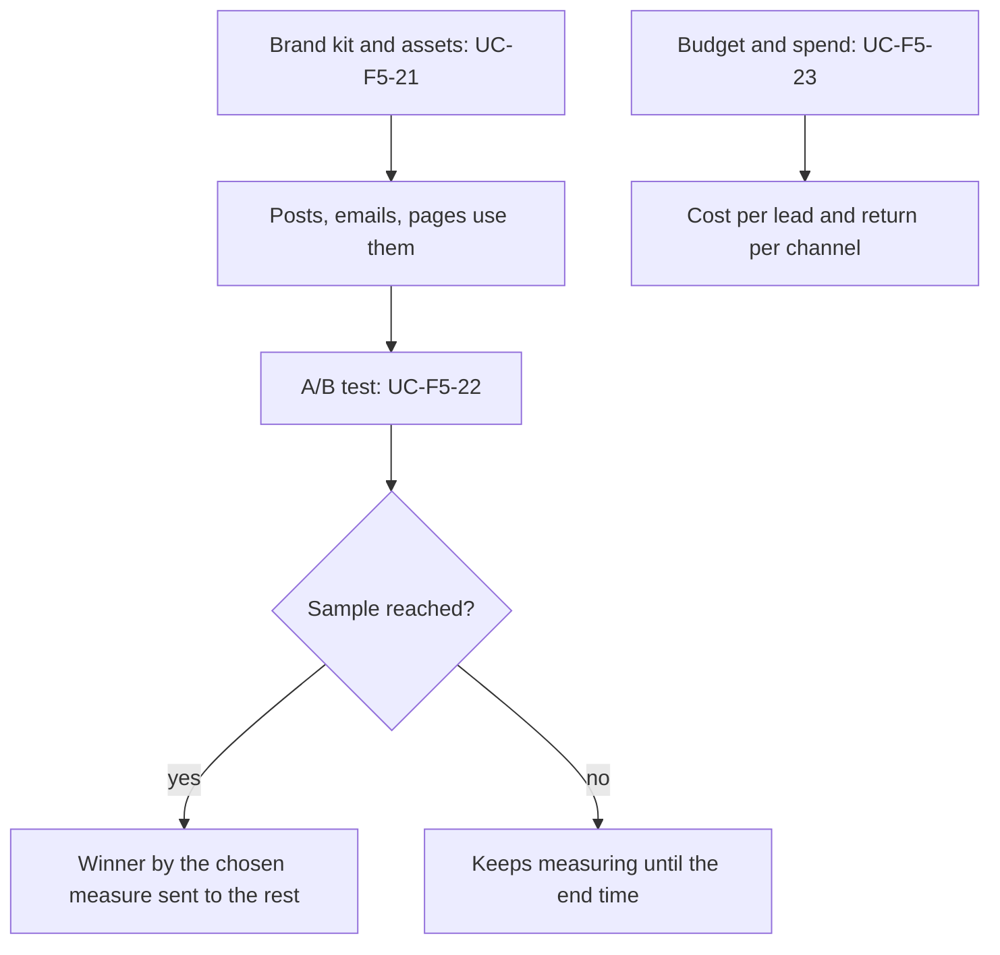

🏠 [Specs](../../../README.md) › 🧩 [Functional capabilities](../../README.md) ›
📣 [F5 Social media and marketing](../README.md) › 🔀 [Flows](README.md) ›
🔀 FL-F5-09 Brand, tests and return on investment

# 🔀 FL-F5-09 Brand, tests and return on investment

**Status:** ✅ specified

## Summary

One brand kit and asset library for every channel, A/B tests on posts, emails and SMS with a winner rule, and each
campaign's budget, cost per lead and return.

## Personas

- [U12 Marketing and communication](../../../01-users/personas/u12-marketing.md)
- [U13 Owner](../../../01-users/personas/u13-owner.md)

## Flowchart

## Sequence diagram

- [UC-F5-22 A/B test posts, emails and SMS](../use-cases/09-brand-tests-and-return-on-investment/uc-f05-22-a-b-test-posts-emails-and-sms.md#sequence-diagram)

## Steps

| Step | Persona | Screen | Use case | What happens |
|---|---|---|---|---|
| 1 | [U12](../../../01-users/personas/u12-marketing.md) | [S-F5-21](../screens/09-brand-tests-and-return-on-investment/s-f05-21-brand-kit.md) | [UC-F5-21](../use-cases/09-brand-tests-and-return-on-investment/uc-f05-21-keep-the-brand-kit-and-asset-library.md) | Keep the brand kit and the asset library |
| 2 | [U12](../../../01-users/personas/u12-marketing.md) | [S-F5-22](../screens/09-brand-tests-and-return-on-investment/s-f05-22-a-b-test.md) | [UC-F5-22](../use-cases/09-brand-tests-and-return-on-investment/uc-f05-22-a-b-test-posts-emails-and-sms.md) | Test two variants and send the winner |
| 3 | [U13](../../../01-users/personas/u13-owner.md) | [S-F5-23](../screens/09-brand-tests-and-return-on-investment/s-f05-23-budget-and-return.md) | [UC-F5-23](../use-cases/09-brand-tests-and-return-on-investment/uc-f05-23-track-campaign-budget-cost-per-lead-and-return.md) | Read the budget, cost per lead and return |

### Entities and screens

| Entity | States in this flow | Shown at step and screen | Aggregated view |
|---|---|---|---|
| [E-F5-15 Brand asset](../data/e-f05-15-brand-asset.md) | Draft, Expired | 1 [S-F5-21](../screens/09-brand-tests-and-return-on-investment/s-f05-21-brand-kit.md) | Brand assets |
| [E-F5-01 Post](../data/e-f05-01-post.md) | Draft, To approve, Refused, Scheduled, Published, Held | Shown elsewhere: [S-F5-01 Post composer](../screens/01-publish-a-post/s-f05-01-post-composer.md) | Posts |
| [E-F5-05 Email or SMS campaign](../data/e-f05-05-email-or-sms-campaign.md) | Draft, Scheduled, Sent | 3 [S-F5-23](../screens/09-brand-tests-and-return-on-investment/s-f05-23-budget-and-return.md) | Email or SMS campaigns |
| [E-F5-13 Landing page and form](../data/e-f05-13-landing-page-and-form.md) | Draft, Published | Shown elsewhere: [S-F5-19 Landing page editor](../screens/08-pages-forms-surveys-and-whatsapp/s-f05-19-landing-page-editor.md) | Landing page and forms |
| [E-F5-16 A/B test](../data/e-f05-16-a-b-test.md) | Running | 2 [S-F5-22](../screens/09-brand-tests-and-return-on-investment/s-f05-22-a-b-test.md) | A/B tests |
| [E-F5-17 Campaign budget](../data/e-f05-17-campaign-budget.md) | Open, Closed | 3 [S-F5-23](../screens/09-brand-tests-and-return-on-investment/s-f05-23-budget-and-return.md) | Campaign budgets |

## Errors

An asset without its rights, a test without enough contacts, spend with no traced lead (BR-F5-16, BR-F5-17).

## Images

Every step and error, for each persona taking part, in light and dark mode (D120). Steps are numbered as in the Steps
table; E rows are the error cases.

| Step | Persona | Device | Light | Dark |
|---|---|---|---|---|
| 1 | U12 | desktop | [light](../images/09-brand-tests-and-return-on-investment/u12-marketing/1-brand-kit-desktop-light.png) | [dark](../images/09-brand-tests-and-return-on-investment/u12-marketing/1-brand-kit-desktop-dark.png) |
| 1 | U12 | phone | [light](../images/09-brand-tests-and-return-on-investment/u12-marketing/1-brand-kit-phone-light.png) | [dark](../images/09-brand-tests-and-return-on-investment/u12-marketing/1-brand-kit-phone-dark.png) |
| 2 | U12 | desktop | [light](../images/09-brand-tests-and-return-on-investment/u12-marketing/2-a-b-test-desktop-light.png) | [dark](../images/09-brand-tests-and-return-on-investment/u12-marketing/2-a-b-test-desktop-dark.png) |
| 2 | U12 | phone | [light](../images/09-brand-tests-and-return-on-investment/u12-marketing/2-a-b-test-phone-light.png) | [dark](../images/09-brand-tests-and-return-on-investment/u12-marketing/2-a-b-test-phone-dark.png) |
| 3 | U13 | desktop | [light](../images/09-brand-tests-and-return-on-investment/u13-owner/3-budget-and-return-desktop-light.png) | [dark](../images/09-brand-tests-and-return-on-investment/u13-owner/3-budget-and-return-desktop-dark.png) |
| 3 | U13 | phone | [light](../images/09-brand-tests-and-return-on-investment/u13-owner/3-budget-and-return-phone-light.png) | [dark](../images/09-brand-tests-and-return-on-investment/u13-owner/3-budget-and-return-phone-dark.png) |
| E1 | U12 | desktop | [light](../images/09-brand-tests-and-return-on-investment/u12-marketing/e1-brand-kit-refused-desktop-light.png) | [dark](../images/09-brand-tests-and-return-on-investment/u12-marketing/e1-brand-kit-refused-desktop-dark.png) |
| E1 | U12 | phone | [light](../images/09-brand-tests-and-return-on-investment/u12-marketing/e1-brand-kit-refused-phone-light.png) | [dark](../images/09-brand-tests-and-return-on-investment/u12-marketing/e1-brand-kit-refused-phone-dark.png) |

## Open questions

None.

---

⬅️ [FL-F5-08 Pages, forms, surveys and WhatsApp](fl-f05-08-pages-forms-surveys-and-whatsapp.md) · ⬆️ [Up](README.md) ·
➡️ [FL-F5-10 Cards, referrals, push and listening](fl-f05-10-referrals-push-and-listening.md)
