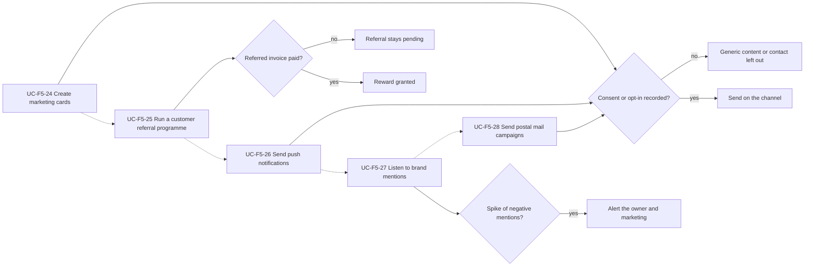
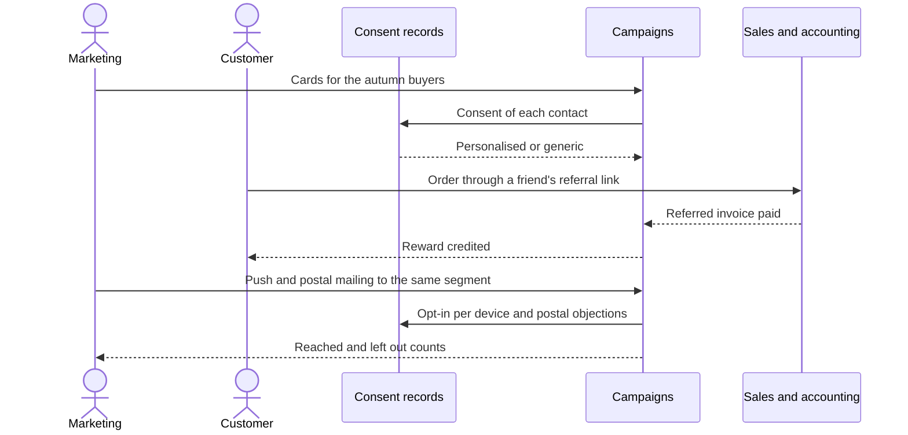

🏠 [Specs](../../../README.md) › 🧩 [Functional capabilities](../../README.md) ›
📣 [F5 Social media and marketing](../README.md) › 🔀 [Flows](README.md) ›
🔀 FL-F5-10 Cards, referrals, push and listening

# 🔀 FL-F5-10 Cards, referrals, push and listening

**Status:** 🔄 waiting for the owner

## Summary

Marketing builds personalised cards from the brand kit, runs a customer referral programme paid only on paid sales,
sends push notifications to the devices that opted in, listens to public mentions of the brand and sends postal mailings
that honour opt-outs. Every channel checks the recorded consent first
([BR-F5-08](../business-rules/br-f05-08-marketing-needs-consent.md)), and the customer's part of the referral and push
runs on a phone ([D524](../../../06-decisions/f05-social-media/d524-benchmark-gaps-f05-social-media.md)).

## Personas

- [U12 Marketing and communication](../../../01-users/personas/u12-marketing.md)
- [U09 Customer](../../../01-users/personas/u09-customer.md), who shares a referral link and receives pushes
- [U13 Owner](../../../01-users/personas/u13-owner.md), who reads the alerts of brand listening

## Flowchart

## Sequence diagram

## Steps

| Step | Persona | Screen | Use case | What happens |
|---|---|---|---|---|
| 1 | [U12](../../../01-users/personas/u12-marketing.md) | [S-F5-24](../screens/10-referrals-push-and-listening/s-f05-24-marketing-cards.md) | [UC-F5-24](../use-cases/10-referrals-push-and-listening/uc-f05-24-create-marketing-cards.md) | Marketing builds cards from a brand template; each merge field is checked against each contact's consent |
| 2 | [U12](../../../01-users/personas/u12-marketing.md) | [S-F5-25](../screens/10-referrals-push-and-listening/s-f05-25-referral-programme.md) | [UC-F5-25](../use-cases/10-referrals-push-and-listening/uc-f05-25-run-a-customer-referral-programme.md) | A customer shares a referral link from their phone; a friend's order is recorded as a pending referral and the reward is granted when the referred invoice is paid |
| 3 | [U12](../../../01-users/personas/u12-marketing.md) | [S-F5-26](../screens/10-referrals-push-and-listening/s-f05-26-push-campaign.md) | [UC-F5-26](../use-cases/10-referrals-push-and-listening/uc-f05-26-send-push-notifications.md) | Marketing writes a push; only the devices with an opt-in receive it, within the quiet hours |
| 4 | [U12](../../../01-users/personas/u12-marketing.md) | [S-F5-27](../screens/10-referrals-push-and-listening/s-f05-27-brand-mentions.md) | [UC-F5-27](../use-cases/10-referrals-push-and-listening/uc-f05-27-listen-to-brand-mentions.md) | Marketing reads the public mentions of the brand with their tone, answers some and gets alerts on a spike |
| 5 | [U12](../../../01-users/personas/u12-marketing.md) | [S-F5-28](../screens/10-referrals-push-and-listening/s-f05-28-postal-campaign.md) | [UC-F5-28](../use-cases/10-referrals-push-and-listening/uc-f05-28-send-postal-mail-campaigns.md) | Marketing prepares a postal mailing; objections and bad addresses are removed before the file goes to the print partner |

### Entities and screens

| Entity | States in this flow | Shown at step and screen | Aggregated view |
|---|---|---|---|
| [E-F5-21 Marketing card](../data/e-f05-21-marketing-card.md) | Draft, Ready, Sent, Withdrawn | 1 [S-F5-24](../screens/10-referrals-push-and-listening/s-f05-24-marketing-cards.md) | Marketing cards |
| [E-F5-22 Referral](../data/e-f05-22-referral.md) | Pending, Earned, Rejected, Reversed | 2 [S-F5-25](../screens/10-referrals-push-and-listening/s-f05-25-referral-programme.md) | Referrals |
| [E-F5-23 Push campaign](../data/e-f05-23-push-campaign.md) | Draft, Queued, Sent, Cancelled, Closed | 3 [S-F5-26](../screens/10-referrals-push-and-listening/s-f05-26-push-campaign.md) | Push campaigns |
| [E-F5-24 Brand mention](../data/e-f05-24-brand-mention.md) | Collected, Rated, Handled, Deleted at source, Erased | 4 [S-F5-27](../screens/10-referrals-push-and-listening/s-f05-27-brand-mentions.md) | Brand mentions |
| [E-F5-25 Postal campaign](../data/e-f05-25-postal-campaign.md) | Draft, Approved, Sent, Cancelled, Posted, Closed | 5 [S-F5-28](../screens/10-referrals-push-and-listening/s-f05-28-postal-campaign.md) | Postal campaigns |

## Errors

- **E1 A contact has no consent.** The card, push or letter is not made for that contact: the generic card is used or
  the contact is listed as left out with the reason
  ([BR-F5-19](../business-rules/br-f05-19-cards-use-only-consented-personal-data.md), step 1).

## Images

Every step and error, for each persona taking part, in light and dark mode (D120). Steps are numbered as in the Steps
table; E rows are the error cases.

| Step | Persona | Device | Light | Dark |
|---|---|---|---|---|
| 1 | U12 | desktop | [light](../images/10-referrals-push-and-listening/u12-marketing/1-marketing-cards-desktop-light.png) | [dark](../images/10-referrals-push-and-listening/u12-marketing/1-marketing-cards-desktop-dark.png) |
| 1 | U12 | phone | [light](../images/10-referrals-push-and-listening/u12-marketing/1-marketing-cards-phone-light.png) | [dark](../images/10-referrals-push-and-listening/u12-marketing/1-marketing-cards-phone-dark.png) |
| 2 | U12 | desktop | [light](../images/10-referrals-push-and-listening/u12-marketing/2-referral-programme-desktop-light.png) | [dark](../images/10-referrals-push-and-listening/u12-marketing/2-referral-programme-desktop-dark.png) |
| 2 | U09 | phone | [light](../images/10-referrals-push-and-listening/u09-customer/2-referral-programme-phone-light.png) | [dark](../images/10-referrals-push-and-listening/u09-customer/2-referral-programme-phone-dark.png) |
| 2 | U12 | phone | [light](../images/10-referrals-push-and-listening/u12-marketing/2-referral-programme-phone-light.png) | [dark](../images/10-referrals-push-and-listening/u12-marketing/2-referral-programme-phone-dark.png) |
| 3 | U12 | desktop | [light](../images/10-referrals-push-and-listening/u12-marketing/3-push-campaign-desktop-light.png) | [dark](../images/10-referrals-push-and-listening/u12-marketing/3-push-campaign-desktop-dark.png) |
| 3 | U09 | phone | [light](../images/10-referrals-push-and-listening/u09-customer/3-push-campaign-phone-light.png) | [dark](../images/10-referrals-push-and-listening/u09-customer/3-push-campaign-phone-dark.png) |
| 3 | U12 | phone | [light](../images/10-referrals-push-and-listening/u12-marketing/3-push-campaign-phone-light.png) | [dark](../images/10-referrals-push-and-listening/u12-marketing/3-push-campaign-phone-dark.png) |
| 4 | U12 | desktop | [light](../images/10-referrals-push-and-listening/u12-marketing/4-brand-mentions-desktop-light.png) | [dark](../images/10-referrals-push-and-listening/u12-marketing/4-brand-mentions-desktop-dark.png) |
| 4 | U13 | phone | [light](../images/10-referrals-push-and-listening/u13-owner/4-brand-mentions-phone-light.png) | [dark](../images/10-referrals-push-and-listening/u13-owner/4-brand-mentions-phone-dark.png) |
| 4 | U12 | phone | [light](../images/10-referrals-push-and-listening/u12-marketing/4-brand-mentions-phone-light.png) | [dark](../images/10-referrals-push-and-listening/u12-marketing/4-brand-mentions-phone-dark.png) |
| 5 | U12 | desktop | [light](../images/10-referrals-push-and-listening/u12-marketing/5-postal-campaign-desktop-light.png) | [dark](../images/10-referrals-push-and-listening/u12-marketing/5-postal-campaign-desktop-dark.png) |
| 5 | U12 | phone | [light](../images/10-referrals-push-and-listening/u12-marketing/5-postal-campaign-phone-light.png) | [dark](../images/10-referrals-push-and-listening/u12-marketing/5-postal-campaign-phone-dark.png) |
| E1 | U12 | desktop | [light](../images/10-referrals-push-and-listening/u12-marketing/e1-a-contact-has-no-consent-desktop-light.png) | [dark](../images/10-referrals-push-and-listening/u12-marketing/e1-a-contact-has-no-consent-desktop-dark.png) |
| E1 | U12 | phone | [light](../images/10-referrals-push-and-listening/u12-marketing/e1-a-contact-has-no-consent-phone-light.png) | [dark](../images/10-referrals-push-and-listening/u12-marketing/e1-a-contact-has-no-consent-phone-dark.png) |

## Open questions

None.

---

⬅️ [FL-F5-09 Brand, tests and return on investment](fl-f05-09-brand-tests-and-return-on-investment.md) ·
⬆️ [Up](README.md)
