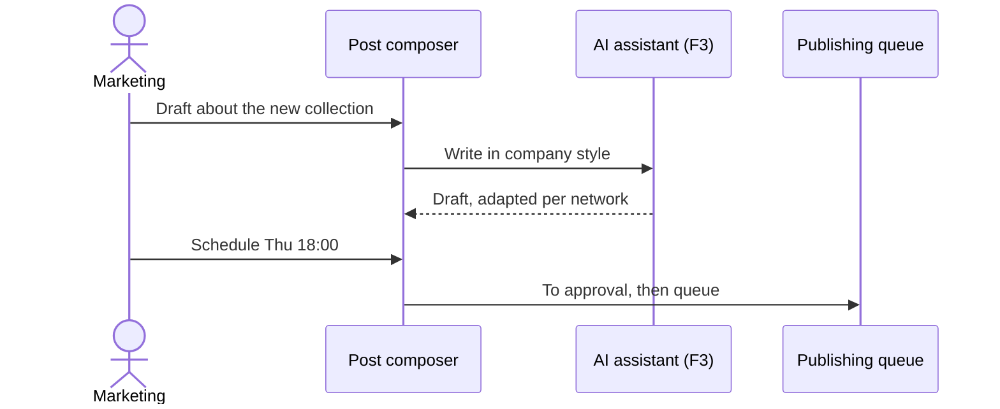

🏠 [Specs](../../../../README.md) › 🧩 [Functional capabilities](../../../README.md) ›
📣 [F5 Social media and marketing](../../README.md) › 📝 [Use cases](../README.md) ›
📝 [Use cases: FL-F5-01 Publish a post](README.md) › 📝 UC-F5-01 Prepare and schedule a post

# 📝 UC-F5-01 Prepare and schedule a post

**Status:** ✅ specified

## Summary

A marketing person writes or asks the AI for a post, adds media, adapts it per network, and schedules it.

## Personas

- [U12 Marketing](../../../../01-users/personas/u12-marketing.md)

## Goal

Posts that go out on time, adapted to each network, in the company's style.

## Trigger

A topic to publish: a product, a project, an event.

## Frequency

Several posts a week.

## Preconditions

Accounts connected (UC-F5-07).

## Postconditions

- **Succeeded:** the post is scheduled and waits for approval.
- **Failed:** the post stays a draft.

## Main flow

1. The marketing person opens the post composer ([S-F5-01](../../screens/01-publish-a-post/s-f05-01-post-composer.md))
   and writes, or asks the AI for a draft from a topic, a product, a project or a meeting, in the company style.
2. They add images or videos from the brand kit,
   [UC-F5-21](../09-brand-tests-and-return-on-investment/uc-f05-21-keep-the-brand-kit-and-asset-library.md), or generate
   them, marked as AI ([BR-F5-04](../../business-rules/br-f05-04-ai-content-is-marked.md)).
3. The post is adapted per network ([BR-F5-03](../../business-rules/br-f05-03-posts-are-adapted-per-network.md)), with
   suggested times and hashtags.
4. They schedule it; it goes to approval ([BR-F5-01](../../business-rules/br-f05-01-posts-need-an-approver.md)) and
   joins the queue within network limits
   ([BR-F5-07](../../business-rules/br-f05-07-posts-queue-within-network-limits.md)).

## Alternative flows

- 1a. Variants are added for an A/B test
  ([UC-F5-22](../09-brand-tests-and-return-on-investment/uc-f05-22-a-b-test-posts-emails-and-sms.md)).
- 4a. No approval on the account: it is scheduled directly.

## Error flows

- 3e. A format a network refuses (video too long): flagged before scheduling.
- 4e. The network unavailable at the time: retried
  ([BR-F3-32](../../../f03-assistant/business-rules/br-f03-32-retry-before-an-error.md)), then the author told.

## Business rules

- [BR-F5-01](../../business-rules/br-f05-01-posts-need-an-approver.md)
- [BR-F5-03](../../business-rules/br-f05-03-posts-are-adapted-per-network.md)
- [BR-F5-04](../../business-rules/br-f05-04-ai-content-is-marked.md)
- [BR-F5-07](../../business-rules/br-f05-07-posts-queue-within-network-limits.md)

## Entities

- [E-F5-01 Post](../../data/e-f05-01-post.md)

## Permissions

Marketing and communication; record rules on contacts apply; the owner reads.

## Notifications

The approver: a post to approve.

## Audit events

Post drafted, scheduled, published, with the AI mention.

## AI involvement

Drafts and images by the AI, marked ([BR-F5-04](../../business-rules/br-f05-04-ai-content-is-marked.md)); a person
schedules.

## API, MCP and A2A exposure

T5 operations of F5 with the caller's rights; the MCP tool of F5; no A2A skill.

## Screens

- [S-F5-01](../../screens/01-publish-a-post/s-f05-01-post-composer.md)

## Flowchart

See [FL-F5-01 Publish a post](../../flows/fl-f05-01-publish-a-post.md#flowchart).

## Sequence diagram

## Acceptance criteria

1. **Given** the example shop chain's new collection **when** marketing asks a draft **then** a draft in the company
   style is adapted for Instagram and LinkedIn.
2. **Given** an AI-generated image **when** it is added **then** the post carries the AI mention.
3. **Given** a 4-minute video for X **when** the post is checked **then** it is flagged as too long for X.
4. **Given** a post scheduled Thursday 18:00 **when** it is approved Wednesday **then** it goes out Thursday 18:00.

## Non-functional notes

Composer opens within 2 seconds.

## Regulatory references

AI content marked,
[CR-FR-056](../../../../10-country-packs/france/ai-and-recording/cr-fr-056-people-know-they-deal-with-an-ai.md).

## Related use cases

F16 (support requests), F6 (leads).

- [UC-F5-21 Keep the brand kit and asset library](../09-brand-tests-and-return-on-investment/uc-f05-21-keep-the-brand-kit-and-asset-library.md)

- [UC-F5-22 A/B test posts, emails and SMS](../09-brand-tests-and-return-on-investment/uc-f05-22-a-b-test-posts-emails-and-sms.md)

## Open questions

None.

---

⬆️ [Up](README.md) · ➡️ [UC-F5-02 Approve a post](uc-f05-02-approve-a-post.md)
