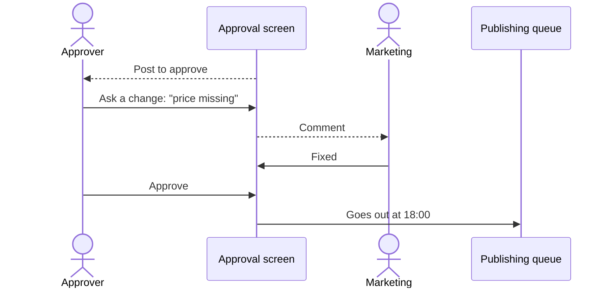

🏠 [Specs](../../../../README.md) › 🧩 [Functional capabilities](../../../README.md) ›
📣 [F5 Social media and marketing](../../README.md) › 📝 [Use cases](../README.md) ›
📝 [Use cases: FL-F5-01 Publish a post](README.md) › 📝 UC-F5-02 Approve a post

# 📝 UC-F5-02 Approve a post

**Status:** ✅ specified

## Summary

The approver reads a scheduled post and approves it, asks for a change with a comment, or refuses it.

## Personas

- [U13 Owner](../../../../01-users/personas/u13-owner.md)
- [U02 Manager](../../../../01-users/personas/u02-manager.md)

## Goal

Nothing goes out in the company's name without a second look.

## Trigger

A post waits for approval.

## Frequency

Several a week.

## Preconditions

Accounts connected (UC-F5-07).

## Postconditions

- **Succeeded:** approved posts go out at their time.
- **Failed:** a refused post goes back to its author with the comment.

## Main flow

1. The approver gets the post to approve ([BR-F5-01](../../business-rules/br-f05-01-posts-need-an-approver.md)) and
   opens it on the approval screen ([S-F5-02](../../screens/01-publish-a-post/s-f05-02-approval.md)), with its preview
   per network.
2. They read the text, images and time.
3. They approve, ask for a change with a comment, or refuse.
4. Approved posts go out at their time; the author is told of the decision.

## Alternative flows

- 1a. No approval set on the account: the step is skipped.
- 3a. The approver edits the text directly; the author is told.

## Error flows

- 4e. The time passed while waiting: rescheduled to the next suggested time, the author told.
- 4e. The network refuses the post: the author is told with the reason.

## Business rules

- [BR-F5-01](../../business-rules/br-f05-01-posts-need-an-approver.md)

## Entities

- [E-F5-01 Post](../../data/e-f05-01-post.md)

## Permissions

The approvers set per account: the owner or a manager.

## Notifications

The author: the decision.

## Audit events

Approved, changed, refused, with comment.

## AI involvement

None: approval is a person's decision.

## API, MCP and A2A exposure

T5 operations of F5 with the caller's rights; the MCP tool of F5; no A2A skill.

## Screens

- [S-F5-02](../../screens/01-publish-a-post/s-f05-02-approval.md)

## Flowchart

See [FL-F5-01 Publish a post](../../flows/fl-f05-01-publish-a-post.md#flowchart).

## Sequence diagram

## Acceptance criteria

1. **Given** a post scheduled 2026-11-20 18:00 **when** the owner approves it at 10:00 **then** it goes out at 18:00.
2. **Given** the same **when** she asks a change "price missing" **then** the author gets the comment and the post
   waits.
3. **Given** approval given at 19:00 **when** the time has passed **then** it is rescheduled to the next suggested time
   and the author told.

## Non-functional notes

Approval works on a phone.

## Regulatory references

AI content marked,
[CR-FR-056](../../../../10-country-packs/france/ai-and-recording/cr-fr-056-people-know-they-deal-with-an-ai.md).

## Related use cases

F16 (support requests), F6 (leads).

## Open questions

None.

---

⬅️ [UC-F5-01 Prepare and schedule a post](uc-f05-01-prepare-and-schedule-a-post.md) · ⬆️ [Up](README.md) ·
➡️ [UC-F5-03 Set up automatic posts](../02-automatic-posts/uc-f05-03-set-up-automatic-posts.md)
