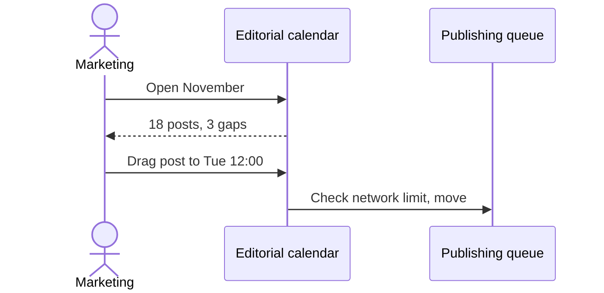

🏠 [Specs](../../../../README.md) › 🧩 [Functional capabilities](../../../README.md) ›
📣 [F5 Social media and marketing](../../README.md) › 📝 [Use cases](../README.md) ›
📝 [Use cases: FL-F5-01 Publish a post](README.md) › 📝 UC-F5-04 Manage the editorial calendar

# 📝 UC-F5-04 Manage the editorial calendar

**Status:** ✅ specified

## Summary

The editorial calendar shows every planned, waiting, published and automatic post across networks, and lets marketing
move them.

## Personas

- [U12 Marketing](../../../../01-users/personas/u12-marketing.md)
- [U13 Owner](../../../../01-users/personas/u13-owner.md)
- [U02 Manager](../../../../01-users/personas/u02-manager.md)

## Goal

See and balance what the company publishes.

## Trigger

Planning the week or month.

## Frequency

Weekly.

## Preconditions

Accounts connected (UC-F5-07).

## Postconditions

- **Succeeded:** posts are moved within network limits.
- **Failed:** a move breaking a limit is refused.

## Main flow

1. The marketing person opens the editorial calendar
   ([S-F5-03](../../screens/02-automatic-posts/s-f05-03-editorial-calendar.md)).
2. Every post shows by day and network with its state.
3. They drag a post to another time, or open it.
4. Gaps and suggested times show; they plan a post into a gap ([UC-F5-01](uc-f05-01-prepare-and-schedule-a-post.md)).

## Alternative flows

- 2a. Filter by network, author or campaign.

## Error flows

- 3e. A move into a network's limit: refused with the reason
  ([BR-F5-07](../../business-rules/br-f05-07-posts-queue-within-network-limits.md)).

## Business rules

- See F5's rules.

## Entities

- [E-F5-01 Post](../../data/e-f05-01-post.md)

## Permissions

Marketing; the owner and managers read.

## Notifications

The author: a post moved.

## Audit events

Posts moved.

## AI involvement

The AI assistant suggests times from past engagement.

## API, MCP and A2A exposure

T5 operations of F5 with the caller's rights; the MCP tool of F5; no A2A skill.

## Screens

- [S-F5-03](../../screens/02-automatic-posts/s-f05-03-editorial-calendar.md)

## Flowchart

See [FL-F5-01 Publish a post](../../flows/fl-f05-01-publish-a-post.md#flowchart).

## Sequence diagram

## Acceptance criteria

1. **Given** 18 posts in November **when** the calendar opens **then** each shows by day, network and state.
2. **Given** a post moved to Tuesday 12:00 **when** it is dropped **then** it is rescheduled and its author told.
3. **Given** a network limit of 3 posts a day already reached **when** a fourth is dropped **then** it is refused with
   the reason.

## Non-functional notes

None.

## Regulatory references

None.

## Related use cases

F16 (support requests), F6 (leads).

## Open questions

None.

---

⬅️ [UC-F5-03 Set up automatic posts](../02-automatic-posts/uc-f05-03-set-up-automatic-posts.md) · ⬆️ [Up](README.md) ·
➡️ [UC-F5-05 Answer comments and messages](../03-inbox-and-statistics/uc-f05-05-answer-comments-and-messages.md)
