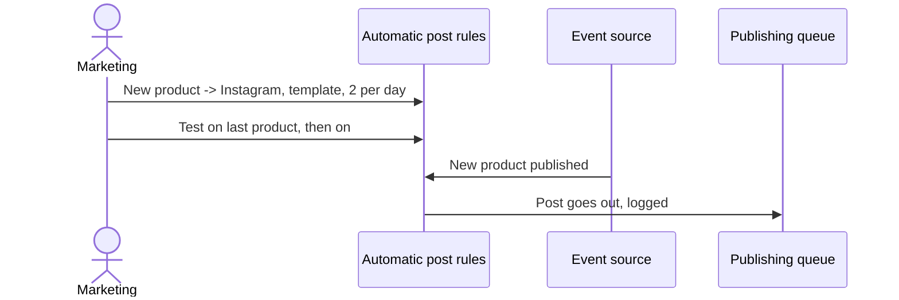

🏠 [Specs](../../../../README.md) › 🧩 [Functional capabilities](../../../README.md) ›
📣 [F5 Social media and marketing](../../README.md) › 📝 [Use cases](../README.md) ›
📝 [Use cases: FL-F5-02 Automatic posts](README.md) › 📝 UC-F5-03 Set up automatic posts

# 📝 UC-F5-03 Set up automatic posts

**Status:** ✅ specified

## Summary

Event types are set to automatic posting with a template and guard rails.

## Personas

- [U12 Marketing](../../../../01-users/personas/u12-marketing.md)
- [U07 Administrator](../../../../01-users/personas/u07-administrator.md)

## Goal

Regular posts about what happens, without writing each one.

## Trigger

Marketing sets a rule; then each event of that type.

## Frequency

Set once; then per event.

## Preconditions

Accounts connected (UC-F5-07).

## Postconditions

- **Succeeded:** posts go out on events, with no approval, logged.
- **Failed:** the rule stays off.

## Main flow

1. The marketing person opens automatic post rules
   ([S-F5-04](../../screens/01-publish-a-post/s-f05-04-automatic-post-rules.md)) and picks an event type: a new product,
   a finished project, a job opening, a review, a feed item
   ([BR-F5-02](../../business-rules/br-f05-02-automatic-posts-follow-their-event-rule.md)).
2. They choose the networks and the template.
3. They set the guard rails (daily limit, words never published) and test on a past event without publishing.
4. They turn it on; when the event happens, the post goes out with no approval, logged.

## Alternative flows

- 4a. The stop switch per account pauses every automatic post.

## Error flows

- 4e. Daily limit reached: the post waits for the next day.
- 4e. A word never to be published: the post is held for approval.

## Business rules

- [BR-F5-02](../../business-rules/br-f05-02-automatic-posts-follow-their-event-rule.md)

## Entities

- [E-F5-01 Post](../../data/e-f05-01-post.md)

- [E-F5-03 Automatic post rule](../../data/e-f05-03-automatic-post-rule.md)
- [E-F5-19 Trigger event](../../data/e-f05-19-trigger-event.md)

## Permissions

Marketing and administrators.

## Notifications

Marketing: posts held for approval.

## Audit events

Rule changed; each automatic post.

## AI involvement

The template may use the AI; marked ([BR-F5-04](../../business-rules/br-f05-04-ai-content-is-marked.md)).

## API, MCP and A2A exposure

T5 operations of F5 with the caller's rights; the MCP tool of F5; no A2A skill.

## Screens

- [S-F5-04](../../screens/01-publish-a-post/s-f05-04-automatic-post-rules.md)

## Flowchart

See [FL-F5-02 Automatic posts](../../flows/fl-f05-02-automatic-posts.md#flowchart).

## Sequence diagram

## Acceptance criteria

1. **Given** a rule "new product" with a limit of 2 a day **when** 3 products are published on 2026-11-20 **then** 2
   posts go out and the third waits for the next day.
2. **Given** the word "free" never to be published **when** a product named "free delivery pack" is published **then**
   the post is held for approval.
3. **Given** the stop switch on **when** a product is published **then** no post goes out.

## Non-functional notes

None.

## Regulatory references

AI content marked,
[CR-FR-056](../../../../10-country-packs/france/ai-and-recording/cr-fr-056-people-know-they-deal-with-an-ai.md).

## Related use cases

F16 (support requests), F6 (leads).

## Open questions

None.

---

⬅️ [UC-F5-02 Approve a post](../01-publish-a-post/uc-f05-02-approve-a-post.md) · ⬆️ [Up](README.md) ·
➡️ [UC-F5-04 Manage the editorial calendar](../01-publish-a-post/uc-f05-04-manage-the-editorial-calendar.md)
