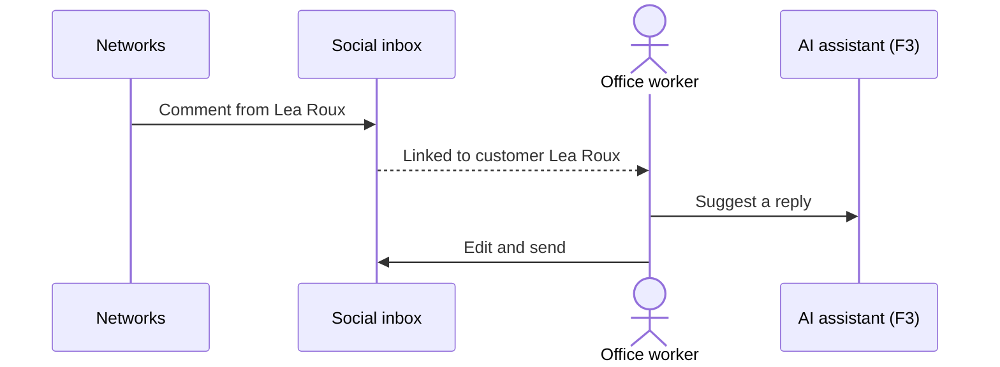

🏠 [Specs](../../../../README.md) › 🧩 [Functional capabilities](../../../README.md) ›
📣 [F5 Social media and marketing](../../README.md) › 📝 [Use cases](../README.md) ›
📝 [Use cases: FL-F5-03 Inbox and statistics](README.md) › 📝 UC-F5-05 Answer comments and messages

# 📝 UC-F5-05 Answer comments and messages

**Status:** 🔄 waiting for the owner

## Summary

Comments and messages from every network are answered from one inbox.

## Personas

- [U12 Marketing](../../../../01-users/personas/u12-marketing.md)
- [U16 Office worker](../../../../01-users/personas/u16-office-worker.md)

## Goal

Every comment and message answered by a person, from one place.

## Trigger

A comment, mention or message arrives.

## Frequency

Daily.

## Preconditions

Accounts connected (UC-F5-07).

## Postconditions

- **Succeeded:** the reply is sent and linked to the customer's record.
- **Failed:** the message stays open.

## Main flow

1. The office worker opens the social inbox ([S-F5-05](../../screens/03-inbox-and-statistics/s-f05-05-social-inbox.md)):
   comments, mentions and messages of every network and WhatsApp
   ([BR-F5-05](../../business-rules/br-f05-05-one-inbox-replies-by-a-person.md)).
2. A known customer's message links to their record.
3. The AI suggests a reply; the person edits and sends it.
4. They close the conversation, or turn it into a customer request (F16).

## Alternative flows

- 4a. Hide or report a comment where the network allows.

## Error flows

- 3e. A private message the network's API does not expose: a link to answer in the network.
- 3e. Sending fails: retried, then the person told.

## Business rules

- [BR-F5-05](../../business-rules/br-f05-05-one-inbox-replies-by-a-person.md)

## Entities

- [E-F5-01 Post](../../data/e-f05-01-post.md)

- [E-F5-04 Social message](../../data/e-f05-04-social-message.md)
- [E-F6-20 Lead](../../../f06-customers-and-sales/data/e-f06-20-lead.md)

## Permissions

Marketing and office workers given the inbox.

## Notifications

The assigned person: new messages.

## Audit events

Reply sent, by whom; conversation closed or turned into a request.

## AI involvement

Suggested replies; a person sends ([BR-F5-05](../../business-rules/br-f05-05-one-inbox-replies-by-a-person.md)).

## API, MCP and A2A exposure

T5 operations of F5 with the caller's rights; the MCP tool of F5; no A2A skill.

## Screens

- [S-F5-05](../../screens/03-inbox-and-statistics/s-f05-05-social-inbox.md)

## Flowchart

See [FL-F5-03 Inbox and statistics](../../flows/fl-f05-03-inbox-and-statistics.md#flowchart).

## Sequence diagram

## Acceptance criteria

1. **Given** a comment by a known customer **when** it arrives **then** it links to her record.
2. **Given** a suggested reply **when** the person edits and sends it **then** the reply is sent signed by the person.
3. **Given** a support question **when** it is turned into a request **then** an F16 request exists with the message.

## Non-functional notes

New messages appear within a minute (Proposed).

## Regulatory references

GDPR for messages ([CR-FR-052](../../../../10-country-packs/france/data-protection/cr-fr-052-storage-limitation.md)).

## Related use cases

F16 (support requests), F6 (leads).

- [UC-F5-20 Message customers on WhatsApp Business](../08-pages-forms-surveys-and-whatsapp/uc-f05-20-message-customers-on-whatsapp-business.md)

## Open questions

None.

---

⬅️ [UC-F5-04 Manage the editorial calendar](../01-publish-a-post/uc-f05-04-manage-the-editorial-calendar.md) ·
⬆️ [Up](README.md) · ➡️ [UC-F5-06 Read statistics](uc-f05-06-read-statistics.md)
