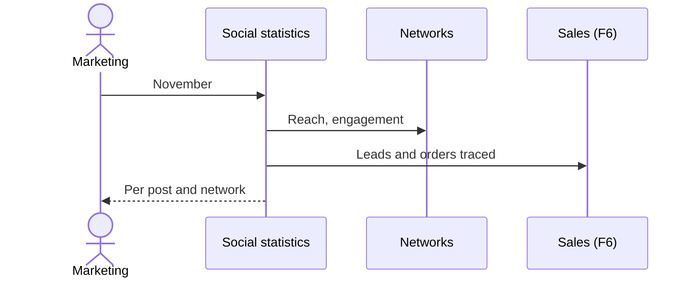

🏠 [Specs](../../../../README.md) › 🧩 [Functional capabilities](../../../README.md) ›
📣 [F5 Social media and marketing](../../README.md) › 📝 [Use cases](../README.md) ›
📝 [Use cases: FL-F5-03 Inbox and statistics](README.md) › 📝 UC-F5-06 Read statistics

# 📝 UC-F5-06 Read statistics

**Status:** ✅ specified

## Summary

Statistics per post, network and month, with leads and orders traced.

## Personas

- [U12 Marketing](../../../../01-users/personas/u12-marketing.md)
- [U13 Owner](../../../../01-users/personas/u13-owner.md)

## Goal

Know which posts work and what they bring.

## Trigger

Marketing opens the statistics; the monthly summary.

## Frequency

Weekly; monthly summary.

## Preconditions

Accounts connected (UC-F5-07).

## Postconditions

- **Succeeded:** figures shown and exported.
- **Failed:** a network's figures missing are shown with their last date.

## Main flow

1. The marketing person opens social statistics
   ([S-F5-06](../../screens/03-inbox-and-statistics/s-f05-06-social-statistics.md)).
2. They see reach, impressions, engagement, clicks and followers per post and network.
3. Leads and orders traced through links show per post
   ([BR-F5-06](../../business-rules/br-f05-06-leads-traced-through-tracked-links.md)).
4. A monthly summary goes to marketing and the owner; they export as a spreadsheet.

## Alternative flows

- 4a. Budget and return per campaign,
  [UC-F5-23](../09-brand-tests-and-return-on-investment/uc-f05-23-track-campaign-budget-cost-per-lead-and-return.md).

## Error flows

- 2e. A network's statistics API unavailable: last figures shown with their date.

## Business rules

- [BR-F5-06](../../business-rules/br-f05-06-leads-traced-through-tracked-links.md)

## Entities

- [E-F5-01 Post](../../data/e-f05-01-post.md)

## Permissions

Marketing and the owner.

## Notifications

Monthly summary.

## Audit events

Exports.

## AI involvement

The AI assistant comments the month; figures come from queries
([BR-F3-03](../../../f03-assistant/business-rules/br-f03-03-figures-come-from-queries.md)).

## API, MCP and A2A exposure

T5 operations of F5 with the caller's rights; the MCP tool of F5; no A2A skill.

## Screens

- [S-F5-06](../../screens/03-inbox-and-statistics/s-f05-06-social-statistics.md)

## Flowchart

See [FL-F5-03 Inbox and statistics](../../flows/fl-f05-03-inbox-and-statistics.md#flowchart).

## Sequence diagram

## Acceptance criteria

1. **Given** November with 18 posts **when** statistics open **then** each post shows reach, engagement and clicks.
2. **Given** a post whose link brought 3 orders **when** it is opened **then** 3 orders and their revenue show.
3. **Given** LinkedIn's API down **when** statistics open **then** LinkedIn shows the last figures with their date.

## Non-functional notes

None.

## Regulatory references

None.

## Related use cases

F16 (support requests), F6 (leads).

- [UC-F5-23 Track campaign budget, cost per lead and return](../09-brand-tests-and-return-on-investment/uc-f05-23-track-campaign-budget-cost-per-lead-and-return.md)

## Open questions

None.

---

⬅️ [UC-F5-05 Answer comments and messages](uc-f05-05-answer-comments-and-messages.md) · ⬆️ [Up](README.md) ·
➡️ [UC-F5-07 Connect the company's accounts](../04-connect-accounts/uc-f05-07-connect-the-company-s-accounts.md)
