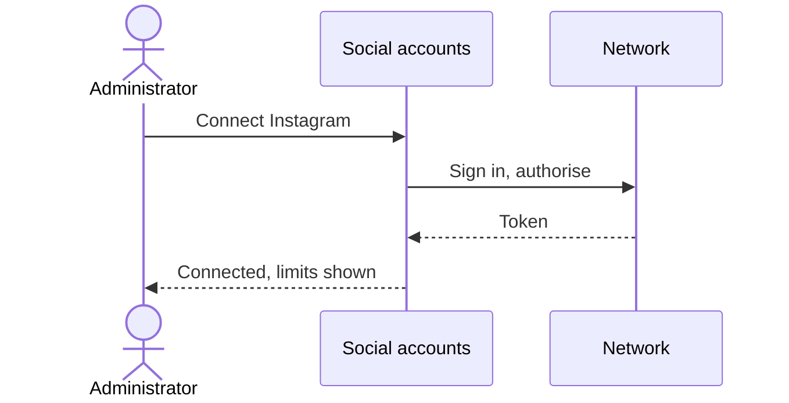

🏠 [Specs](../../../../README.md) › 🧩 [Functional capabilities](../../../README.md) ›
📣 [F5 Social media and marketing](../../README.md) › 📝 [Use cases](../README.md) ›
📝 [Use cases: FL-F5-04 Connect accounts](README.md) › 📝 UC-F5-07 Connect the company's accounts

# 📝 UC-F5-07 Connect the company's accounts

**Status:** ✅ specified

## Summary

The administrator connects the company's accounts on each network.

## Personas

- [U07 Administrator](../../../../01-users/personas/u07-administrator.md)
- [U12 Marketing](../../../../01-users/personas/u12-marketing.md)

## Goal

The company's accounts ready to publish and answer.

## Trigger

Setting up F5 or adding a network.

## Frequency

At setup; then rarely.

## Preconditions

- The network account belongs to the company.

## Postconditions

- **Succeeded:** the account is connected with its limits shown.
- **Failed:** not connected; the steps to fix it are shown.

## Main flow

1. The administrator opens social accounts ([S-F5-07](../../screens/04-connect-accounts/s-f05-07-social-accounts.md))
   and chooses a network.
2. They sign in with the company's account; the install's own app is used, its keys in the vault
   ([D250](../../../../06-decisions/f05-social-media/d250-network-apps.md)).
3. In the hosted edition, the publisher's shared app may relay posts under its own terms
   ([BR-F5-07](../../business-rules/br-f05-07-posts-queue-within-network-limits.md)).
4. The account's limits and costs show; marketing can publish.

## Alternative flows

- 1a. An IT provider connects for a client company.

## Error flows

- 2e. The network refuses the app (not reviewed): the steps to get it reviewed are shown.
- 2e. The token expires later: the account shows expired and marketing is told.

## Business rules

- [BR-F5-07](../../business-rules/br-f05-07-posts-queue-within-network-limits.md)

## Entities

- [E-F5-01 Post](../../data/e-f05-01-post.md)

- [E-F5-02 Social account](../../data/e-f05-02-social-account.md)

## Permissions

Administrators; marketing for the networks allowed.

## Notifications

Marketing: an account expired.

## Audit events

Account connected, disconnected, expired.

## AI involvement

None.

## API, MCP and A2A exposure

None.

## Screens

- [S-F5-07](../../screens/04-connect-accounts/s-f05-07-social-accounts.md)

## Flowchart

See [FL-F5-04 Connect accounts](../../flows/fl-f05-04-connect-accounts.md#flowchart).

## Sequence diagram

## Acceptance criteria

1. **Given** the company's Instagram account **when** the administrator connects it **then** it shows connected with its
   limits.
2. **Given** an app not reviewed by the network **when** it is connected **then** the steps to get it reviewed show.
3. **Given** a token expired **when** a post is due **then** the account shows expired and marketing is told.

## Non-functional notes

None.

## Regulatory references

None.

## Related use cases

F16 (support requests), F6 (leads).

## Open questions

None.

---

⬅️ [UC-F5-06 Read statistics](../03-inbox-and-statistics/uc-f05-06-read-statistics.md) · ⬆️ [Up](README.md) ·
➡️ [UC-F5-08 Run email campaigns](../05-benchmark-additions/uc-f05-08-run-email-campaigns.md)
