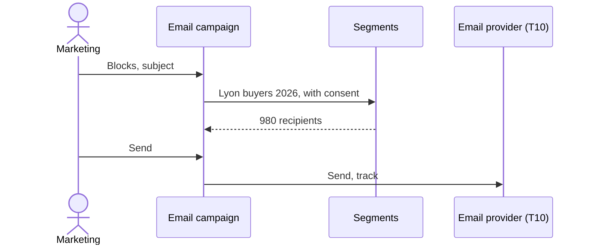

🏠 [Specs](../../../../README.md) › 🧩 [Functional capabilities](../../../README.md) ›
📣 [F5 Social media and marketing](../../README.md) › 📝 [Use cases](../README.md) ›
📝 [Use cases: FL-F5-05 Benchmark additions](README.md) › 📝 UC-F5-08 Run email campaigns

# 📝 UC-F5-08 Run email campaigns

**Status:** ✅ specified

## Summary

Marketing builds an email from blocks, chooses a consented segment, tests variants, sends or schedules it, and follows
opens, clicks and revenue.

## Personas

- [U12 Marketing](../../../../01-users/personas/u12-marketing.md)

## Goal

Emails that reach the right people and bring orders.

## Trigger

A campaign to send.

## Frequency

Weekly.

## Preconditions

- A verified sending domain ([UC-F5-16](../06-audiences-consent-and-journeys/uc-f05-16-keep-emails-delivered.md)).

## Postconditions

- **Succeeded:** the campaign is sent to consented contacts; results show.
- **Failed:** nothing is sent.

## Main flow

1. The marketing person builds the email ([S-F5-08](../../screens/05-benchmark-additions/s-f05-08-email-campaign.md))
   from blocks with the brand kit, or asks the AI for a draft
   ([D164](../../../../06-decisions/f03-assistant/d164-drafted-with-ai-label.md)).
2. They choose a segment ([UC-F5-14](../06-audiences-consent-and-journeys/uc-f05-14-build-a-segment-of-contacts.md));
   contacts without email consent or suppressed are removed
   ([BR-F5-08](../../business-rules/br-f05-08-marketing-needs-consent.md)).
3. They add variants for an A/B test
   ([UC-F5-22](../09-brand-tests-and-return-on-investment/uc-f05-22-a-b-test-posts-emails-and-sms.md)) or not, and send
   a test to themselves.
4. They send or schedule; results show: opens, clicks, unsubscribes, revenue.

## Alternative flows

- 4a. Resend to non-openers with another subject.

## Error flows

- 4e. Sending domain not verified: sending refused.
- 4e. Complaint rate too high: paused
  ([BR-F5-11](../../business-rules/br-f05-11-bounces-and-complaints-are-suppressed.md)).

## Business rules

- [BR-F5-08 Marketing messages need consent](../../business-rules/br-f05-08-marketing-needs-consent.md)

## Entities

- [E-F5-05 Email or SMS campaign](../../data/e-f05-05-email-or-sms-campaign.md)

## Permissions

Marketing and communication; record rules on contacts apply; the owner reads.

## Notifications

Marketing: campaign sent and results.

## Audit events

Campaign sent, to whom, results.

## AI involvement

The AI assistant drafts texts and segments in the company style
([BR-F3-11](../../../f03-assistant/business-rules/br-f03-11-drafts-follow-the-company-style.md)); a person sends.

## API, MCP and A2A exposure

T5 operations of F5 with the caller's rights; the MCP tool of F5; no A2A skill.

## Screens

- [S-F5-08](../../screens/05-benchmark-additions/s-f05-08-email-campaign.md)

## Flowchart

See [FL-F5-05 Benchmark additions](../../flows/fl-f05-05-benchmark-additions.md#flowchart).

## Sequence diagram

## Acceptance criteria

1. **Given** the segment of 1,240 contacts with 980 email consents **when** the campaign is sent **then** 980 emails go
   out.
2. **Given** a contact who unsubscribed this morning **when** the campaign is sent at 15:00 **then** she is not sent it.
3. **Given** a domain without DKIM **when** sending is asked **then** it is refused.

## Non-functional notes

10,000 emails sent within an hour.

## Regulatory references

[CR-FR-063](../../../../10-country-packs/france/consumer/cr-fr-063-electronic-marketing-consent.md).

## Related use cases

See [FL-F5-05](../../flows/fl-f05-05-benchmark-additions.md).

- [UC-F5-14 Build a segment of contacts](../06-audiences-consent-and-journeys/uc-f05-14-build-a-segment-of-contacts.md)

- [UC-F5-16 Keep emails delivered](../06-audiences-consent-and-journeys/uc-f05-16-keep-emails-delivered.md)

- [UC-F5-22 A/B test posts, emails and SMS](../09-brand-tests-and-return-on-investment/uc-f05-22-a-b-test-posts-emails-and-sms.md)

- [UC-F5-23 Track campaign budget, cost per lead and return](../09-brand-tests-and-return-on-investment/uc-f05-23-track-campaign-budget-cost-per-lead-and-return.md)

## Open questions

None.

---

⬅️ [UC-F5-07 Connect the company's accounts](../04-connect-accounts/uc-f05-07-connect-the-company-s-accounts.md) ·
⬆️ [Up](README.md) · ➡️ [UC-F5-09 Send SMS campaigns](uc-f05-09-send-sms-campaigns.md)
