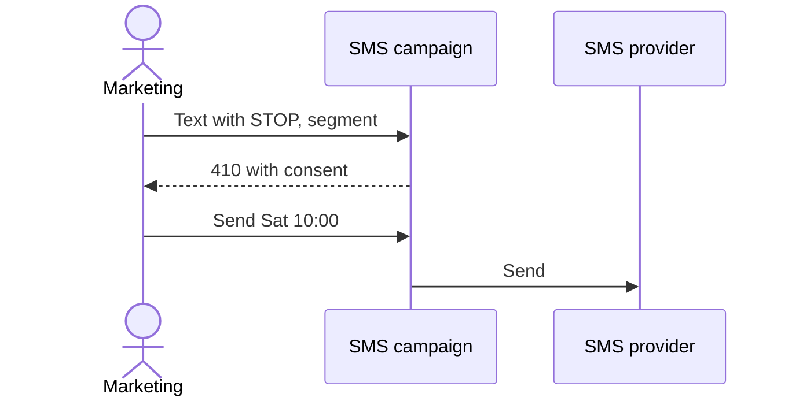

🏠 [Specs](../../../../README.md) › 🧩 [Functional capabilities](../../../README.md) ›
📣 [F5 Social media and marketing](../../README.md) › 📝 [Use cases](../README.md) ›
📝 [Use cases: FL-F5-05 Benchmark additions](README.md) › 📝 UC-F5-09 Send SMS campaigns

# 📝 UC-F5-09 Send SMS campaigns

**Status:** ✅ specified

## Summary

Marketing sends an SMS to a consented segment, with opt-out, a test send and link tracking.

## Personas

- [U12 Marketing](../../../../01-users/personas/u12-marketing.md)

## Goal

Short messages for urgent offers or reminders.

## Trigger

An SMS campaign to send.

## Frequency

Monthly.

## Preconditions

- An SMS provider with credit.

## Postconditions

- **Succeeded:** SMS sent to consented contacts.
- **Failed:** nothing is sent; the campaign is paused.

## Main flow

1. The marketing person writes the SMS ([S-F5-09](../../screens/05-benchmark-additions/s-f05-09-sms-campaign.md)) with
   its STOP mention.
2. They choose a segment; only SMS consents are kept, duplicates removed
   ([BR-F5-08](../../business-rules/br-f05-08-marketing-needs-consent.md)).
3. They send a test to their phone.
4. They send or schedule within the hours allowed (Proposed: 8:00 to 20:00, not Sundays); links are tracked.

## Alternative flows

- 1a. Variants for an A/B test
  ([UC-F5-22](../09-brand-tests-and-return-on-investment/uc-f05-22-a-b-test-posts-emails-and-sms.md)).

## Error flows

- 4e. Credit exhausted or provider down: paused, marketing told.

## Business rules

- [BR-F5-08 Marketing messages need consent](../../business-rules/br-f05-08-marketing-needs-consent.md)

## Entities

- [E-F5-05 Email or SMS campaign](../../data/e-f05-05-email-or-sms-campaign.md)

## Permissions

Marketing and communication; record rules on contacts apply; the owner reads.

## Notifications

Marketing: sent and results.

## Audit events

SMS sent, to whom.

## AI involvement

The AI assistant drafts texts and segments in the company style
([BR-F3-11](../../../f03-assistant/business-rules/br-f03-11-drafts-follow-the-company-style.md)); a person sends.

## API, MCP and A2A exposure

T5 operations of F5 with the caller's rights; the MCP tool of F5; no A2A skill.

## Screens

- [S-F5-09](../../screens/05-benchmark-additions/s-f05-09-sms-campaign.md)

## Flowchart

See [FL-F5-05 Benchmark additions](../../flows/fl-f05-05-benchmark-additions.md#flowchart).

## Sequence diagram

## Acceptance criteria

1. **Given** 410 SMS consents in the segment **when** the SMS is sent **then** 410 SMS go out with the STOP mention.
2. **Given** a reply STOP **when** it arrives **then** the contact's SMS consent is withdrawn.
3. **Given** credit for 200 SMS **when** 410 are sent **then** sending pauses at 200 and marketing is told.

## Non-functional notes

None.

## Regulatory references

[CR-FR-063](../../../../10-country-packs/france/consumer/cr-fr-063-electronic-marketing-consent.md).

## Related use cases

See [FL-F5-05](../../flows/fl-f05-05-benchmark-additions.md).

- [UC-F5-22 A/B test posts, emails and SMS](../09-brand-tests-and-return-on-investment/uc-f05-22-a-b-test-posts-emails-and-sms.md)

## Open questions

None.

---

⬅️ [UC-F5-08 Run email campaigns](uc-f05-08-run-email-campaigns.md) · ⬆️ [Up](README.md) ·
➡️ [UC-F5-10](../06-audiences-consent-and-journeys/uc-f05-10-automate-marketing-journeys.md)
