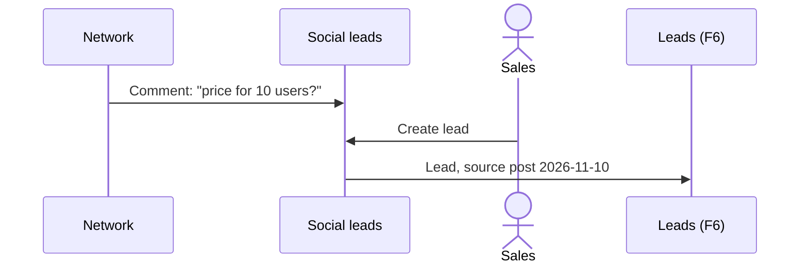

🏠 [Specs](../../../../README.md) › 🧩 [Functional capabilities](../../../README.md) ›
📣 [F5 Social media and marketing](../../README.md) › 📝 [Use cases](../README.md) ›
📝 [Use cases: FL-F5-05 Benchmark additions](README.md) › 📝 UC-F5-13 Turn social interactions into leads

# 📝 UC-F5-13 Turn social interactions into leads

**Status:** ✅ specified

## Summary

Comments, messages and tracked links on social media become leads with their source, and the revenue they bring is
attributed to the post.

## Personas

- [U12 Marketing](../../../../01-users/personas/u12-marketing.md)
- [U03 Sales](../../../../01-users/personas/u03-sales.md)

## Goal

No interested person lost in the comments.

## Trigger

A comment or message shows interest.

## Frequency

Daily.

## Preconditions

F5 set up for the company.

## Postconditions

- **Succeeded:** a lead exists with its source post.
- **Failed:** nothing is created.

## Main flow

1. A comment asks a price; the social leads screen
   ([S-F5-13](../../screens/05-benchmark-additions/s-f05-13-social-leads.md)) shows it as interest.
2. The marketing person or a seller creates the lead in one click, with the post as source.
3. The seller follows it in F6,
   [UC-F6-01](../../../f06-customers-and-sales/use-cases/01-lead-to-quote/uc-f06-01-capture-and-qualify-a-lead.md).
4. When it becomes an order, the revenue is attributed to the post
   ([BR-F5-06](../../business-rules/br-f05-06-leads-traced-through-tracked-links.md)).

## Alternative flows

- 1a. Automatic for chosen keywords ("price", "quote").

## Error flows

- 2e. The contact already exists: merged, not duplicated.

## Business rules

- See F5's rules.

## Entities

- Existing entities of the capability.
- [E-F6-20 Lead](../../../f06-customers-and-sales/data/e-f06-20-lead.md)

## Permissions

Marketing and sales.

## Notifications

The seller: lead assigned.

## Audit events

Lead created from a post.

## AI involvement

The AI assistant detects interest; a person creates the lead.

## API, MCP and A2A exposure

T5 operations of F5 with the caller's rights; the MCP tool of F5; no A2A skill.

## Screens

- [S-F5-13](../../screens/05-benchmark-additions/s-f05-13-social-leads.md)

## Flowchart

See [FL-F5-05 Benchmark additions](../../flows/fl-f05-05-benchmark-additions.md#flowchart).

## Sequence diagram

## Acceptance criteria

1. **Given** a comment "price for 10 users?" on Nuvola Logiciels' post **when** the seller creates the lead **then** a
   lead exists with the post as source.
2. **Given** the commenter is already a contact **when** the lead is created **then** it is linked to the contact.
3. **Given** the lead becomes an order of 2,400 EUR **when** it is signed **then** 2,400 EUR is attributed to the post.

## Non-functional notes

None.

## Regulatory references

[CR-FR-196](../../../../10-country-packs/france/data-protection/cr-fr-196-legitimate-interest-balancing.md).

## Related use cases

See [FL-F5-05](../../flows/fl-f05-05-benchmark-additions.md).

## Open questions

None.

---

⬅️ [UC-F5-12](../08-pages-forms-surveys-and-whatsapp/uc-f05-12-run-surveys-and-live-polls.md) · ⬆️ [Up](README.md) ·
➡️ [UC-F5-14](../06-audiences-consent-and-journeys/uc-f05-14-build-a-segment-of-contacts.md)
