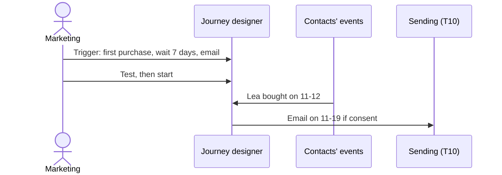

🏠 [Specs](../../../../README.md) › 🧩 [Functional capabilities](../../../README.md) ›
📣 [F5 Social media and marketing](../../README.md) › 📝 [Use cases](../README.md) ›
📝 [Use cases: FL-F5-06 Audiences, consent and journeys](README.md) › 📝 UC-F5-10 Automate marketing journeys

# 📝 UC-F5-10 Automate marketing journeys

**Status:** ✅ specified

## Summary

Marketing builds journeys that react to contacts' events and behaviour with emails, SMS, waits, branches and record
updates.

## Personas

- [U12 Marketing](../../../../01-users/personas/u12-marketing.md)

## Goal

The right message at the right moment, without sending it by hand.

## Trigger

A journey to set up.

## Frequency

A few journeys a year, running continuously.

## Preconditions

F5 set up for the company.

## Postconditions

- **Succeeded:** the journey runs on its segment.
- **Failed:** the journey stays in test.

## Main flow

1. The marketing person opens the journey designer
   ([S-F5-10](../../screens/06-audiences-consent-and-journeys/s-f05-10-journey-designer.md)) and picks a trigger (signed
   up, bought, abandoned a cart) and a segment ([UC-F5-14](uc-f05-14-build-a-segment-of-contacts.md)).
2. They add steps: email, SMS, wait, branch on a behaviour, update a record or a lead score.
3. They run it in test mode on sample contacts.
4. They start it; each contact follows it, consent checked at every message
   ([BR-F5-09](../../business-rules/br-f05-09-segments-are-evaluated-at-send-time.md)).

## Alternative flows

- 2a. Lead scoring updated,
  [UC-F6-13](../../../f06-customers-and-sales/use-cases/05-benchmark-additions/uc-f06-13-score-assign-and-enrich-leads.md).

## Error flows

- 2e. A loop detected: refused.
- 4e. A contact withdraws consent: their remaining messages stop.

## Business rules

- [BR-F5-08 Marketing messages need consent](../../business-rules/br-f05-08-marketing-needs-consent.md)

## Entities

- [E-F5-06 Journey](../../data/e-f05-06-journey.md)

## Permissions

Marketing and communication; record rules on contacts apply; the owner reads.

## Notifications

Marketing: a journey's errors.

## Audit events

Journey started, changed, stopped; contacts' steps.

## AI involvement

The AI assistant drafts texts and segments in the company style
([BR-F3-11](../../../f03-assistant/business-rules/br-f03-11-drafts-follow-the-company-style.md)); a person sends.

## API, MCP and A2A exposure

T5 operations of F5 with the caller's rights; the MCP tool of F5; no A2A skill.

## Screens

- [S-F5-10](../../screens/06-audiences-consent-and-journeys/s-f05-10-journey-designer.md)

## Flowchart

See [FL-F5-06 Audiences, consent and journeys](../../flows/fl-f05-06-audiences-consent-and-journeys.md#flowchart).

## Sequence diagram

## Acceptance criteria

1. **Given** a journey "first purchase, wait 7 days, review request" **when** Lea buys on 2026-11-12 **then** she gets
   the email on 2026-11-19.
2. **Given** Lea withdraws email consent on 11-15 **when** 11-19 comes **then** no email is sent.
3. **Given** a branch pointing back to its own start **when** it is saved **then** it is refused as a loop.

## Non-functional notes

None.

## Regulatory references

[CR-FR-063](../../../../10-country-packs/france/consumer/cr-fr-063-electronic-marketing-consent.md).

## Related use cases

See [FL-F5-06](../../flows/fl-f05-06-audiences-consent-and-journeys.md).

- [UC-F5-14 Build a segment of contacts](uc-f05-14-build-a-segment-of-contacts.md)

## Open questions

None.

---

⬅️ [UC-F5-09 Send SMS campaigns](../05-benchmark-additions/uc-f05-09-send-sms-campaigns.md) · ⬆️ [Up](README.md) ·
➡️ [UC-F5-11](../07-events-and-ticketing/uc-f05-11-organise-events-and-sell-tickets.md)
